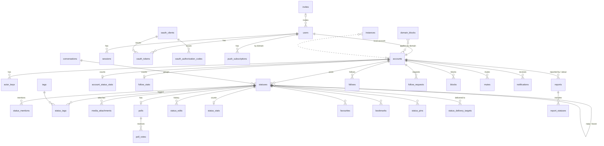

# 論理データモデル（v0 初版）

> 方言に依存しない **論理スキーマ** です。方言別の `schema/<dialect>.sql` はこの文書に従って書き、乖離は CI で検査します（[ADR-0003](../adr/0003-database-abstraction.md)）。
> Proposed な ADR（[ADR-0002](../adr/0002-modular-monolith-hexagonal.md), [ADR-0003](../adr/0003-database-abstraction.md), [ADR-0004](../adr/0004-job-queue-abstraction.md), [ADR-0013](../adr/0013-timeline-strategy.md)）と、
> Accepted な [ADR-0007](../adr/0007-client-api.md)（独自クライアント API）・[ADR-0017](../adr/0017-visibility-local.md)（公開範囲 `local`）を前提にしています。ADR が変わったら追従して更新します。
> v0 はマイグレーションを持たず作り直す前提です（[ADR-0012](../adr/0012-v0-breaking-change-policy.md)）。

## 1. 共通規約

### 1.1 論理型

| 論理型 | 意味 | SQLite 系 | PostgreSQL 系 |
| --- | --- | --- | --- |
| `id` | UUIDv7 の正規形文字列（36 文字、小文字） | `TEXT` | `text`（`uuid` 型にするかは #17 の spike で決める） |
| `string(n)` | 長さ上限つき文字列。上限はアプリで検証し、DB では強制しなくてよい | `TEXT` | `text` |
| `text` | 長文（HTML・本文など） | `TEXT` | `text` |
| `iri` | URL / ActivityPub の IRI。最大 2048 文字を想定 | `TEXT` | `text` |
| `int` | 32 bit 整数 | `INTEGER` | `integer` |
| `bigint` | 64 bit 整数（カウンタ・バイト数） | `INTEGER` | `bigint` |
| `bool` | 真偽値 | `INTEGER`（0/1） | `boolean` |
| `timestamp` | UTC の時刻（ミリ秒精度） | 保存形式は ADR-0003 の未決事項 | `timestamptz` |
| `json` | JSON 文書。検索条件には使わない | `TEXT` | `jsonb` |
| `bytes` | バイナリ（暗号化済み秘密など） | `BLOB` | `bytea` |
| `enum(a, b, …)` | 列挙。値は英小文字のスネークケース文字列 | `TEXT` + `CHECK` | `text` + `CHECK` |

- 本文中の「NN」は `NOT NULL`、「NULL」は NULL 可を表します。
- カラム名・テーブル名は英語のスネークケース、テーブル名は複数形。
- 照合順序に依存した比較をしない。大文字小文字を無視したい値は **正規化済みカラム**（`*_normalized`）を別に持ち、そちらに一意制約を張る（ADR-0003）。
- ドメイン名は小文字・punycode（IDNA）に正規化して保存する。

### 1.2 ID とキーセットページング

- 主キーはすべて UUIDv7（`IdGenerator` ポートで生成）。同一ミリ秒内でも単調増加する生成方式（RFC 9562 の方式）を使う。
- 正規形の小文字 16 進文字列は **辞書順 = 時刻順** になるので、`ORDER BY id` がそのまま時系列ソートになる。SQLite では `BINARY` 照合のまま使う（`NOCASE` 禁止）。
- ページングは常に `id` によるキーセット方式。オフセットページングは使わない。

| パラメータ | 条件 | 並び |
| --- | --- | --- |
| `max_id`（古い方へ） | `id < :max_id` | `ORDER BY id DESC LIMIT :n + 1` |
| `since_id`（新着、新しい順） | `id > :since_id` | `ORDER BY id DESC LIMIT :n + 1` |
| `min_id`（新着、古い順から） | `id > :min_id` | `ORDER BY id ASC LIMIT :n + 1`（返す前に反転） |

- `LIMIT n + 1` で次ページの有無を判定する。API が不透明なカーソルを返す場合も、中身はこの `id` である（API 様式は ADR-0016）。
- 一覧の並びが「関係が作られた時刻」の場合（フォロワー一覧・お気に入り一覧など）は、関係テーブル自身の `id` でページングする。
- **リモート投稿の `id`** は受信時刻ではなく AP の `published` から生成する（未来時刻は現在時刻に丸める）。タイムラインが投稿時刻順に並ぶ。
  過去の投稿を後から取得すると古い位置に挿入されるため、`since_id` のポーリングでは拾えない（リアルタイム配信は SSE が担う）。
- UUIDv7 は時刻から下限値を作れるので、「直近 N 日」の範囲条件 `id >= uuidv7_floor(now - N days)` を読み取り量の上限として使える（§5）。

### 1.3 参照整合性と削除

- 参照は論理参照として `xxx_id` で表す。**物理的な外部キー制約は同一モジュール内に限り任意**（方言ごとに付けてもよい）とし、モジュールをまたぐ参照には付けない。
  モジュール境界（ADR-0002）を保つためと、外部キー非対応の候補（Aurora DSQL）を残すため。
- 削除は原則 **物理削除**。依存行の削除は `ON DELETE CASCADE` に頼らず、アプリケーションが削除イベント → ジョブで、モジュールごとに小さなバッチで行う（冪等）。
- 削除済みの AP オブジェクトは `tombstones` に URI を残し、遅れて届いた `Create` / `Update` で復活しないようにする。
- `NULL` は一意制約上は互いに異なる値として扱われる（SQLite・PostgreSQL 共通）。「ローカル」を `NULL` で表すと一意性が崩れるため、`accounts.domain` などは **空文字 `''` = ローカル** とする。

## 2. 整合性モデル

### 2.1 トランザクションの規律

ADR-0003（改訂版）に従い、短い対話的トランザクションを許容するが、次を守る。

- **トランザクション内で外部 I/O をしない**（HTTP、キュー投入、Blob 操作、メール、Push）。キュー投入は `outbox_events` への INSERT で代替する（Transactional Outbox）。
- トランザクション関数は **再実行可能** に書く（`UnitOfWork` が直列化失敗・競合を有限回リトライする）。関数の中で乱数・時刻を取り直さない（ID と時刻は関数の外で一度だけ生成して渡す）。
- 1 トランザクションで触るのは原則 **1 モジュールのテーブル + `outbox_events`**。他モジュールへの反映はドメインイベント → outbox → ジョブで行う。
- 件数が利用者数・フォロワー数に比例する処理（配送先の展開、アカウント削除の後始末、再集計）は、カーソル付きのジョブで **一定件数ずつ** 処理する。

代表的な書き込み単位:

| ユースケース | トランザクション内 | トランザクションの外 |
| --- | --- | --- |
| 投稿（PostStatus） | `statuses`・`status_mentions`・`status_tags`（`tags` は upsert）・`media_attachments` の紐付け・`polls`・`account_status_stats` の加算・`outbox_events` | メンション先の解決（WebFinger）は事前に実施。配送・通知は outbox 経由のジョブ |
| お気に入り | `favourites` を `ON CONFLICT DO NOTHING` で挿入し、挿入できたときだけ `status_stats` を加算・`outbox_events` | `Like` の配送、通知生成 |
| フォロー | `follows` または `follow_requests`・`follow_stats` の加算・`outbox_events` | `Follow` の配送 |
| Inbox 処理（ProcessInbox） | `received_activities` への挿入（重複なら何もせず終了）+ そのアクティビティの反映 + `outbox_events` | 署名検証・リモート Actor / Object の取得は事前に実施 |
| 配送先の展開（FanOutDelivery） | 宛先 inbox を一定件数読み、`status_delivery_targets` に挿入・配送ジョブを outbox に追加・カーソルを進める | 実際の POST は `DeliverActivity` ジョブ |
| リモート取得 | 取得結果の upsert（`uri` で一意） | HTTP 取得（SSRF ガード付き `HttpClient`） |

`queue/db` アダプタでは、outbox を経由せず同じトランザクションで `jobs` に直接挿入してもよい（同じ DB なので原子性が保たれる）。

### 2.2 冪等キーと一意制約

at-least-once 実行（ADR-0004）とリトライされるトランザクションのもとで、二重実行しても結果が変わらないように、次の自然キー・冪等キーに一意制約を張る。

| 対象 | キー | 用途 |
| --- | --- | --- |
| 受信アクティビティ | `received_activities.activity_uri` | Inbox 処理の重複排除（FR-405）。`id` を持たないアクティビティは本文ダイジェストから合成する |
| AP オブジェクト | `statuses.uri`, `accounts.uri`, `favourites.uri`, `follows.uri`, `follow_requests.uri`, `blocks.uri`, `reports.uri`, `poll_votes.uri`, `custom_emojis.uri` | リモート取得・受信の upsert、ローカル生成物の URI 固定 |
| 関係 | `follows (account_id, target_account_id)` ほか、`favourites` `bookmarks` `blocks` `mutes` `status_pins` の `(account_id, 対象)` | 同じ操作の二重実行を no-op にする |
| ブースト | `statuses (account_id, boost_of_id)` | 同一投稿の二重ブーストを防ぐ |
| クライアントからの投稿 | `statuses (account_id, idempotency_key)` | API の `Idempotency-Key`（クライアント生成）。再送で同じ投稿を返す |
| 投稿の編集 | `status_edits (status_id, edited_at)` | 同じ `Update` の再処理を no-op にする。`edited_at` が現在値以下の `Update` は無視 |
| 通知 | `notifications (account_id, dedupe_key)` | 元になった行から決まるキー（例: `favourite:<favourites.id>`）。ジョブ再実行で二重通知しない |
| 配送先 | `status_delivery_targets (status_id, inbox_url)` | 展開ジョブの再実行で重複しない |
| ジョブ | `jobs.idempotency_key` | 例: `federation.deliver:<activity_uri>:<inbox_url>`、`federation.inbox:<activity_uri>`、`media.process:<media_id>` |
| 1 回限りのトークン | `oauth_authorization_codes.code_hash`, `user_tokens.token_hash` | `UPDATE … SET used_at = :now WHERE … AND used_at IS NULL` の影響行数が 1 のときだけ成功 |
| 招待 | `invites.code` | 使用回数は条件付き UPDATE（`uses_count < max_uses`）で上限を守る |

### 2.3 カウンタの補正方針

- カウンタは本体の行と **別テーブル**（`account_status_stats` / `follow_stats` / `status_stats`）に置く。本体行の更新競合を避け、各カウンタを本体と同じモジュールが持つため。
- 加算・減算は `SET n = n + 1` / `SET n = MAX(n - 1, 0)` 相当の加算 SQL で行い、**元になる行の挿入・削除が実際に起きたとき（影響行数 = 1）だけ** 実行する。これで再実行による二重加算を防ぐ。
- stats 行が無い場合は upsert（`INSERT … ON CONFLICT DO UPDATE SET n = n + 1`）。
- ずれ（並行削除、部分失敗、手動操作）は定期ジョブ `stats.recount` で補正する: 実件数を `COUNT(*)` で数えて上書きする。対象は「直近に更新された行」+「全行を日単位で巡回」とし、1 回あたりの件数を制限する。CLI から全件再集計も実行できる（FR-801）。
- **リモートのアカウント** のフォロワー数・フォロー数・投稿数は、こちらでは一部しか分からないため、Actor 取得時の `totalItems` を `accounts.remote_*_count` に保存して表示に使う。ローカルの stats テーブルは「このインスタンスが知っている件数」として別に持つ。
- リモート投稿の返信数・ブースト数・お気に入り数は、v0 では「このインスタンスが知っている件数」を表示する。

## 3. ER 図

主要なエンティティと関係だけを示します（カラムの詳細は §4）。破線はモジュールをまたぐ論理参照です。



## 4. モジュール別テーブル定義

### 4.1 所有モジュール

各テーブルの読み書きは所有モジュールのリポジトリだけが行う（ADR-0002）。他モジュールはアプリケーション層の公開 API 経由で参照する。
例外は §5 の **タイムライン読み取りクエリ** で、`timeline` モジュールは `content` / `graph` / `account` のテーブルを **読み取り専用** で JOIN する（下記「Decisions」）。

| モジュール | テーブル |
| --- | --- |
| `identity` | `users`, `invites`, `user_tokens`, `totp_recovery_codes`, `sessions`, `oauth_clients`, `oauth_authorization_codes`, `oauth_tokens`, `account_exports` |
| `account` | `accounts`, `actor_keys` |
| `content` | `statuses`, `conversations`, `status_edits`, `status_mentions`, `tags`, `status_tags`, `media_attachments`, `remote_media_cache`, `custom_emojis`, `polls`, `poll_votes`, `favourites`, `bookmarks`, `status_pins`, `status_stats`, `account_status_stats`, `tombstones` |
| `graph` | `follows`, `follow_requests`, `blocks`, `mutes`, `account_domain_mutes`, `follow_stats` |
| `timeline` | なし（読み取りモデル。将来の fan-out-on-write 用 `home_feed` は ADR-0013 の差し替え先） |
| `notification` | `notifications`, `notification_markers`, `push_subscriptions` |
| `federation` | `received_activities`, `status_delivery_targets`, `instances` |
| `moderation` | `reports`, `report_statuses`, `domain_blocks`, `audit_logs` |
| `instance` | `instance_settings`, `instance_rules` |
| 基盤（アダプタ所有） | `outbox_events`, `jobs`, `dead_jobs`（`queue/db`）, `kv_entries`（`kv/db`） |

### 4.2 identity

#### users

ローカルの利用者（ログイン主体）。公開プロフィールは `accounts` 側に持つ。

| カラム | 論理型 | NULL | 説明 |
| --- | --- | --- | --- |
| `id` | `id` | NN | PK |
| `account_id` | `id` | NN | 対応するローカル `accounts.id`（1:1） |
| `email` | `string(320)` | NN | 入力されたままの表記 |
| `email_normalized` | `string(320)` | NN | 小文字化したもの |
| `password_hash` | `string(255)` | NN | Argon2id の PHC 文字列（NFR-SEC-3） |
| `role` | `enum(user, moderator, admin)` | NN | 既定 `user` |
| `email_confirmed_at` | `timestamp` | NULL | メール検証完了時刻 |
| `approved_at` | `timestamp` | NULL | 承認制での承認時刻。`open` / `invite` では作成時刻を入れる |
| `registration_reason` | `text` | NULL | 承認制の申請理由 |
| `invite_id` | `id` | NULL | 使った招待 |
| `disabled_at` | `timestamp` | NULL | ログイン停止 |
| `locale` | `string(35)` | NN | UI 言語（BCP 47） |
| `default_post_language` | `string(35)` | NULL | 既定の投稿言語 |
| `default_visibility` | `enum(public, local, unlisted, private, direct)` | NN | 既定の公開範囲 |
| `time_zone` | `string(64)` | NN | IANA タイムゾーン名。既定 `UTC` |
| `filter_languages` | `json` | NULL | タイムラインに表示する言語の配列（FR-208）。NULL = すべて |
| `require_media_description` | `bool` | NN | 代替テキスト未入力時に警告する（FR-105 / NFR-A11Y-2） |
| `totp_secret_enc` | `bytes` | NULL | 暗号化した TOTP シークレット（NFR-SEC-7） |
| `totp_enabled_at` | `timestamp` | NULL | |
| `created_at` / `updated_at` | `timestamp` | NN | |

- 一意: `(email_normalized)`, `(account_id)`
- インデックス: 承認待ち一覧 `(created_at) WHERE approved_at IS NULL`

#### invites

| カラム | 論理型 | NULL | 説明 |
| --- | --- | --- | --- |
| `id` | `id` | NN | PK |
| `code` | `string(32)` | NN | 招待コード |
| `created_by_user_id` | `id` | NN | |
| `max_uses` | `int` | NULL | NULL = 無制限 |
| `uses_count` | `int` | NN | 条件付き UPDATE で加算 |
| `expires_at` / `revoked_at` | `timestamp` | NULL | |
| `created_at` | `timestamp` | NN | |

- 一意: `(code)`。インデックス: `(created_by_user_id, id)`

#### user_tokens

メール検証・パスワード再設定・メール変更の 1 回限りトークン。

| カラム | 論理型 | NULL | 説明 |
| --- | --- | --- | --- |
| `id` | `id` | NN | PK |
| `user_id` | `id` | NN | |
| `purpose` | `enum(email_confirmation, password_reset, email_change)` | NN | |
| `token_hash` | `string(64)` | NN | トークンの SHA-256。平文は保存しない |
| `new_email` | `string(320)` | NULL | `email_change` のみ |
| `expires_at` | `timestamp` | NN | |
| `used_at` | `timestamp` | NULL | |
| `created_at` | `timestamp` | NN | |

- 一意: `(token_hash)`。インデックス: `(user_id, purpose)`, `(expires_at)`（クリーンアップ）

#### totp_recovery_codes

| カラム | 論理型 | NULL | 説明 |
| --- | --- | --- | --- |
| `user_id` | `id` | NN | |
| `code_hash` | `string(64)` | NN | |
| `used_at` | `timestamp` | NULL | |

- PK: `(user_id, code_hash)`

#### sessions

Web の認可画面（OAuth の `authorize`）などで使うブラウザセッション。

| カラム | 論理型 | NULL | 説明 |
| --- | --- | --- | --- |
| `id` | `id` | NN | PK |
| `user_id` | `id` | NN | |
| `token_hash` | `string(64)` | NN | Cookie 値のハッシュ |
| `user_agent` | `string(512)` | NULL | |
| `ip` | `string(45)` | NULL | |
| `created_at` / `expires_at` | `timestamp` | NN | |
| `last_seen_at` | `timestamp` | NN | 更新は間引く（例: 1 時間に 1 回） |

- 一意: `(token_hash)`。インデックス: `(user_id)`, `(expires_at)`

#### oauth_clients

| カラム | 論理型 | NULL | 説明 |
| --- | --- | --- | --- |
| `id` | `id` | NN | PK |
| `client_id` | `string(64)` | NN | 公開識別子 |
| `client_secret_hash` | `string(64)` | NULL | 公開クライアント（PKCE のみ）は NULL |
| `name` | `string(255)` | NN | |
| `website` | `iri` | NULL | |
| `redirect_uris` | `json` | NN | 文字列配列 |
| `scopes` | `string(1024)` | NN | 空白区切り |
| `is_first_party` | `bool` | NN | 自前クライアント（同意画面を省略できる） |
| `owner_user_id` | `id` | NULL | |
| `created_at` | `timestamp` | NN | |

- 一意: `(client_id)`

#### oauth_authorization_codes

| カラム | 論理型 | NULL | 説明 |
| --- | --- | --- | --- |
| `code_hash` | `string(64)` | NN | PK |
| `client_id` | `id` | NN | `oauth_clients.id` |
| `user_id` | `id` | NN | |
| `redirect_uri` | `iri` | NN | |
| `scopes` | `string(1024)` | NN | |
| `code_challenge` | `string(128)` | NN | PKCE |
| `code_challenge_method` | `enum(s256)` | NN | |
| `expires_at` / `created_at` | `timestamp` | NN | |
| `used_at` | `timestamp` | NULL | |

- インデックス: `(expires_at)`

#### oauth_tokens

| カラム | 論理型 | NULL | 説明 |
| --- | --- | --- | --- |
| `id` | `id` | NN | PK |
| `client_id` | `id` | NN | `oauth_clients.id` |
| `user_id` | `id` | NN | |
| `access_token_hash` | `string(64)` | NN | |
| `refresh_token_hash` | `string(64)` | NULL | |
| `scopes` | `string(1024)` | NN | |
| `expires_at` | `timestamp` | NN | |
| `refresh_expires_at` | `timestamp` | NULL | |
| `revoked_at` | `timestamp` | NULL | |
| `last_used_at` | `timestamp` | NULL | 更新は間引く |
| `created_at` | `timestamp` | NN | |

- 一意: `(access_token_hash)`, `(refresh_token_hash)`。インデックス: `(user_id)`, `(expires_at)`

#### account_exports

データエクスポート（FR-008）。生成物は Blob に置く。

| カラム | 論理型 | NULL | 説明 |
| --- | --- | --- | --- |
| `id` | `id` | NN | PK |
| `user_id` | `id` | NN | |
| `state` | `enum(pending, processing, ready, failed)` | NN | |
| `blob_key` | `string(512)` | NULL | |
| `file_size` | `bigint` | NULL | |
| `created_at` | `timestamp` | NN | |
| `completed_at` / `expires_at` | `timestamp` | NULL | |

- インデックス: `(user_id, id)`, `(expires_at)`

### 4.3 account

#### accounts

ローカル・リモート両方の Actor。インスタンス自身の Actor（`Application`）もここに 1 行持つ。

| カラム | 論理型 | NULL | 説明 |
| --- | --- | --- | --- |
| `id` | `id` | NN | PK |
| `username` | `string(255)` | NN | 表示用（大小文字を保持） |
| `username_normalized` | `string(255)` | NN | 小文字化したもの |
| `domain` | `string(253)` | NN | `''` = ローカル。リモートは正規化したホスト名 |
| `uri` | `iri` | NN | Actor の IRI（ローカルも生成して保存） |
| `url` | `iri` | NULL | プロフィールページの URL |
| `actor_type` | `enum(person, service, application, group, organization)` | NN | |
| `display_name` | `string(255)` | NN | 既定 `''` |
| `note` | `text` | NN | サニタイズ済み HTML |
| `note_source` | `text` | NULL | ローカルのみ。入力されたままの自己紹介 |
| `fields` | `json` | NN | プロフィール補足情報 `[{name, value, verified_at}]`（FR-006） |
| `avatar_blob_key` / `header_blob_key` | `string(512)` | NULL | ローカルのアップロード |
| `avatar_remote_url` / `header_remote_url` | `iri` | NULL | リモートの元 URL（メディアプロキシ経由で配信） |
| `locked` | `bool` | NN | 鍵アカウント |
| `bot` | `bool` | NN | |
| `discoverable` / `indexable` | `bool` | NN | |
| `inbox_url` / `shared_inbox_url` / `outbox_url` / `followers_url` / `following_url` / `featured_url` | `iri` | NULL | リモートは Actor から取得。ローカルは URI 規約から導出してもよい |
| `remote_followers_count` / `remote_following_count` / `remote_statuses_count` | `bigint` | NULL | リモート Actor の `totalItems`（§2.3） |
| `suspended_at` / `silenced_at` | `timestamp` | NULL | 凍結・サイレンス（FR-703）。`moderation` が `account` の公開 API 経由で設定 |
| `last_fetched_at` | `timestamp` | NULL | リモートの最終取得（FR-407） |
| `fetch_failed_count` | `int` | NN | 連続取得失敗回数 |
| `deleted_at` | `timestamp` | NULL | 削除済み。個人データを消したうえで行と `uri` を残し、再作成を防ぐ |
| `created_at` / `updated_at` | `timestamp` | NN | リモートの `created_at` は `published` |

- 一意: `(username_normalized, domain)`, `(uri)`
- インデックス: `(domain, id)`（ドメインブロック適用・ドメイン単位の一覧）、`(last_fetched_at) WHERE domain <> ''`（定期リフレッシュ）
- 検索（FR-305）: `@user@host` は一意インデックスで解決、URL 指定は `uri` / `url` で解決。表示名の部分一致は `SearchIndex` ポート（FTS、方言別）に委ねる。

#### actor_keys

ローカル Actor の署名鍵と、リモート Actor の公開鍵（FR-404）。

| カラム | 論理型 | NULL | 説明 |
| --- | --- | --- | --- |
| `id` | `id` | NN | PK |
| `account_id` | `id` | NN | |
| `key_id` | `iri` | NN | 例: `<actor>#main-key` |
| `algorithm` | `enum(rsa_sha256, ed25519)` | NN | |
| `public_key_pem` | `text` | NN | |
| `private_key_enc` | `bytes` | NULL | ローカルのみ。暗号化して保存（NFR-SEC-7）。リストア後も変わらないこと（NFR-REL-4） |
| `created_at` | `timestamp` | NN | |
| `revoked_at` | `timestamp` | NULL | |

- 一意: `(key_id)`。インデックス: `(account_id)`

### 4.4 content

#### statuses

投稿とブーストを同じテーブルに持つ（ブーストは `boost_of_id` を持つ行）。ホームタイムラインがブーストを含めて 1 本のインデックスで読めるようにするため。

| カラム | 論理型 | NULL | 説明 |
| --- | --- | --- | --- |
| `id` | `id` | NN | PK。リモートは `published` から生成（§1.2） |
| `uri` | `iri` | NN | `Note` の IRI（ブーストは `Announce` の IRI） |
| `url` | `iri` | NULL | HTML 表示用 URL |
| `account_id` | `id` | NN | 作者 |
| `is_local` | `bool` | NN | ローカル投稿か。作成後は不変 |
| `visibility` | `enum(public, local, unlisted, private, direct)` | NN | 作成後は不変（ADR-0017）。ブーストは元投稿の値を写す |
| `in_reply_to_id` | `id` | NULL | |
| `in_reply_to_account_id` | `id` | NULL | ホームの返信フィルタ用に非正規化 |
| `in_reply_to_uri` | `iri` | NULL | 親が未取得の場合の IRI |
| `conversation_id` | `id` | NULL | スレッド |
| `boost_of_id` | `id` | NULL | ブースト元 |
| `text` | `text` | NULL | ローカル投稿の入力ソース |
| `content` | `text` | NULL | サニタイズ済み HTML。ブーストは NULL |
| `content_map` | `json` | NULL | 言語別の本文（`contentMap`、NFR-I18N-5） |
| `spoiler_text` | `text` | NN | CW。既定 `''`（FR-104） |
| `sensitive` | `bool` | NN | |
| `language` | `string(35)` | NULL | BCP 47（FR-110） |
| `idempotency_key` | `string(64)` | NULL | クライアント API の冪等キー |
| `published_at` | `timestamp` | NN | |
| `edited_at` | `timestamp` | NULL | 最終編集（FR-109） |
| `fetched_at` | `timestamp` | NULL | リモートの最終取得 |
| `created_at` / `updated_at` | `timestamp` | NN | |

- 一意: `(uri)`, `(account_id, boost_of_id)`, `(account_id, idempotency_key)`
- CHECK: `boost_of_id IS NULL OR content IS NULL`、`visibility <> 'local' OR is_local`（`local` はローカルの投稿・ブーストにだけ存在する。リモートからはフォロワー限定として届くので `private` になる）
- インデックス（用途は §5）:
  - `statuses_account_id_id (account_id, id)` — ホーム・プロフィール
  - `statuses_local_tl (id) WHERE is_local AND boost_of_id IS NULL AND visibility IN ('public', 'local')` — ローカルタイムライン（部分インデックス）
  - `statuses_federated_tl (id) WHERE boost_of_id IS NULL AND visibility = 'public'` — 連合タイムライン（部分インデックス）
  - `(conversation_id, id)` — スレッド表示
  - `(in_reply_to_id, id)` — 返信一覧・返信数の再集計
  - `(boost_of_id)` — ブースト一覧・ブースト元削除時の後始末

#### conversations

| カラム | 論理型 | NULL | 説明 |
| --- | --- | --- | --- |
| `id` | `id` | NN | PK |
| `uri` | `iri` | NULL | AP の `context` / `conversation`。ローカル起点は NULL でもよい |
| `created_at` | `timestamp` | NN | |

- 一意: `(uri)`

#### status_edits

編集履歴（FR-109）。各版のスナップショット。

| カラム | 論理型 | NULL | 説明 |
| --- | --- | --- | --- |
| `id` | `id` | NN | PK |
| `status_id` | `id` | NN | |
| `content` | `text` | NN | |
| `spoiler_text` | `text` | NN | |
| `sensitive` | `bool` | NN | |
| `language` | `string(35)` | NULL | |
| `media_snapshot` | `json` | NULL | その版の添付（ID・説明） |
| `poll_options` | `json` | NULL | |
| `edited_at` | `timestamp` | NN | その版の時刻（AP の `updated`） |

- 一意: `(status_id, edited_at)`。インデックスは一意制約で兼ねる

#### status_mentions

| カラム | 論理型 | NULL | 説明 |
| --- | --- | --- | --- |
| `status_id` | `id` | NN | |
| `account_id` | `id` | NN | メンション先 |

- PK: `(status_id, account_id)`
- インデックス: `(account_id, status_id)` — メンション通知・`direct` の閲覧判定

#### tags / status_tags

| カラム（`tags`） | 論理型 | NULL | 説明 |
| --- | --- | --- | --- |
| `id` | `id` | NN | PK |
| `name` | `string(255)` | NN | 最初に使われた表記 |
| `name_normalized` | `string(255)` | NN | NFKC + 小文字化（ADR-0009 のトークナイズ方針に従う） |
| `usable` / `listable` | `bool` | NN | モデレーション用 |
| `created_at` | `timestamp` | NN | |

| カラム（`status_tags`） | 論理型 | NULL | 説明 |
| --- | --- | --- | --- |
| `status_id` | `id` | NN | |
| `tag_id` | `id` | NN | |
| `visibility` | `enum(…)` | NN | `statuses.visibility` の非正規化コピー（不変なので安全） |
| `is_local` | `bool` | NN | 同上 |

- 一意: `tags (name_normalized)`。PK: `status_tags (status_id, tag_id)`
- インデックス: `status_tags (tag_id, status_id)` — ハッシュタグタイムライン（FR-203）

#### media_attachments

| カラム | 論理型 | NULL | 説明 |
| --- | --- | --- | --- |
| `id` | `id` | NN | PK |
| `account_id` | `id` | NN | アップロード者 / リモート投稿の作者 |
| `status_id` | `id` | NULL | 投稿前は NULL |
| `position` | `int` | NN | 投稿内の順序（0〜3、FR-105） |
| `type` | `enum(image, gifv, video, audio, unknown)` | NN | |
| `state` | `enum(pending, processing, ready, failed)` | NN | `media.process` ジョブで更新 |
| `blob_key` / `thumbnail_blob_key` | `string(512)` | NULL | ローカル保存先 |
| `remote_url` | `iri` | NULL | リモートの元 URL |
| `content_type` | `string(127)` | NULL | |
| `file_size` | `bigint` | NULL | |
| `meta` | `json` | NULL | 幅・高さ・長さ・フォーカス |
| `blurhash` | `string(64)` | NULL | |
| `description` | `text` | NULL | 代替テキスト |
| `created_at` / `updated_at` | `timestamp` | NN | |

- インデックス: `(status_id, position)`, `(account_id, id)`, `(created_at) WHERE status_id IS NULL`（未使用アップロードの削除、FR-803）

#### remote_media_cache

リモートメディアを TTL 付きでキャッシュする設定のときに使う（FR-409、NFR-COST-4）。添付・アバター・ヘッダー・絵文字を URL 単位で共通管理する。

| カラム | 論理型 | NULL | 説明 |
| --- | --- | --- | --- |
| `id` | `id` | NN | PK |
| `url` | `iri` | NN | 元 URL |
| `blob_key` | `string(512)` | NN | |
| `content_type` | `string(127)` | NN | |
| `file_size` | `bigint` | NN | 容量上限の判定に使う |
| `fetched_at` / `expires_at` | `timestamp` | NN | |
| `last_accessed_at` | `timestamp` | NN | 更新は間引く |

- 一意: `(url)`。インデックス: `(expires_at)`, `(last_accessed_at)`（容量超過時の LRU 削除）

#### custom_emojis

| カラム | 論理型 | NULL | 説明 |
| --- | --- | --- | --- |
| `id` | `id` | NN | PK |
| `shortcode` | `string(64)` | NN | |
| `domain` | `string(253)` | NN | `''` = ローカル |
| `uri` | `iri` | NULL | リモートの `Emoji` IRI |
| `image_blob_key` | `string(512)` | NULL | ローカル登録（FR-111 の S） |
| `image_remote_url` | `iri` | NULL | |
| `category` | `string(64)` | NULL | |
| `visible_in_picker` / `disabled` | `bool` | NN | |
| `remote_updated_at` | `timestamp` | NULL | AP の `updated`。古い更新を無視する |
| `created_at` / `updated_at` | `timestamp` | NN | |

- 一意: `(shortcode, domain)`, `(uri)`
- 投稿・プロフィール中の絵文字は `(shortcode, 作者の domain)` で引く（中間テーブルは持たない）。

#### polls / poll_votes

投票の表示と回答（FR-112、C）。

| カラム（`polls`） | 論理型 | NULL | 説明 |
| --- | --- | --- | --- |
| `id` | `id` | NN | PK |
| `status_id` | `id` | NN | |
| `options` | `json` | NN | `[{title}]` |
| `option_votes` | `json` | NN | 選択肢ごとの票数。リモートは `Update` で、ローカルは `poll_votes` から再集計 |
| `multiple` | `bool` | NN | |
| `voters_count` | `bigint` | NULL | |
| `expires_at` | `timestamp` | NULL | |
| `created_at` / `updated_at` | `timestamp` | NN | |

| カラム（`poll_votes`） | 論理型 | NULL | 説明 |
| --- | --- | --- | --- |
| `id` | `id` | NN | PK |
| `poll_id` | `id` | NN | |
| `account_id` | `id` | NN | |
| `choice` | `int` | NN | |
| `uri` | `iri` | NULL | 票の `Note` の IRI |
| `created_at` | `timestamp` | NN | |

- 一意: `polls (status_id)`, `poll_votes (poll_id, account_id, choice)`, `poll_votes (uri)`

#### favourites / bookmarks / status_pins

| テーブル | カラム | 一意 | インデックス |
| --- | --- | --- | --- |
| `favourites` | `id`, `account_id`, `status_id`, `uri`（`iri` NN。ローカルも生成）, `created_at` | `(account_id, status_id)`, `(uri)` | `(account_id, id)`（お気に入り一覧）, `(status_id, id)`（お気に入りした人一覧） |
| `bookmarks` | `id`, `account_id`, `status_id`, `created_at` | `(account_id, status_id)` | `(account_id, id)`, `(status_id)`（後始末） |
| `status_pins` | `id`, `account_id`, `status_id`, `created_at` | `(account_id, status_id)` | `(account_id, id)`（Featured コレクション、FR-403） |

- ピン留め数の上限はアプリケーションで検証する。

#### status_stats / account_status_stats

| テーブル | カラム | 説明 |
| --- | --- | --- |
| `status_stats` | `status_id`（PK）, `replies_count`, `boosts_count`, `favourites_count`（`bigint`）, `updated_at` | §2.3 の方針で加算・再集計 |
| `account_status_stats` | `account_id`（PK）, `statuses_count`（`bigint`）, `last_status_at`（`timestamp` NULL）, `updated_at` | ローカルが知っている投稿数 |

#### tombstones

| カラム | 論理型 | NULL | 説明 |
| --- | --- | --- | --- |
| `uri` | `iri` | NN | PK。削除された投稿の IRI |
| `account_id` | `id` | NN | |
| `deleted_at` | `timestamp` | NN | |

- インデックス: `(deleted_at)`（保持期間を過ぎたら削除）
- ローカル投稿の IRI への GET は `410 Gone` と `Tombstone` を返す。

### 4.5 graph

| テーブル | カラム | 一意 | インデックス |
| --- | --- | --- | --- |
| `follows` | `id`, `account_id`（フォローする側）, `target_account_id`, `uri`（`Follow` の IRI、NN）, `show_boosts`（`bool`）, `notify`（`bool`）, `created_at`, `updated_at` | `(account_id, target_account_id)`, `(uri)` | `(account_id, id)`（フォロー一覧）, `(target_account_id, id)`（フォロワー一覧・配送先の展開） |
| `follow_requests` | `follows` と同じカラム | `(account_id, target_account_id)`, `(uri)` | `(target_account_id, id)`（承認待ち一覧）, `(account_id, id)` |
| `blocks` | `id`, `account_id`, `target_account_id`, `uri`（NULL 可）, `created_at` | `(account_id, target_account_id)`, `(uri)` | `(target_account_id)`（逆方向の判定） |
| `mutes` | `id`, `account_id`, `target_account_id`, `hide_notifications`（`bool`）, `expires_at`（NULL 可）, `created_at` | `(account_id, target_account_id)` | `(expires_at)` |
| `account_domain_mutes` | `id`, `account_id`, `domain`, `created_at` | `(account_id, domain)` | — （FR-304、C） |
| `follow_stats` | `account_id`（PK）, `followers_count`, `following_count`（`bigint`）, `updated_at` | — | — |

- リモートへのフォローは `Accept` を受け取るまで `follow_requests` に置き、`Accept` で `follows` に移す（1 トランザクションで DELETE + INSERT）。
- 鍵アカウントへのフォローも同様（FR-302）。`Reject` / 拒否は `follow_requests` から削除する。

### 4.6 notification

#### notifications

| カラム | 論理型 | NULL | 説明 |
| --- | --- | --- | --- |
| `id` | `id` | NN | PK |
| `account_id` | `id` | NN | 受信者（ローカル） |
| `type` | `enum(follow, follow_request, mention, boost, favourite, poll)` | NN | FR-205（`poll` は FR-112 用） |
| `from_account_id` | `id` | NN | |
| `status_id` | `id` | NULL | |
| `dedupe_key` | `string(128)` | NN | §2.2 |
| `created_at` | `timestamp` | NN | |

- 一意: `(account_id, dedupe_key)`
- インデックス: `(account_id, id)`（一覧）, `(account_id, type, id)`（種別フィルタ）, `(from_account_id)` / `(status_id)`（ブロック・削除時の後始末）

#### notification_markers / push_subscriptions

| テーブル | カラム | 一意 | 説明 |
| --- | --- | --- | --- |
| `notification_markers` | `account_id`（PK）, `last_read_id`（`id`）, `updated_at` | — | 既読位置。未読数は `id > last_read_id` で数える |
| `push_subscriptions` | `id`, `user_id`, `oauth_token_id`, `endpoint`（`iri`）, `key_p256dh`, `key_auth`, `alerts`（`json`）, `created_at`, `updated_at` | `(endpoint)` | Web Push（FR-206）。インデックス `(user_id)`, `(oauth_token_id)` |

### 4.7 federation

#### received_activities

| カラム | 論理型 | NULL | 説明 |
| --- | --- | --- | --- |
| `activity_uri` | `iri` | NN | PK |
| `actor_uri` | `iri` | NN | 検証済みの送信者 |
| `type` | `string(64)` | NN | |
| `received_at` | `timestamp` | NN | |

- インデックス: `(received_at)`（保持期間を過ぎたら削除、FR-803）

#### status_delivery_targets

`local` / `private` / `direct` の投稿を **実際に配送した inbox** の記録（§6）。

| カラム | 論理型 | NULL | 説明 |
| --- | --- | --- | --- |
| `status_id` | `id` | NN | |
| `inbox_url` | `iri` | NN | shared inbox に集約済みの URL |
| `created_at` | `timestamp` | NN | |

- PK: `(status_id, inbox_url)`

#### instances

リモートインスタンスの状態（InstanceHealth、FR-406）。

| カラム | 論理型 | NULL | 説明 |
| --- | --- | --- | --- |
| `domain` | `string(253)` | NN | PK |
| `shared_inbox_url` | `iri` | NULL | |
| `software_name` / `software_version` | `string(64)` | NULL | NodeInfo から取得 |
| `last_success_at` / `last_failure_at` | `timestamp` | NULL | |
| `consecutive_failures` | `int` | NN | |
| `unavailable_until` | `timestamp` | NULL | サーキットブレーカーによる一時停止 |
| `created_at` / `updated_at` | `timestamp` | NN | |

- インデックス: `(unavailable_until)`
- 成功時の更新は間引く（`consecutive_failures > 0` のとき、または `last_success_at` が古いときだけ書く）。配送ごとに同じ行を更新し続けないため。
- 試行ごとの記録（DeliveryAttempt）は持たず、`jobs` / `dead_jobs` とこのテーブルで代替する。

### 4.8 moderation

| テーブル | カラム | 一意 | インデックス |
| --- | --- | --- | --- |
| `reports` | `id`, `uri`（受信した `Flag` の IRI、NULL 可）, `reporter_account_id`（リモートはインスタンス Actor の場合あり）, `target_account_id`, `category`（`enum(spam, legal, violation, other)`）, `comment`（`text`）, `rule_ids`（`json`）, `forwarded`（`bool`）, `assigned_user_id`, `resolved_at`, `resolved_by_user_id`, `created_at`, `updated_at` | `(uri)` | `(id) WHERE resolved_at IS NULL`（未解決一覧）, `(target_account_id, id)` |
| `report_statuses` | `report_id`, `status_id` | PK `(report_id, status_id)` | — |
| `domain_blocks` | `id`, `domain`, `severity`（`enum(noop, silence, suspend)`）, `reject_media`, `reject_reports`, `obfuscate`（`bool`）, `private_comment`, `public_comment`, `created_at`, `updated_at` | `(domain)` | — |
| `audit_logs` | `id`, `actor_user_id`, `action`（`string(64)`）, `target_type`（`string(32)`）, `target_id`（`string(255)`）, `data`（`json`）, `created_at` | — | `(target_type, target_id, id)`（`id` 自体が時系列） |

- ドメインブロックはサブドメインにも効く。判定は対象ドメインとその親ドメイン群を列挙して `domain IN (…)` で一意インデックスを引く。
- 凍結・サイレンスの状態は `accounts` に持つ（§4.3）。操作の記録は `audit_logs`（FR-704）。

### 4.9 instance

| テーブル | カラム | 一意 | 説明 |
| --- | --- | --- | --- |
| `instance_settings` | `key`（`string(128)`、PK）, `value`（`json`）, `updated_by_user_id`, `updated_at` | — | 名前・説明・規約・登録モード（FR-001）・文字数上限（FR-101）・既定言語・タイムラインの有効/無効（FR-202）・リモートメディア方針（FR-409）・Authorized Fetch（FR-408）など（FR-705） |
| `instance_rules` | `id`, `position`（`int`）, `text`, `hint`, `translations`（`json`、ロケール → 文言）, `created_at`, `updated_at` | — | インデックス `(position)` |

- 起動時の環境変数設定（ADR-0010）と DB 上の設定のどちらが優先かは ADR-0010 に従う。

### 4.10 基盤（アダプタ所有）

モジュールではなくアダプタが所有する。スキーマはアダプタごとに持つが、DB 系アダプタの既定の形をここに記す。

| テーブル | カラム | 一意 | インデックス |
| --- | --- | --- | --- |
| `outbox_events` | `id`, `job_type`, `payload`（`json`）, `idempotency_key`, `created_at` | — | `(id)`（PK で兼ねる。リレーは `id` 順に読み、キュー投入後に削除） |
| `jobs`（`queue/db`） | `id`, `type`, `payload`（`json`）, `idempotency_key`（NULL 可）, `ordering_key`（NULL 可）, `attempt`（`int`）, `run_at`, `locked_by`, `locked_until`, `last_error`, `created_at` | `(idempotency_key)` | `(run_at)`, `(ordering_key, run_at)` |
| `dead_jobs` | `id`, `type`, `payload`, `idempotency_key`, `attempt`, `last_error`, `created_at`, `failed_at` | — | `(failed_at)` |
| `kv_entries`（`kv/db`） | `namespace`, `key`, `value`（`bytes`）, `expires_at`（NULL 可） | PK `(namespace, key)` | `(expires_at)` |

- `jobs.idempotency_key` の一意性は「未完了のジョブの間で」効く（完了したジョブは削除する）。ハンドラ自体も冪等にする（ADR-0004）。
- `kv_entries` はリモート文書のキャッシュ・レート制限（NFR-SEC-5）・短命トークンに使う。

## 5. タイムラインのクエリとインデックス

v0 は fan-out-on-read（ADR-0013）。読み取りクエリは `timeline` モジュールが持ち、公開範囲の条件はドメインの `canView` を SQL に写像する共通クエリビルダで作る（NFR-SEC-4）。
SQL で絞り込んだ結果にも、返す直前に `canView` をもう一度適用する（多重防御）。以下は方言非依存の概略です。

### 5.1 ホーム（FR-201）

```sql
SELECT s.*
FROM statuses s
WHERE s.account_id IN (
        SELECT f.target_account_id FROM follows f WHERE f.account_id = :viewer
        UNION ALL SELECT :viewer)
  AND s.id < :max_id
  AND s.id >= :window_floor          -- uuidv7_floor(now - N days)。読み取り量の上限
  AND (s.visibility <> 'direct'
       OR s.account_id = :viewer
       OR EXISTS (SELECT 1 FROM status_mentions m
                  WHERE m.status_id = s.id AND m.account_id = :viewer))
  AND NOT EXISTS (SELECT 1 FROM mutes mu
                  WHERE mu.account_id = :viewer AND mu.target_account_id = s.account_id)
  -- ブースト: follows.show_boosts、ブースト元作者のブロック/ミュート、返信先が非フォローの返信の除外、言語フィルタ（FR-208）
ORDER BY s.id DESC
LIMIT :limit + 1
```

- 使うインデックス: `statuses (account_id, id)`、`follows (account_id, target_account_id)`、`status_mentions (status_id, account_id)`、`mutes (account_id, target_account_id)`。
- フォローしている相手の投稿は `public` / `local` / `unlisted` / `private` のどれも閲覧できる（閲覧者はフォロワーかつローカル）。
- `:window_floor` で走査範囲を区切り、ページが埋まらなければ窓を広げて再検索する。フォロー数が多い利用者の rows read を抑えるため（従量課金 DB 対策、ADR-0013 の計測で N を決める）。

### 5.2 ローカル / 連合（FR-202）

```sql
-- ローカル: 部分インデックス statuses_local_tl を使う
SELECT * FROM statuses
WHERE is_local AND boost_of_id IS NULL
  AND visibility IN ('public', 'local')    -- 未ログインの閲覧者は 'public' だけ
  AND id < :max_id
ORDER BY id DESC LIMIT :limit + 1;

-- 連合: 部分インデックス statuses_federated_tl を使う
SELECT * FROM statuses
WHERE boost_of_id IS NULL AND visibility = 'public' AND id < :max_id
ORDER BY id DESC LIMIT :limit + 1;
```

- 部分インデックスは SQLite・PostgreSQL の両方で使える。部分インデックスを持たない方言（将来の MySQL 系）では `(is_local, visibility, id)` の複合インデックスで代替する。
- 閲覧者のブロック・ミュート、ドメインブロック（silence）の除外は `NOT EXISTS` で追加する。

### 5.3 ハッシュタグ（FR-203）

```sql
SELECT s.* FROM status_tags st JOIN statuses s ON s.id = st.status_id
WHERE st.tag_id = :tag
  AND st.visibility IN ('public', 'local')  -- ログイン中のローカルアカウント。未ログインは 'public' だけ
  AND st.status_id < :max_id
ORDER BY st.status_id DESC LIMIT :limit + 1;
```

- `status_tags (tag_id, status_id)` と非正規化した `visibility` で、`statuses` を引く前に絞り込む。公開範囲が不変なので非正規化してもずれない。
- `unlisted` / `private` / `direct` はハッシュタグタイムラインに出さない。

### 5.4 プロフィール（FR-204）・スレッド（FR-106）・その他

- プロフィール: `statuses (account_id, id)`。閲覧者と作者の関係（本人 / フォロワー / ローカルログイン / 未ログイン）を先に 1 回求め、許される `visibility` の集合を `IN (…)` に入れる。ピン留めは `status_pins (account_id, id)`。
- スレッド: `statuses (conversation_id, id)` で一括取得し、行ごとに `canView`。親が `conversation_id` を持たない古いデータは `in_reply_to_id` をたどる。
- 通知: `notifications (account_id, id)`。お気に入り・ブックマーク一覧: `favourites (account_id, id)` / `bookmarks (account_id, id)`。フォロー / フォロワー一覧: `follows (account_id, id)` / `follows (target_account_id, id)`。

## 6. 公開範囲と配送先の記録

### 6.1 公開範囲ごとの配送

| 公開範囲 | 配送先（新規作成時） | `status_delivery_targets` への記録 |
| --- | --- | --- |
| `public` / `unlisted` | 作者のリモートフォロワーの inbox + メンション先の inbox | しない（`Update` / `Delete` は、その時点のフォロワー + メンション先へ送る） |
| `local` | 作者の **リモートフォロワー** の inbox だけ。フォロワーでないメンション先には送らない（ADR-0017） | **する** |
| `private` | 作者のリモートフォロワー + メンション先の inbox | **する** |
| `direct` | メンション先の inbox | **する** |

- `local` 投稿のブーストは連合しない（配送ジョブを作らない）。ブースト行の `visibility` は `local` になり、閲覧判定もそれに従う。
- 配送先は shared inbox があれば shared inbox に集約した URL を記録する（NFR-COST-5）。

### 6.2 記録と利用の流れ

1. 投稿のトランザクションで `outbox_events` に `FanOutDelivery{status_id}` を入れる。
2. `FanOutDelivery` ジョブが宛先を一定件数ずつ算出し、各バッチを 1 トランザクションで処理する:
   `status_delivery_targets` に `ON CONFLICT DO NOTHING` で挿入 → `DeliverActivity{inbox, activity}`（冪等キー `federation.deliver:<activity_uri>:<inbox_url>`）を outbox に追加 → カーソルを進める。
3. `Update`（FR-109）: 記録済みの配送先にだけ送る。投稿後に増えたフォロワーには送らない。
4. `Delete`（FR-108）: 投稿の削除トランザクションで `statuses` などを消し、`tombstones` に URI を入れ、`FanOutDelete{status_id, uri}` を outbox に入れる。
   ジョブは記録済みの配送先に `Delete` を送り、配送ジョブを投入し終えたら `status_delivery_targets` の行を消す。フォローを解除した元フォロワーにも `Delete` が届く。
5. オブジェクト IRI への署名付き GET（ADR-0017）は `canView` で判定する。`local` / `private` は「署名者のドメインに作者のフォロワーがいる」ことで許可し、それ以外は 404 を返す。

### 6.3 アカウント削除（FR-008）

`accounts.deleted_at` を設定し、`AccountDeleted` イベントを outbox に入れる。各モジュールのジョブが自分のテーブルの行をバッチで削除する。
`Delete`（Actor）は、フォロワーの inbox と `instances` に記録された既知のドメインの shared inbox に送る。

## 7. 機能要件とテーブルの対応

優先度 M / S の要件と、表示を伴う C の一部を対応付ける。テーブルを持たない要件はその旨を記す。

| FR | 優先度 | 主なテーブル |
| --- | --- | --- |
| FR-001 登録モード | M | `instance_settings`, `users.approved_at` / `registration_reason`, `invites` |
| FR-002 メール + パスワード | M | `users`, `user_tokens` |
| FR-003 OAuth 2.0 + PKCE | M | `oauth_clients`, `oauth_authorization_codes`, `oauth_tokens`, `sessions` |
| FR-005 TOTP | S | `users.totp_*`, `totp_recovery_codes` |
| FR-006 プロフィール | M | `accounts`（`fields`, `locked`, `bot`, アバター・ヘッダー） |
| FR-007 UI 言語・投稿言語・タイムゾーン | M | `users.locale` / `default_post_language` / `time_zone` |
| FR-008 アカウント削除・エクスポート | S | `accounts.deleted_at`, `account_exports`, `outbox_events` |
| FR-101 テキスト投稿 | M | `statuses`, `instance_settings`（文字数上限） |
| FR-102 公開範囲 | M | `statuses.visibility`, `status_tags.visibility`, `status_delivery_targets` |
| FR-103 メンション・ハッシュタグ・URL | M | `status_mentions`, `tags`, `status_tags`, `statuses.content` |
| FR-104 CW・センシティブ | M | `statuses.spoiler_text` / `sensitive` |
| FR-105 画像添付・代替テキスト | M | `media_attachments`, `users.require_media_description` |
| FR-106 返信・スレッド | M | `statuses.in_reply_to_*`, `conversations` |
| FR-107 ブースト・お気に入り | M | `statuses.boost_of_id`, `favourites`, `status_stats` |
| FR-108 削除 | M | `tombstones`, `status_delivery_targets` |
| FR-109 編集と履歴 | S | `status_edits`, `statuses.edited_at` |
| FR-110 言語タグ | M | `statuses.language` / `content_map` |
| FR-111 カスタム絵文字 | S | `custom_emojis` |
| FR-112 投票（表示・回答） | C | `polls`, `poll_votes` |
| FR-113 ブックマーク | S | `bookmarks` |
| FR-201 ホーム | M | `statuses`, `follows`, `mutes`, `blocks`, `status_mentions` |
| FR-202 ローカル / 連合 | M | `statuses`（部分インデックス）, `instance_settings` |
| FR-203 ハッシュタグ | M | `status_tags`, `tags` |
| FR-204 プロフィール | M | `statuses`, `status_pins` |
| FR-205 通知 | M | `notifications`, `notification_markers` |
| FR-206 Web Push | S | `push_subscriptions` |
| FR-207 リアルタイム更新（SSE） | S | なし（配信はプロセス内。取りこぼしは `id > 最後に受け取った id` で再取得） |
| FR-208 言語フィルタ | S | `users.filter_languages`, `statuses.language` |
| FR-301 フォロー | M | `follows`, `follow_requests`, `follow_stats` |
| FR-302 フォローリクエスト | M | `follow_requests` |
| FR-303 ブロック・ミュート | M | `blocks`, `mutes` |
| FR-304 ドメインミュート | C | `account_domain_mutes` |
| FR-305 リモートアカウント検索 | M | `accounts`（`username_normalized`, `domain`, `uri`）, `kv_entries`（WebFinger キャッシュ） |
| FR-401 WebFinger / host-meta | M | `accounts` |
| FR-402 NodeInfo | M | `users`, `account_status_stats`（集計）, `instance_settings` |
| FR-403 Actor / コレクション | M | `accounts`, `actor_keys`, `follows`, `statuses`, `status_pins` |
| FR-404 HTTP Signatures | M | `actor_keys` |
| FR-405 受信アクティビティ | M | `received_activities` + 各アクティビティの対象テーブル（`reports` は `Flag`） |
| FR-406 非同期配送・リトライ・一時停止 | M | `outbox_events`, `jobs`, `dead_jobs`, `instances`, `status_delivery_targets` |
| FR-407 リモート取得とキャッシュ | M | `accounts.last_fetched_at`, `statuses.fetched_at`, `kv_entries` |
| FR-408 Authorized Fetch | S | `instance_settings`, `actor_keys` |
| FR-409 リモートメディアのキャッシュ方針 | M | `remote_media_cache`, `instance_settings` |
| FR-501 独自クライアント API | M | `oauth_*`, `statuses.idempotency_key` |
| FR-503 エラーのローカライズ | S | なし（`Accept-Language` と `users.locale`） |
| FR-601 Web クライアント | M | なし |
| FR-602 管理画面 | M | `users.role` と各モデレーション系テーブル |
| FR-701 通報 | M | `reports`, `report_statuses` |
| FR-702 ドメインブロック | M | `domain_blocks` |
| FR-703 凍結・サイレンス | M | `accounts.suspended_at` / `silenced_at` |
| FR-704 監査ログ | S | `audit_logs` |
| FR-705 インスタンス設定 | M | `instance_settings`, `instance_rules` |
| FR-801 CLI | M | なし（`dead_jobs` の再実行、`stats.recount`） |
| FR-802 ヘルスチェック | M | なし |
| FR-803 定期クリーンアップ | M | `remote_media_cache`, `received_activities`, `tombstones`, `dead_jobs`, `media_attachments`（未使用）, `kv_entries`, 古いリモート `statuses` |
| FR-804 バックアップ / リストア | S | なし（`actor_keys.private_key_enc` の鍵を失わないことが要件） |

C / W で v0 のテーブルを持たないもの: FR-004（パスキー）、FR-114（引用）、FR-209（リスト・キーワードフィルタ）、FR-410（Object Integrity Proofs）、FR-603 / FR-604、FR-706。

## 8. 未決事項

- [ ] 時刻の保存形式（ADR-0003 の未決事項。#17 の spike で確定）と、PostgreSQL で `id` を `uuid` 型にするか
- [ ] 同一モジュール内の外部キーを方言別スキーマに付けるか（Aurora DSQL の検証結果次第）
- [ ] リモート投稿の `id` を `published` から生成する方針でよいか（後から取得した古い投稿が `since_id` で拾えない）
- [ ] ホームタイムラインの読み取り窓 `N` 日の既定値（ADR-0013 の計測で決める）
- [ ] 古いリモート投稿のクリーンアップ条件（ローカルからの参照 — お気に入り・ブックマーク・返信・ブースト — がある投稿を残すか）
- [x] 未ログインの閲覧者に `local` 投稿を見せるか → 見せない（ADR-0017 でオーナー確認済み。§5.2 / §5.3 の条件のとおり）
