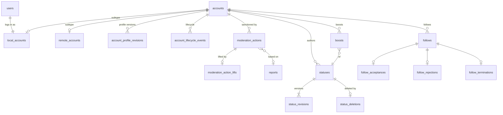
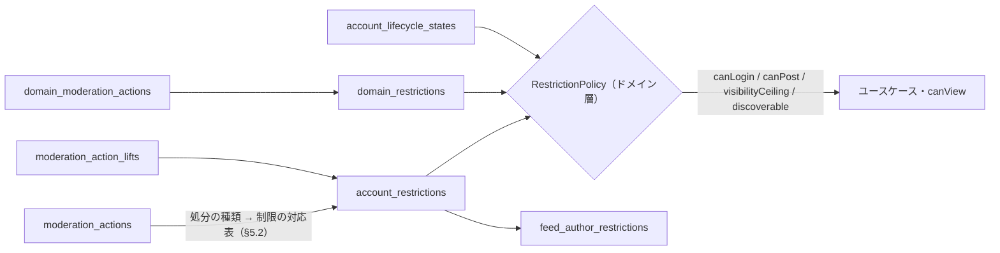

# 論理データモデル（v0）

> 方言に依存しない **論理スキーマ** です。方言別の `schema/<dialect>.sql` はこの文書に従って書き、乖離は CI で検査します（[ADR-0003](../adr/0003-database-abstraction.md)）。
> モデリングの規約は [ADR-0020](../adr/0020-data-modeling-principles.md)（リソース・イベント・投影の分離と、状態の直交分解）です。この文書はその適用結果です。
> 前提にしている ADR: [ADR-0002](../adr/0002-modular-monolith-hexagonal.md)、[ADR-0003](../adr/0003-database-abstraction.md)、[ADR-0004](../adr/0004-job-queue-abstraction.md)、[ADR-0007](../adr/0007-client-api.md)、[ADR-0013](../adr/0013-timeline-strategy.md)、[ADR-0017](../adr/0017-visibility-local.md)、[ADR-0018](../adr/0018-federated-uris.md)。
> v0 はマイグレーションを持たず作り直す前提です（[ADR-0012](../adr/0012-v0-breaking-change-policy.md)）。

## 1. 共通規約

### 1.1 テーブルの分類

すべてのテーブルに、次のいずれかの分類を付けます（ADR-0020 規約 1, 5）。各表の見出しの横に【分類】を記します。

| 分類 | 書き込み | 説明 |
| --- | --- | --- |
| 【リソース】 | INSERT のみ（消去ジョブによる物理削除を除く） | 識別子を持つ「もの」。作成時に決まる不変の事実だけを持つ |
| 【イベント】 | INSERT のみ | 起きた事実。**発生日時のカラムは 1 つだけ**（`*_at`）。訂正・取り消しは別のイベントで表す |
| 【投影】 | 所有モジュールの projector だけが UPSERT / DELETE | イベントから導出した現在値。§9 の再構築手順で作り直せる |
| 【現在値】 | 所有モジュールが UPSERT / DELETE | 履歴に意味がない高頻度の関係・設定値（ADR-0020 規約 5）。お気に入り・ミュート・利用者設定など |
| 【基盤】 | アダプタ | outbox・ジョブ・KV |

- 版（リビジョン）は【イベント】の一種です。「最新版」を頻繁に引くものは投影（`*_heads`）で指します。最新版を引く頻度が低いものは `(親, id DESC)` のインデックスで直接引きます。
- 期限（`expires_at`、`closes_at`）は「決定の内容」であって発生日時ではありません。イベントが持ってもよい属性です。

### 1.2 論理型

| 論理型 | 意味 | SQLite 系 | PostgreSQL 系 |
| --- | --- | --- | --- |
| `id` | UUIDv7 の正規形文字列（36 文字、小文字） | `TEXT` | `text COLLATE "C"`（照合順序に依らずバイト順 = 時刻順。`uuid` 型にするかは §11） |
| `string(n)` | 長さ上限つき文字列（上限はアプリで検証） | `TEXT` | `text` |
| `text` | 長文 | `TEXT` | `text` |
| `iri` | URL / ActivityPub の IRI（最大 2048 文字を想定） | `TEXT` | `text` |
| `int` / `bigint` | 整数 | `INTEGER` | `integer` / `bigint` |
| `real` | 倍精度の浮動小数点数（メディアの焦点など、誤差を許す量だけ） | `REAL` | `double precision` |
| `bool` | 真偽値 | `INTEGER`（0/1） | `boolean` |
| `timestamp` | UTC・ミリ秒精度の時刻 | `INTEGER`（Unix ミリ秒、#17 の推奨） | `timestamptz` |
| `lang` | BCP 47 言語タグ。不明は `und` | `TEXT` | `text` |
| `enum(…)` | 英小文字スネークケースの列挙 | `TEXT` + `CHECK` | `text` + `CHECK` |
| `bytes` | バイナリ（暗号化済みの秘密など） | `BLOB` | `bytea` |
| `document` | **解釈しない** JSON 文書のバイト列（受信した AP 文書の原本など）。書いたバイト列のまま読み戻す。検索・制約・部分更新に使わない | `BLOB` | `bytea` |

- `document` を JSON の型（PostgreSQL の `jsonb`・`json`）や `text` にしないのは、データベースに文書を解釈させないためです。
  - `jsonb` はキーの順序と空白を変え、重複したキーは最後の値だけを残します。AS2 の正規化（[federation §4](federation.md#4-as2-の正規化)）は最初の値を読み、`contentMap` の順序にも意味を持たせるので、方言によって処理の結果が変わってしまいます。
  - `jsonb` は `\u0000` と対になっていないサロゲートのエスケープを、`text` はヌル文字を受け付けません。そのような受信を `500` で返すと、送信側は再送し続けます。
  - 受信した文書の原本は、障害調査とフィクスチャの採取のため、受け取ったバイト列のまま残します。
- 文字列の論理型（`id`・`string(n)`・`text`・`iri`・`lang`・`enum`）の値は、妥当な UTF-8 でヌル文字（U+0000）を含みません。
  PostgreSQL の `text` はヌル文字を保存できず、SQLite は保存できるので、方言で結果が変わらないようにアプリが書く前に守ります。
  ローカルの入力（クライアント API・CLI・認証画面から文字列の列に書く値）は、モジュールのドメインの検証で拒否します。
  検証は入力の種類ごとに 1 か所にあり（`content.ValidText`、`moderation.TextError` を返す処分と解除の検証、`identity` の `Validate…` など）、クライアント API はそれを `422` で返します。
  JSON の本文は不正な UTF-8 を U+FFFD として読みますが、`multipart/form-data` の部分とヘッダー（`Idempotency-Key`）はバイト列のまま届くので、ヌル文字と不正な UTF-8 の両方を検証します。
  リモートの文書の文字列は正規化でヌル文字を U+FFFD に置き換えます（[federation §4](federation.md#4-as2-の正規化)）。
  検索に使う入力も同じです。PostgreSQL はそのようなパラメーターで検索に失敗し（SQLSTATE 22021）、SQLite は何も見つけないので、検索する前に HTTP の入口で拒否します。
  リクエストのパス・クエリのパラメーター・`application/x-www-form-urlencoded` の本文のフィールドは `platform` の `rejectInvalidText` が `400` に、
  クライアント API の JSON の本文の文字列は `clientapi` の `rejectInvalidBodyText`（strict のミドルウェア）がプロパティ名を示す `422` にします。
  検索に使うヘッダーと Cookie のトークン（アクセストークン・セッション）は、ハッシュにしてから検索します。
- 表記: カラムは特記がなければ `NOT NULL`。NULL 可のものは「NULL 可」と書きます。
  - **状態を NULL で表すことはしません**（ADR-0020 規約 4）。NULL 可は「任意の関連」（例: 通報に基づかない処分の `report_id`）と「無期限」（`expires_at`）に限ります。
- 名前: カラム・テーブルは英語スネークケースで、テーブル名は複数形です。
  - 大文字小文字を無視する値は正規化済みカラム（`*_normalized`）を別に持ち、そちらに一意制約を張ります。
  - ドメイン名とリモートの URI のホストは、IDNA 2008 の A-label（小文字の punycode）で保存します（[federation §1.2](federation.md#12-自サーバーの-uri)）。
- 「ローカル」を表すドメインは空文字 `''` です。NULL は一意制約上は互いに別の値として扱われるため、NULL では表しません。

### 1.3 ID とキーセットページング

- 主キーは UUIDv7 です（`IdGenerator` ポート、Go 1.27 の `uuid.NewV7()`）。辞書順と時刻順が一致するので、`ORDER BY id` がそのまま時系列になります。
- ページングは常にキーセット方式（`id < :cursor ORDER BY id DESC LIMIT :n + 1`）です。不透明なカーソルの中身はこの `id` です（ADR-0016）。
- リモート投稿の `id` は AP の `published` から生成します（未来の時刻は現在時刻に丸めます）。Go では `IDGenerator.NewIDAt` です。
  - 同じミリ秒の ID どうしの順序は保証せず、ランダム部で一意性だけを確保します。キーセットページングは `id` の全順序で進むので、順序が任意でも行の取りこぼしや重複は起きません。
- UUIDv7 は時刻から下限値を作れるので、`id >= uuidv7_floor(now - N days)` を読み取り量の上限として使えます（§6）。Go では `kernel.UUIDv7Floor` が下限値を返します。

### 1.4 参照と削除

- 参照は `xxx_id` による論理参照です。物理的な外部キーは同一モジュール内に限り任意で、モジュールをまたぐ参照には付けません。
  - Aurora DSQL も外部キーに対応した（#18）ため、同一モジュール内の外部キーは方言別スキーマで付ける方向で検討します（§11）。
- 削除の扱い（ADR-0020 規約 6）:
  - **論理的な削除は削除イベントで表します**（`status_deletions`、`account_lifecycle_events`）。
  - **物理削除は消去ジョブだけが行います**。個人データの行（本文・プロフィール・メールアドレス）を消し、投影を更新します。
  - 連合の重複排除に必要な URI は削除イベント側に残ります（tombstone を兼ねます）。

## 2. 整合性モデル

### 2.1 トランザクションの規律

ADR-0003（短く再実行可能なトランザクション、内部で外部 I/O をしない）と ADR-0020 規約 7 に従います。

- 1 つのコマンドは、**1 つのモジュールのリソース / イベント** を書き込みます。加えて、そのイベントを購読する **同期 projector**（自分の投影を更新）と `outbox_events` を、同じトランザクションで書きます。
- projector は購読するイベントの内容だけで投影を更新し、他モジュールのテーブルを読みません。必要な値はイベントに載せます。
- 同期 projector は起動時に `uow.Projectors` へイベント種別ごとに登録します。コマンドがトランザクション関数の中で `tx.Emit(ctx, event)` を呼ぶと、登録順に同じトランザクションで実行され、projector の失敗はコマンドごとロールバックします。
- コミットフック（`uow.Projectors.OnCommit`）は、コミットしたトランザクションが `tx.Emit` で発行したイベントを、コミットの後にトランザクションの外で受け取ります。
  ロールバックした試行・再実行で捨てた試行のイベントは届きません。フックはプロセス内の通知（リアルタイム更新、[overview §4.4](overview.md#44-リアルタイム更新sse)）だけに使い、失わせてはいけない処理は outbox のジョブにします。
  投影の再構築（§9）は `tx.Emit` を通らないので、フックを起こしません。
- 件数が利用者数・フォロワー数に比例する処理は、非同期 projector またはカーソル付きのジョブで、一定件数ずつ行います。
  - 該当するのは、配送先の展開・消去・アカウント単位の制限の全投稿への反映などです。
- 時刻と ID はトランザクション関数の外で一度だけ生成して渡します（再実行で値が変わらないように）。

| コマンド | 書き込むリソース / イベント | 同期で更新する投影 | outbox |
| --- | --- | --- | --- |
| 利用者登録 | `users`, `password_credentials`, `accounts`, `local_accounts`, `account_profile_revisions`, `account_keys`, `local_account_private_keys`（登録画面からは加えて `user_email_addresses`, `registration_applications`, `registration_decisions`, `invite_redemptions`, `user_tokens`, `sessions`） | `account_handles`, `account_profile_heads`（登録画面からは加えて `user_primary_emails`, `user_registration_states`, `session_activity`） | なし（確認メールはコミット後に `Mailer` で送る） |
| 投稿 | `statuses`, `local_statuses`, `status_revisions` と子テーブル | `status_heads`, `status_mention_index`, `status_reply_links`, `status_counters`, `feed_entries`, `feed_tag_entries`, `feed_direct_recipients`, `account_post_counters`, `notifications`（メンション） | 配送の展開 |
| 投稿の編集 | `status_revisions` と子テーブル | `status_heads`, `status_mention_index`, `feed_entries`（言語）, `feed_tag_entries`, `feed_direct_recipients`, `notifications`（増えたメンション） | `Update` の配送 |
| 投稿の削除 | `status_deletions` | `status_heads`, `status_mention_index`, `status_reply_links`, `status_counters`, `account_post_counters`, `boost_edges`, `feed_entries`, `feed_tag_entries`, `feed_direct_recipients`, `notification_deleted_statuses` | `Delete` の配送 |
| ブースト | `boosts` | `boost_edges`, `feed_entries`, `status_counters`, `notifications` | `Announce` の配送（`local` 投稿のブーストは連合しない） |
| ブーストの取り消し | `boost_retractions` | `boost_edges`, `feed_entries`, `status_counters` | `Undo Announce` の配送（連合したブーストだけ） |
| お気に入り / 取り消し | `favourites`（現在値） | `status_counters`, `notifications`（お気に入りだけ） | `Like` / `Undo Like` の配送（リモートの投稿だけ） |
| ブックマーク・ピン留め / 取り消し | `bookmarks` / `status_pins`（現在値） | なし | なし |
| フォロー | `follows`（＋自動承認なら `follow_acceptances`） | `follow_edges`, `feed_follow_edges`, `follow_counters`, `notifications` | `Follow` / `Accept` の配送 |
| ブロック | `blocks`（＋両方向のフォローの `follow_terminations`） | `block_edges`, `follow_edges`, `feed_follow_edges`, `feed_exclusions`, `follow_counters`, `notification_exclusions` | `Block` の配送 |
| ミュート / 解除 | `mutes`（現在値） | `feed_exclusions`, `notification_exclusions` | なし |
| 処分 | `moderation_actions`（＋`moderation_action_statuses`） | `account_restrictions`, `feed_author_restrictions` | 通知・投稿の削除やセンシティブ化（大量なら非同期） |
| Inbox 処理 | `received_activities` と対象のリソース / イベント | 対象に応じて | 対象に応じて |

`queue/db` アダプタでは、outbox を経由せず同じトランザクションで `jobs` に挿入してもかまいません。

利用者登録は、ログイン主体（`identity`）とそれが名乗るアカウント（`account`）が片方だけ存在する状態を作らないよう、例外として 2 つのモジュールに書き込みます。
`identity` のコマンドが `account` のアプリケーション層の公開 API（`PrepareLocalAccount` / `WriteLocalAccount`）を同じトランザクションの中で呼び、`account` のテーブルは `account` のコードだけが書きます。
鍵の生成・暗号化とパスワードのハッシュ計算は、トランザクションの前に済ませます。

### 2.2 冪等キーと一意制約

| 対象 | キー | 用途 |
| --- | --- | --- |
| 受信アクティビティ | `received_activities (activity_uri)` | Inbox の受信時の重複排除（[ADR-0033](../adr/0033-inbox-processing-model.md)）。`id` を持たないものは `actor` と本文の SHA-256 から `urn:my:digest:<hex>` を合成する（[federation §3.1](federation.md#31-同期の部分)） |
| 順序の入れ替わり | `remote_object_tombstones (uri)`、`remote_follow_tombstones (activity_uri)`、`status_deletions (uri)` | 先に届いた `Delete` / `Undo` の後に届いた `Create` / `Follow` などを捨てる |
| AP オブジェクト | `accounts (uri)`, `statuses (uri)`, `boosts (uri)`, `follows (uri)`, `follow_resends (uri)`, `blocks (uri)`, `reports (uri)`, `poll_votes (uri)`, `custom_emojis (uri)` | 受信・取得の重複排除 |
| 版 | `status_revisions (status_id, seq)`, `account_profile_revisions (account_id, seq)` | 同じ `Update` の再処理を no-op にする。リモートの `updated` が現在版以下なら版を作らない |
| 状態遷移イベント | `follow_acceptances (follow_id)`, `follow_rejections (follow_id)`, `follow_terminations (follow_id)`, `boost_retractions (boost_id)`, `block_retractions (block_id)`, `moderation_action_lifts (action_id)` | 同じ遷移の二重記録を防ぐ（1 リソースにつき 1 回だけ起きる遷移は PK にする） |
| 1 回限りの引き換え | `oauth_authorization_code_redemptions (code_hash)`, `user_token_redemptions (token_id)`, `invite_redemptions (invite_id, seq)` | 条件付き UPDATE の代わりに、引き換えイベントの一意制約で 1 回性を保証する |
| クライアントからの投稿 | `local_statuses (author_account_id, idempotency_key)` | API の `Idempotency-Key`。再送には同じ投稿を返す |
| 通知 | `notifications (recipient_account_id, dedupe_key)` | 同じイベントの再処理や繰り返した操作で通知を増やさない（§4.7） |
| 配送 | `deliveries (outbound_activity_id, inbox_url)` | 展開ジョブの再実行で重複しない |
| ジョブ | `jobs (idempotency_key)` | 未完了のジョブの重複投入を no-op にする（ADR-0004） |

### 2.3 集計値

- カウンタは【投影】です。イベントを集計するモジュールが所有します。
  - `account_post_counters` と `status_counters` は `content`、`follow_counters` は `graph` が所有します。
- 加算・減算は、元のイベントが実際に挿入された（影響行数 = 1）ときだけ行います。
- ずれは定期ジョブ `projection.verify` が、イベントから数え直して補正します（§9）。
- リモートアカウントのフォロワー数などは、取得スナップショットの `totalItems` を表示に使います。ローカルのカウンタは「このインスタンスが知っている件数」として別に持ちます。

## 3. 概念モデル

### 3.1 モジュールと主な概念



### 3.2 イベントから投影への流れ（例: 処分）



## 4. モジュール別テーブル定義

### 4.0 所有モジュール

| モジュール | リソース / イベント | 投影 / 現在値 |
| --- | --- | --- |
| `identity` | `users`, `user_email_addresses`, `user_email_verifications`, `password_credentials`, `totp_enrollments`, `totp_enrollment_revocations`, `totp_recovery_codes`, `totp_recovery_code_uses`, `registration_applications`, `registration_decisions`, `invites`, `invite_redemptions`, `invite_revocations`, `user_tokens`, `user_token_redemptions`, `roles`, `role_permissions`, `user_role_grants`, `user_role_revocations`, `sessions`, `session_origins`, `registration_origins`, `session_revocations`, `oauth_clients`, `oauth_client_redirect_uris`, `oauth_authorization_codes`, `oauth_authorization_code_redemptions`, `oauth_access_tokens`, `oauth_token_revocations`, `data_exports`, `data_export_results` | `user_primary_emails`, `user_registration_states`, `user_roles`, `user_preferences`, `user_timeline_languages`, `session_activity` |
| `account` | `accounts`, `local_accounts`, `remote_accounts`, `remote_account_snapshots`, `account_profile_revisions`, `account_profile_revision_sources`, `account_profile_fields`, `account_profile_field_verifications`, `account_keys`, `local_account_private_keys`, `account_key_revocations`, `remote_account_handle_verifications`, `remote_profile_revisions`, `account_lifecycle_events` | `account_handles`, `account_profile_heads`, `remote_account_heads`, `account_lifecycle_states` |
| `moderation` | `moderation_actions`, `moderation_action_statuses`, `moderation_action_lifts`, `moderation_appeals`, `moderation_appeal_decisions`, `domain_moderation_actions`, `domain_moderation_action_lifts`, `reports`, `report_statuses`, `report_rule_citations`, `report_assignments`, `report_resolutions`, `report_reopenings`, `report_notes`, `signup_blocks`, `signup_block_lifts`, `audit_log_entries`, `relationship_severances`, `retention_holds`, `retention_hold_releases` | `account_restrictions`, `domain_restrictions`, `report_states`, `appeal_states` |
| `content` | `statuses`, `local_statuses`, `status_revisions`, `status_revision_bodies`, `status_revision_sources`, `status_revision_attachments`, `status_revision_mentions`, `status_revision_tags`, `status_revision_emojis`, `remote_status_revisions`, `status_deletions`, `boosts`, `boost_retractions`, `tags`, `media_files`, `uploaded_media`, `remote_media`, `media_processing_results`, `media_variants`, `custom_emojis`, `custom_emoji_images`, `polls`, `poll_options`, `poll_votes`, `poll_tally_observations`, `poll_tally_observation_counts` | `status_heads`, `status_reply_links`, `status_mention_index`, `status_sensitivity_overrides`, `boost_edges`, `status_counters`, `account_post_counters`, `poll_tallies`, `custom_emoji_settings`, `media_focus`, `media_descriptions`, `remote_media_cache`, `favourites`, `bookmarks`, `status_pins` |
| `graph` | `follows`, `follow_acceptances`, `follow_rejections`, `follow_terminations`, `follow_resends`, `blocks`, `block_retractions` | `follow_edges`, `block_edges`, `follow_counters`, `follow_preferences`, `mutes`, `account_domain_mutes` |
| `timeline` | なし | `feed_entries`, `feed_direct_recipients`, `feed_tag_entries`, `feed_follow_edges`, `feed_exclusions`, `feed_author_restrictions`, `feed_domain_restrictions` |
| `notification` | `notifications`, `notification_dismissals` | `notification_read_markers`, `push_subscriptions`, `push_subscription_alerts` |
| `federation` | `received_activities`, `received_activity_documents`, `remote_object_tombstones`, `remote_follow_tombstones`, `outbound_activities`, `outbound_activity_documents`, `deliveries`, `delivery_attempts`, `remote_instances`, `instance_nodeinfo_observations`, `instance_availability_events` | `instance_health` |
| `instance` | `instance_setting_revisions`, `instance_text_revisions`, `instance_rules`, `instance_rule_revisions`, `instance_rule_texts`, `instance_rule_retirements` | `instance_settings`, `instance_texts`, `instance_rule_heads` |
| 基盤 | — | `outbox_events`, `jobs`, `dead_jobs`, `kv_entries` |

### 4.1 identity

ログイン主体（`users`）を中心に、資格情報・メール・登録審査・権限・設定を、それぞれ独立した概念として持ちます。

#### users【リソース】

| カラム | 型 | 説明 |
| --- | --- | --- |
| `id` | `id` | PK |
| `created_at` | `timestamp` | |

ログイン主体の識別だけを持ちます。ローカルアカウントとの対応は `local_accounts.user_id` です。

#### メールアドレス

| テーブル | 分類 | カラム | 制約 |
| --- | --- | --- | --- |
| `user_email_addresses` | リソース | `id`, `user_id`, `address`（`string(320)`）, `address_normalized`, `added_at` | インデックス `(user_id, id)` |
| `user_email_verifications` | イベント | `email_address_id`（PK）, `verified_at` | 確認は 1 アドレスにつき 1 回 |
| `user_primary_emails` | 投影 | `user_id`（PK）, `email_address_id`, `address_normalized` | **一意 `(address_normalized)`**。ログイン時の照合とアドレスの重複防止 |

- メールアドレスの変更は、新しいアドレスの追加 → 確認 → 主アドレスの切り替え（投影の更新）で表します。古いアドレスは消去ジョブの対象です。

#### 資格情報

| テーブル | 分類 | カラム | 制約 |
| --- | --- | --- | --- |
| `password_credentials` | イベント（版） | `id`, `user_id`, `password_hash`（Argon2id の PHC 文字列）, `set_at` | インデックス `(user_id, id DESC)`。最新行が現在のパスワード。過去のハッシュは再利用防止に使え、保持期間後に消去する |
| `totp_enrollments` | イベント | `id`, `user_id`, `secret_enc`（`bytes`）, `enrolled_at` | インデックス `(user_id, id DESC)` |
| `totp_enrollment_revocations` | イベント | `enrollment_id`（PK）, `revoked_at` | 有効な登録 = 失効イベントの無い最新の登録 |
| `totp_recovery_codes` | リソース | `enrollment_id`, `code_hash` | PK `(enrollment_id, code_hash)` |
| `totp_recovery_code_uses` | イベント | `enrollment_id`, `code_hash`, `used_at` | PK `(enrollment_id, code_hash)`。挿入の成否で 1 回性を保証 |

#### 登録審査

| テーブル | 分類 | カラム | 制約 |
| --- | --- | --- | --- |
| `registration_applications` | リソース | `id`, `user_id`, `reason`（`text`、NULL 可）, `invite_id`（NULL 可）, `submitted_at` | 一意 `(user_id)` |
| `registration_decisions` | イベント | `id`, `application_id`, `decision`（`enum(approved, rejected)`）, `decided_by`（`enum(moderator, system)`）, `decided_by_user_id`（NULL 可 = `system` または CLI による決定）, `note`（NULL 可。1,000 文字まで）, `decided_at` | インデックス `(application_id, id DESC)`。`open` / `invite` モードでは `system` が即時に承認する |
| `user_registration_states` | 投影 | `user_id`（PK）, `state`（`enum(pending, approved, rejected)`）, `since` | インデックス `(state, since)`（承認待ち一覧）。行の無い利用者（CLI で作った管理者など）は承認済み |
| `registration_origins` | リソース | `user_id`（PK）, `ip`, `recorded_at` | インデックス `(ip)`, `(recorded_at)`。登録画面からの登録だけが作る。登録の拒否リスト（FR-719）と同じ IP のアカウントの検索に使い、保持期間（ADR-0038、既定 180 日）を過ぎた行を消去ジョブが消す |

- 登録画面からの登録は、登録モード（インスタンス設定 `registration_mode`、§4.9）に従います。
  `open` は `system` が即時に承認し、`approval` はモデレーターの決定まで `pending` のまま、`invite` は有効な招待があれば `system` が即時に承認し、`closed` は受け付けません。
  `approval` モードでだけ `reason` を受け取り、`invite` モードでだけ `invite_id` を記録します。
- メールを届けられない構成（`mail = none`）では、メール確認の代わりにモデレーターの承認を求めます（FR-002）。このとき `open` モードの登録も `pending` で始まり、確認済みでないことはアプリの利用を妨げません。
- アプリ（クライアント API と OAuth の認可）を使えるのは、`user_registration_states` が `approved`（または行が無い）で、メール確認が必要な構成では主アドレスが確認済みの利用者だけです。
  承認待ち・却下・未確認の利用者もサーバーが返す画面にはログインでき、何を待っているかが表示されます。
  ログインを奪う処分（制限 `login`、§5.2）を受けた利用者も同じで、サーバーが返す画面にはログインでき、効いている処分のうちログインを奪うもの（種類・理由のカテゴリと公開の理由・期限）が本人の UI 言語で表示されます。アクセストークンは得られません。
- モデレーターの決定（CLI と管理の API）は、`pending` の行だけを更新する条件付きの更新で `user_registration_states` を変え、同じトランザクションで `registration_decisions` と監査ログの行を加えます。
  更新する行が無ければ（決定済み、または同時に決まった）何も記録しないので、登録の決定は 1 回だけです。
- CLI で作った管理者の主アドレスは、作成と同じトランザクションで確認済みにします（運営者が与えたアドレスなので）。

#### 招待・1 回限りのトークン

| テーブル | 分類 | カラム | 制約 |
| --- | --- | --- | --- |
| `invites` | リソース | `id`, `code`（80 ビットの乱数の base32、16 文字。照合は大文字・空白とハイフンを除いた形で行う）, `created_by_user_id`（NULL 可 = CLI による作成）, `max_uses`（NULL 可 = 無制限）, `expires_at`（NULL 可）, `created_at` | 一意 `(code)` |
| `invite_redemptions` | イベント | `invite_id`, `seq`（`int`、1 始まり）, `user_id`, `redeemed_at` | PK `(invite_id, seq)`。`seq = 既存件数 + 1` で挿入し、一意制約違反なら再試行する。`seq > max_uses` は拒否する |
| `invite_revocations` | イベント | `invite_id`（PK）, `revoked_by_user_id`（NULL 可 = CLI による取り消し）, `revoked_at` | 取り消しは 1 回だけ記録する（2 回目は何もしない） |
| `user_tokens` | リソース | `id`, `user_id`, `purpose`（`enum(email_verification, password_reset)`）, `email_address_id`（NULL 可）, `token_hash`（`bytes`。トークンの SHA-256）, `expires_at`, `issued_at` | 一意 `(token_hash)`。メール確認のトークンは接頭辞 `my_evt_`、有効期限 24 時間 |
| `user_token_redemptions` | イベント | `token_id`（PK）, `redeemed_at` | 挿入の成否で 1 回性を保証する |

#### 権限

固定の `role` enum ではなく、ロールと権限を分けます。組み込みロールは起動時に冪等に作ります（`roles (key)` の一意制約で重複しない）。
`admin`（`position` 1000）はすべての権限、`moderator`（`position` 100）は `manage_reports`・`manage_accounts`・`view_audit` を持ちます。

| テーブル | 分類 | カラム | 制約 |
| --- | --- | --- | --- |
| `roles` | リソース | `id`, `key`（`string(64)`）, `position`（`int`）, `created_at` | 一意 `(key)` |
| `role_permissions` | 現在値 | `role_id`, `permission`（`enum(manage_reports, manage_accounts, manage_domains, manage_rules, manage_settings, manage_roles, manage_invites, view_audit, manage_jobs)`） | PK `(role_id, permission)` |
| `user_role_grants` | イベント | `id`, `user_id`, `role_id`, `granted_by_user_id`（NULL 可 = CLI による付与。最初の管理者など）, `granted_at` | |
| `user_role_revocations` | イベント | `grant_id`（PK）, `revoked_by_user_id`（NULL 可 = CLI による剥奪）, `revoked_at` | |
| `user_roles` | 投影 | `user_id`, `role_id`, `grant_id` | PK `(user_id, role_id)` |

- 付与は `user_role_grants` に 1 行足して `user_roles` に加え、剥奪は `user_role_revocations` に 1 行足して `user_roles` から除きます。どちらも同じトランザクションで監査ログ（`role_granted`・`role_revoked`）を書きます。
  持っているロールの付与と持っていないロールの剥奪は何もしません。
- 利用者は自分のロールの最も高い `position` 以下のロールだけを付与・剥奪できます（FR-720）。CLI はどのロールも付与・剥奪できます。
- `admin` は最後の 1 人から剥奪できません。1 つのロールの変更は、トランザクションの最初にそのロールの行を読んで（PostgreSQL では `FOR UPDATE`）1 つずつ進めます。
- 権限は要求ごとに `user_roles` から読むので、変更は次の要求から効きます。モデレーター向けの通知の宛先も、通知を作るときの `user_roles` で決まります。

#### セッション・OAuth

| テーブル | 分類 | カラム | 制約 |
| --- | --- | --- | --- |
| `sessions` | リソース | `id`, `user_id`, `token_hash`（`bytes`。Cookie の値の SHA-256）, `created_at`, `expires_at` | 一意 `(token_hash)`。インデックス `(user_id)`（処分による失効） |
| `session_origins` | リソース（子） | `session_id`（PK）, `user_id`, `ip`（NULL 可）, `user_agent`（`string(512)`、NULL 可）, `created_at` | インデックス `(ip)`（同じ IP のアカウントの検索、FR-714）, `(created_at)`（保持期間による消去）。保持期間（[ADR-0038](../adr/0038-moderation-personal-data-retention.md)、既定 180 日）を過ぎた行を消去ジョブが消す |
| `session_revocations` | イベント | `session_id`（PK）, `reason`（`enum(logout, replaced, password_changed, moderation, expired_cleanup)`）, `revoked_at` | 有効なセッション = 失効イベントが無く `expires_at` を過ぎていないもの。`replaced` は同じブラウザでのログインし直し |
| `session_activity` | 現在値 | `session_id`（PK）, `last_seen_at` | ログイン時に作り、以後の更新は 1 時間に 1 回に間引く |
| `oauth_clients` | リソース | `id`, `client_id`, `client_secret_hash`（NULL 可 = 公開クライアント）, `name`, `website`（NULL 可）, `scope`, `is_first_party`, `owner_user_id`（NULL 可）, `created_at` | 一意 `(client_id)` |
| `oauth_client_redirect_uris` | 現在値 | `client_id`, `redirect_uri` | PK `(client_id, redirect_uri)`。完全一致で照合する |
| `oauth_authorization_codes` | リソース | `code_hash`（PK）, `client_id`, `user_id`, `redirect_uri`, `scope`, `code_challenge`, `session_id`（NULL 可 = セッションの外で発行）, `issued_at`, `expires_at` | `session_id` は認可した画面のセッション |
| `oauth_authorization_code_redemptions` | イベント | `code_hash`（PK）, `token_id`, `redeemed_at` | 一意 `(token_id)`。`token_id` は交換で発行した系列の最初のトークン |
| `oauth_access_tokens` | リソース | `id`, `family_id`, `client_id`, `user_id`, `access_token_hash`, `refresh_token_hash`（NULL 可）, `scope`, `rotated_from_token_id`（NULL 可）, `issued_at`, `expires_at`, `refresh_expires_at`（NULL 可） | 一意 `(access_token_hash)`, `(refresh_token_hash)`。インデックス `(family_id)`, `(user_id)`（処分による失効）。`refresh_token_hash` と `refresh_expires_at` は同時に NULL |
| `oauth_token_revocations` | イベント | `token_id`（PK）, `reason`（`enum(user, rotation, refresh_reuse, code_reuse, password_changed, moderation)`）, `revoked_at` | |

- セッションは、サーバーが返す画面（ログイン・登録・認可同意）の Cookie `__Host-my_session` です（ADR-0019 §4、ADR-0030）。
  ログインのたびに新しいトークンを発行し、ブラウザが持っていた古いセッションは `replaced` で失効させます。
- ログイン元（`session_origins`）と登録元（`registration_origins`）は、セッション・利用者と同じトランザクションで記録します。
  - IP アドレスは正規形（IPv4 射影の IPv6 は IPv4、ゾーンは外す）で持ち、同じアドレスが同じ文字列になるようにします。IP アドレスとして読めない値は記録しません。
  - IP アドレスも User-Agent も分からないログインは `session_origins` の行を作らず、IP アドレスの分からない登録は `registration_origins` の行を作りません。どちらもログインと登録を妨げません。
  - 1 時間ごとの消去ジョブ `identity.purge_origins` が、保持期間（既定 180 日）を過ぎた行を、1 文あたり 1,000 行・1 テーブルあたり 20 文まで、古い順に消します。セッションと利用者は残ります。
- `scope` は RFC 6749 の scope 文字列（空白区切り・ソート済みの正規形）です。照合は文字列全体で行い、個々のスコープの検索には使わないため、1 カラムで持ちます。
- `oauth_clients` 以外のテーブルの `client_id` は `oauth_clients.id` を指します。クライアントが送る公開の識別子は `oauth_clients.client_id` です。
- ファーストパーティの Web クライアント（`client_id` は `my-web`）は起動時に冪等に登録します。リダイレクト URI は設定 `web_origin` から導くので、`oauth_client_redirect_uris` は起動のたびに設定値へ置き換える【現在値】です。
- 認可コード・アクセストークン・リフレッシュトークンは、DB には SHA-256 ハッシュだけを保存します（ADR-0019 §4）。認可コードの 1 回性は `oauth_authorization_code_redemptions` の PK で保証します。
- `oauth_access_tokens` の 1 行は 1 回の発行（アクセストークンと、あればリフレッシュトークン）です。`expires_at` はアクセストークンの、`refresh_expires_at` はリフレッシュトークンの期限です。
  - リフレッシュのたびに同じ系列（`family_id` = 系列の最初の行の `id`）に新しい行を作り、古い行を `rotation` で失効させます。失効イベントは行のアクセストークンとリフレッシュトークンの両方を無効にします。
  - 失効済みの行のリフレッシュトークンが再び使われたら、系列の全行を `refresh_reuse` で失効させます（RFC 9700 §4.14.2）。使用済みの認可コードが再び使われたら、そのコードで始まった系列を `code_reuse` で失効させます（RFC 6749 §4.1.2）。
  - 有効なアクセストークン = 失効イベントが無く `expires_at` を過ぎていない行です。トークンの失効（RFC 7009）は系列全体を `user` で失効させます。
  - Web クライアントによる失効はログアウトなので、同じトランザクションで、系列の最初の行（`family_id`）→ `oauth_authorization_code_redemptions.token_id`
    → `oauth_authorization_codes.session_id` と辿ったセッションも `logout` で失効させます（すでに失効していれば何もしない）。
    サードパーティのクライアントの失効では、画面のセッションは終わりません。

#### 利用者設定【現在値】

| テーブル | カラム | 制約 |
| --- | --- | --- |
| `user_preferences` | `user_id`（PK）, `locale`（`lang`）, `time_zone`（IANA 名）, `default_visibility`（`enum(public, local, unlisted, private, direct)`）, `default_post_language`（`lang`）, `require_media_description`（`bool`）, `email_moderator_notifications`（`bool`。モデレーターへの通知をメールでも受け取るか、FR-712）, `updated_at` | |
| `user_timeline_languages` | `user_id`, `language`（`lang`） | PK `(user_id, language)`。行が無ければすべての言語を表示（FR-208） |

- 登録時に既定値の行を作ります。`locale` は登録時に指定されたロケール、無ければインスタンスの既定（`default_locale`）、それも無ければ `en` です。
  `time_zone` は `UTC`、`default_visibility` は `public`、`default_post_language` は `und`（クライアントに任せる）、`require_media_description` と `email_moderator_notifications` は偽です。
- `lang` の値は BCP 47 として検証し、正規形（`ja-JP`、`zh-Hant-TW`、`iw` → `he`）で保存します。未知のサブタグ、言語を明示しないタグ（`und-JP`、私用の `x-…`）は拒否します。
  `locale` は `und` も拒否します。
- `time_zone` は IANA タイムゾーンデータベースにある名前だけを受け付けます（`Local` や `+09:00` は不可）。サーバーのバイナリはデータベースを埋め込む（Go の `time/tzdata`）ので、検証結果はホストに依存しません。
- `user_timeline_languages` は 1 回の設定で全体を置き換えます（重複を除き、上限 64 件）。

#### データエクスポート

| テーブル | 分類 | カラム |
| --- | --- | --- |
| `data_exports` | リソース | `id`, `user_id`, `requested_at` |
| `data_export_results` | イベント | `export_id`（PK）, `outcome`（`enum(ready, failed)`）, `blob_key`（NULL 可）, `file_size`（NULL 可）, `expires_at`（NULL 可）, `completed_at` |

### 4.2 account

ローカル・リモートの Actor です。識別（`accounts`）、部分型、プロフィール（版）、ライフサイクル（イベント）を分けます。

#### accounts【リソース】と部分型

| テーブル | 分類 | カラム | 制約 |
| --- | --- | --- | --- |
| `accounts` | リソース | `id`, `uri`, `domain`（`''` = ローカル）, `actor_type`（`enum(person, service, application, group, organization)`）, `created_at` | 一意 `(uri)`。インデックス `(domain, id)`。部分一意 `(domain, actor_type) WHERE domain = '' AND actor_type = 'application'`（インスタンス Actor は 1 つ） |
| `local_accounts` | リソース（部分型） | `account_id`（PK）, `user_id`, `username`, `username_normalized` | 一意 `(user_id)`, `(username_normalized)`。ローカルのユーザー名は変更しない（URI は ID ベースだが、ハンドルの再利用による混乱を避けるため） |
| `remote_accounts` | リソース（部分型） | `account_id`（PK）, `first_seen_at` | |
| `remote_account_snapshots` | イベント | `id`, `account_id`, `preferred_username`, `profile_url`（NULL 可）, `inbox_url`, `shared_inbox_url`（NULL 可）, `outbox_url` / `followers_url` / `following_url` / `featured_url`（NULL 可。持たない実装がある）, `followers_total` / `following_total` / `statuses_total`（`bigint`、NULL 可）, `document_digest`（`bytes`。文書の SHA-256）, `fetched_at` | インデックス `(account_id, id DESC)`。取得のたびに 1 行。内容（ダイジェスト）が前回と同じなら挿入しない |
| `remote_account_heads` | 投影 | `account_id`（PK）, `snapshot_id`, `inbox_url`, `shared_inbox_url`（NULL 可）, `last_fetched_at`, `consecutive_fetch_failures`（`int`） | インデックス `(last_fetched_at)`（定期リフレッシュ）、`(shared_inbox_url)`（アカウント削除の `Delete` を送る既知の shared inbox、§8）。取得のたびに最新のスナップショットを指し、`last_fetched_at` を取得の時刻、`consecutive_fetch_failures` を 0 にする。取得に失敗したら `consecutive_fetch_failures` を 1 増やし、`last_fetched_at` を失敗の時刻にする（次の定期リフレッシュを 24 時間後に送る） |
| `remote_account_handle_verifications` | イベント | `id`, `account_id`, `username`, `domain`, `outcome`（`enum(verified, mismatch)`）, `checked_at` | インデックス `(account_id, id DESC)`。WebFinger で `acct:{username}@{domain}` を確かめた記録（[federation.md §6.2](federation.md#62-actor-とハンドル)）。`verified` は `self` リンクが Actor の `uri` を指したこと、`mismatch` は答えがそれを確かめなかったこと。結果が最新の記録と同じなら挿入しない |
| `account_handles` | 投影 | `account_id`（PK）, `username`, `username_normalized`, `domain` | **一意 `(username_normalized, domain)`**。WebFinger・`@user@host` の解決（FR-305, FR-401）。ローカルは `local_accounts`、リモートは最新の `remote_account_handle_verifications` が `verified` のときだけ作る（確かめていない・`mismatch` のリモートのアカウントは行を持たない） |

- インスタンス自身の Actor（`Application`）もローカルの `accounts` に 1 行持ちます（`local_accounts` と `account_handles` には入れません）。
  ローカルの `application` はこの 1 行だけなので、部分一意インデックスで二重作成を防ぎ、作成を冪等にします。
- ローカルアカウントの `uri` は `https://{host}/ap/actors/{id}`（ADR-0018）です。ハンドルの `domain` は `account_domain` ではなく `''` です（設定値に依存させない）。
- リモートのハンドルが変わった場合、同じハンドルを別の Actor が後から名乗ることがあります。後から `verified` を記録した Actor がハンドルを持ち、先に持っていた Actor の行は投影から消えます（再構築も記録の `id` 順に当てはめるので同じ結果になります）。

#### プロフィール【イベント（版）】

| テーブル | 分類 | カラム | 制約 |
| --- | --- | --- | --- |
| `account_profile_revisions` | イベント | `id`, `account_id`, `seq`, `display_name`, `note_html`, `locked`, `bot`, `discoverable`, `indexable`（`bool`）, `avatar_media_id` / `header_media_id`（NULL 可）, `revised_at` | 一意 `(account_id, seq)` |
| `account_profile_revision_sources` | イベント（部分型） | `revision_id`（PK）, `note_source` | ローカルのみ。入力されたままの自己紹介 |
| `account_profile_fields` | イベント（版の子） | `revision_id`, `position`（`int`）, `name`, `value_html` | PK `(revision_id, position)`（FR-006） |
| `account_profile_field_sources` | イベント（部分型） | `revision_id`, `position`, `value_source` | PK `(revision_id, position)`。ローカルのみ。入力されたままの補足情報の値 |
| `account_profile_field_verifications` | イベント | `revision_id`, `position`, `verified_at` | PK `(revision_id, position)`。`rel="me"` リンクの検証結果 |
| `remote_profile_revisions` | イベント（部分型） | `revision_id`（PK）, `snapshot_id`, `html_policy_version`（`int`） | リモートのみ。版を作った取得と、`note_html` / `value_html` をサニタイズしたポリシーの版（ADR-0019 §2） |
| `account_profile_heads` | 投影 | `account_id`（PK）, `revision_id` | `seq` が最大の版を指す |

- 鍵アカウント（`locked`）・bot などのフラグはプロフィールの一部として版を持ちます。いつから鍵アカウントだったかが分かります。
- 新しい版の `seq` は現在の版の `seq + 1` です。同時に版を作って `(account_id, seq)` が衝突したら、トランザクションを再実行して次の `seq` を取ります。
- ローカルアカウントは作成時に `seq = 1` の版を持ちます。
- ローカルの版は、入力されたままの自己紹介と補足情報の値を `account_profile_revision_sources` と `account_profile_field_sources` に持ちます。
  サーバーはそれを投稿の本文と同じ規則（メンション・ハッシュタグ・URL をリンクにし、ほかはエスケープ）で HTML にして `note_html` と `value_html` に保存します（ADR-0019 §2）。
  補足情報の `name` はプレーンテキストです。プロフィールの更新は、変えない項目を現在の版から写した新しい版を作ります。
- アバター・ヘッダーにできるのは、本人がアップロードして処理が成功した `media_files` だけです。
  表示する画像は、版が指すファイルの現在の処理結果（§4.4 メディア）の `full` 版です。ファイルの所有者がそのアカウントでないか、現在の処理結果が `ready` でなければ表示しません。
  アカウントの一覧・タイムライン・通知は、1 ページ分のアカウントの画像を `content` モジュールの公開 API（`MediaService.ImageURLs`）で 1 回の問い合わせにまとめて読みます。
- リモートのプロフィールは、取得した文書から版を作ります（内容が変わったときだけ）。`summary` と補足情報の値は取り込み時にサニタイズして `note_html` / `value_html` に保存し、表示名と補足情報の名前はプレーンテキストにします（[federation.md §5](federation.md#5-リモート-html-のサニタイズ)）。
- ローカルのアカウントとの関係が無いリモートのアカウント（どちらの向きのフォローも無く、保存した投稿も無い）は、1 日ごとの消去ジョブ `account.prune_remote_profiles` が、プロフィールの版を現在の 1 つに縮めます（[ADR-0034](../adr/0034-remote-content-scope-and-retention.md)）。
  現在の版でない版と子テーブルの行（`account_profile_fields`、`remote_profile_revisions`）、`remote_account_heads` と現在の版のどちらも指さない `remote_account_snapshots` を消し、`accounts`・`remote_accounts`・鍵は残します。
  関係の判定は `graph` と `content` の公開 API で行い（`account` はこの 2 つを import しないので、組み立てる側が渡す）、トランザクションの前に読みます。1 トランザクションで調べるのは 100 アカウントまでで、続きはカーソル（`account_id`）を持った次のジョブが読みます。

#### 署名鍵

| テーブル | 分類 | カラム | 制約 |
| --- | --- | --- | --- |
| `account_keys` | リソース | `id`, `account_id`, `key_id`（`iri`）, `algorithm`（`enum(rsa_sha256, ed25519)`）, `public_key_pem`（PKIX の `PUBLIC KEY`）, `fingerprint`（`bytes`。DER の SHA-256）, `created_at` | 一意 `(key_id, fingerprint)`。インデックス `(key_id, id DESC)`, `(account_id)` |
| `local_account_private_keys` | リソース（部分型） | `account_key_id`（PK）, `private_key_enc`（`bytes`） | NFR-SEC-7。リストア後も変わらないこと（NFR-REL-4） |
| `account_key_revocations` | イベント | `account_key_id`（PK）, `revoked_at` | |

- ローカルの Actor（インスタンス Actor を含む）は、作成時に RSA 2048 ビット（`rsa_sha256`、`key_id` = `{actor}#main-key`）と Ed25519（`ed25519`、`key_id` = `{actor}#ed25519-key`）の 2 つの鍵を持ちます。
- リモートの Actor は、同じ `key_id` のまま公開鍵を替えることがあります（Mastodon の `#main-key`）。取得した鍵の `fingerprint` が既存の行と違えば新しい行を作り、同じトランザクションで古い行に `account_key_revocations` を記録します。文書が宣言しなくなった鍵も同じように失効させます。別のアカウントの鍵になっている `key_id` は書き換えません。署名の検証は、`key_id` の失効していない最新の行を使います（[ADR-0032](../adr/0032-http-signature-profile.md)）。
- `private_key_enc` は PKCS #8 の秘密鍵を `kernel.Sealer` で暗号化した値です（ADR-0019 §6）。AAD は `account_key_id` と列名 `local_account_private_keys.private_key_enc` で、別の行・列に写すと復号できません。

#### ライフサイクル

| テーブル | 分類 | カラム | 制約 |
| --- | --- | --- | --- |
| `account_lifecycle_events` | イベント | `id`, `account_id`, `kind`（`enum(deactivated, reactivated, deletion_scheduled, deletion_cancelled, deleted, remote_deleted)`）, `initiated_by`（`enum(self, moderator, system, remote)`）, `moderation_action_id`（NULL 可）, `deletion_due_at`（NULL 可。`deletion_scheduled` のみ）, `occurred_at` | インデックス `(account_id, id DESC)` |
| `account_lifecycle_states` | 投影 | `account_id`（PK）, `state`（`enum(active, deactivated, deletion_scheduled, deleted)`）, `since`, `deletion_due_at`（NULL 可） | インデックス `(state, deletion_due_at)`（削除の実行） |

- **ライフサイクルは本人とシステムの軸** です。モデレーションの処分は別の軸（§4.3）に置きます。
  - BAN のように処分が削除を伴う場合は、処分が `deletion_scheduled` イベントを `initiated_by = moderator` で発生させます（`moderation_action_id` で根拠を辿れる）。
    期日は処分から 30 日後（`moderation.BanDeletionDelay`）で、処分と同じトランザクションで記録します（`account.Service.ScheduleDeletionByModeration`）。
    削除済みのアカウントと、それより早い期日の削除がすでに予定されているアカウントには記録しません。
- 期日を過ぎた `deletion_scheduled` は、1 時間ごとのジョブ `account.execute_deletions` が `deleted`（`initiated_by = system`）にします（`account.Service.ExecuteDueDeletions`）。
  1 回で 100 件まで、アカウントごとに短いトランザクションで、状態を読み直してから記録するので、再実行しても二重に削除しません。
  `deleted` は既存の購読者を通して、アカウントと投稿を表示から外し、`Delete`（Actor）を送ります（[federation.md §7.1](federation.md)）。
- 行が無いアカウントは `active` とみなします。作成時には行を作らず、最初のライフサイクルイベントで作ります（イベントからの再構築と一致させるため）。
- 投影はイベントを `id` 順に畳み込んで作ります: `deactivated` → `deactivated`、`reactivated` / `deletion_cancelled` → `active`、`deletion_scheduled` → `deletion_scheduled`（`deletion_due_at` を写す）、`deleted` / `remote_deleted` → `deleted`。`deleted` は最終状態で、以後のイベントでは変わりません。`since` は最後に状態を変えたイベントの `occurred_at` です。
- `deletion_due_at` は、イベントでは `kind = deletion_scheduled` のとき、投影では `state = deletion_scheduled` のときだけ値を持ちます（`CHECK` 制約）。

### 4.3 moderation

#### 処分【イベント】

| テーブル | 分類 | カラム | 制約 |
| --- | --- | --- | --- |
| `moderation_actions` | イベント | `id`, `target_account_id`, `kind`（§5.2 の enum）, `reason_category`（`enum(spam, legal, violation, other)`）, `public_reason`（`text`、NULL 可。5,000 文字まで。本人に見せる理由）, `private_note`（`text`、NULL 可。5,000 文字まで）, `report_id`（NULL 可）, `issuer`（`enum(moderator, system, remote)`）, `issued_by_user_id`（NULL 可）, `notify_target`（`bool`）, `expires_at`（NULL 可 = 無期限）, `issued_at` | インデックス `(target_account_id, id DESC)`, `(report_id)` |
| `moderation_action_statuses` | イベント（子） | `action_id`, `status_id` | PK `(action_id, status_id)`。投稿単位の処分（`delete_statuses` / `mark_statuses_sensitive`）の対象。処分 1 件につき 1〜100 件で、処分の対象のアカウントの削除されていない投稿だけ（処分のユースケースが検査する）。ほかの種類の処分は持たない |
| `moderation_action_lifts` | イベント | `action_id`（PK）, `lifted_by_user_id`（NULL 可 = システム）, `reason`（`text`、NULL 可。5,000 文字まで）, `lifted_at` | 期限切れは「解除」ではないので記録しない（投影の読み取り時に期限で判定） |
| `moderation_appeals` | リソース | `id`, `action_id`, `account_id`（申し立てた本人 = 処分の対象）, `body`（2,000 文字まで）, `submitted_at` | 一意 `(action_id)`。ローカルのアカウントへの処分だけが対象。期間（ADR-0038、既定は通知から 180 日）を過ぎた処分には申し立てられない |
| `moderation_appeal_decisions` | イベント | `appeal_id`（PK）, `decision`（`enum(upheld, overturned)`）, `public_reason`（`text`、NULL 可。2,000 文字まで。本人に見せる）, `decided_by_user_id`（NULL 可 = CLI）, `decided_at` | 覆った場合は同じトランザクションで `moderation_action_lifts` も記録する。`delete_statuses` を覆しても投稿は戻らない |
| `appeal_states` | 投影 | `appeal_id`（PK）, `state`（`enum(pending, upheld, overturned)`）, `since` | インデックス `(state, appeal_id)`（審査待ち一覧） |

#### 制限【投影】

| テーブル | カラム | 制約 |
| --- | --- | --- |
| `account_restrictions` | `account_id`, `restriction`（§5.2 の能力の enum）, `source_action_id`, `effective_until`（NULL 可 = 無期限） | PK `(account_id, restriction, source_action_id)`。インデックス `(effective_until)`（期限切れの行の削除）。読み取りは `WHERE account_id = ? AND (effective_until IS NULL OR effective_until > :now)` |

- 1 つの処分は複数の制限を生みます（例: サイレンス → 3 つの制限、§5.2）。
- 複数の処分が重なった場合は、制限の和集合になります。解除すると、その処分由来の行だけが消えます。期限切れの行は、読み取り時の条件で無効になり、定期ジョブで掃除します。
  `account_restrictions` の期限切れの行は、5 分ごとのジョブ `moderation.expire_restrictions` が、1 トランザクションあたり件数を区切って消します。
- アカウントの凍結（`federation` の制限）が効き始めたとき（効いている `federation` の行が無かったアカウントに行ができた）と、終わったとき（`federation` の行が消え、効いている行が残らない）に、`moderation` は同じトランザクションで `moderation.account_suspension_changed` を発行します。
  終わりは、解除か期限切れの行の削除の、先に行を消した方が 1 回だけ伝えます。ローカルのアカウントなら `federation` がこれを受けて `Update`（Actor）を積みます（[federation.md §11.1](federation.md#111-処分の伝播)）。

#### ドメイン単位の処分

| テーブル | 分類 | カラム | 制約 |
| --- | --- | --- | --- |
| `domain_moderation_actions` | イベント | `id`, `domain`, `kind`（`enum(limit, suspend, reject_media, reject_reports, force_sensitive)`）, `public_comment` / `private_note`（NULL 可。5,000 文字まで）, `obfuscate`（`bool`）, `issued_by_user_id`（NULL 可 = CLI）, `expires_at`（NULL 可）, `issued_at` | インデックス `(domain, id DESC)` |
| `domain_moderation_action_lifts` | イベント | `action_id`（PK）, `lifted_by_user_id`（NULL 可 = CLI）, `lifted_at` | |
| `domain_restrictions` | 投影 | `domain`, `restriction`, `source_action_id`, `effective_until`（NULL 可） | PK `(domain, restriction, source_action_id)` |

- `domain` は正規化したホスト（IDNA の A-label、[federation.md §1.2](federation.md#ホスト名の正規化idn)）です。
- サブドメインにも効きます。判定は、対象ドメインとその親ドメイン群を列挙して `domain IN (…)` で引きます。
- 処分と同じトランザクションで、その処分が生む制限の行を `account_restrictions` / `domain_restrictions` に書きます。解除は同じトランザクションでその処分の行（`source_action_id`）を消します。解除の再実行は何もしません。
- ドメイン単位の制限を各アカウントの行に展開することはしません（件数が膨らむため）。判定時に `account_restrictions` と合成します（§5.3）。
- 処分したドメインの公開（FR-718）は、効いている `limit` / `suspend` の処分を `domain_moderation_actions` から新しい順に、処分ごとに 1 項目で返します。
  返すのはドメイン（`obfuscate` なら伏せ字）・ドメインの SHA-256・種類・`public_comment` で、`private_note` は返しません。
  誰に見せるかはインスタンス設定 `domain_actions_visibility` と `domain_actions_rationale_visibility`（§4.9）で決めます。

#### 通報

| テーブル | 分類 | カラム | 制約 |
| --- | --- | --- | --- |
| `reports` | リソース | `id`, `uri`（NULL 可。受信した `Flag` の `id`、`id` の無い `Flag` は受信の記録と同じ `urn:my:digest:…`）, `reporter_account_id`, `target_account_id`, `category`（`enum(spam, legal, violation, other)`）, `comment`（5,000 文字まで）, `forwarded`（`bool`）, `filed_at` | 一意 `(uri)`。インデックス `(target_account_id, id)`, `(reporter_account_id, id)`（通報者の一覧） |
| `report_statuses` | リソース（子） | `report_id`, `status_id` | PK `(report_id, status_id)` |
| `report_rule_citations` | リソース（子） | `report_id`, `rule_id` | PK `(report_id, rule_id)`。ルールの文言が改訂されても `rule_id` は変わらない（§4.9） |
| `report_assignments` | イベント | `id`, `report_id`, `assignee_user_id`（NULL 可 = 担当解除）, `assigned_by_user_id`（NULL 可 = CLI）, `assigned_at` | インデックス `(report_id, id DESC)`。担当が変わらない割り当ては記録しない |
| `report_resolutions` | イベント | `id`, `report_id`, `outcome`（`enum(actioned, dismissed)`）, `resolved_by_user_id`（NULL 可 = CLI）, `resolved_at` | インデックス `(report_id, id DESC)`。処分との関連は `moderation_actions.report_id` で辿る。解決済みの通報の解決は記録しない |
| `report_reopenings` | イベント | `id`, `report_id`, `reopened_by_user_id`（NULL 可 = CLI）, `reopened_at` | インデックス `(report_id, id DESC)`。未解決の通報の再開は記録しない |
| `report_notes` | イベント | `id`, `report_id`, `author_user_id`（NULL 可 = CLI）, `body`（2,000 文字まで）, `written_at` | インデックス `(report_id, id)`。モデレーターだけが見る内部メモ。対象にも通報者にも見せない |
| `report_states` | 投影 | `report_id`（PK）, `state`（`enum(open, resolved)`）, `outcome`（`enum(actioned, dismissed)`、NULL 可。最後の解決の結果）, `assignee_user_id`（NULL 可）, `since`（受け付けた時刻か、解決した時刻か、再開した時刻） | インデックス `(state, report_id)`（未解決一覧）。`outcome` は `state = resolved` のときだけ値を持つ（`CHECK` 制約） |

- 通報者（`reporter_account_id`）は、ローカルの通報ならローカルのアカウント、受信した `Flag` なら送ってきた Actor（多くはリモートのインスタンス Actor）です。通報者は対象に見せません（ADR-0038）。
- ローカルの通報者は、自分の通報を `(reporter_account_id, id)` のキーセットで新しい順に引けます。見せるのは通報の内容と状態（`open` / `resolved`）だけで、`outcome`・担当・処分・メモは見せません（FR-711）。
- 解決はすべて、通報と解決を載せたドメインイベント（`moderation.report_resolved`）を同じトランザクションで発行します。`notification` はそこから `report_resolved` を作り、`dedupe_key` が通報ごとなので、再開のあとの解決では通知し直しません（§4.7）。
- `forwarded` は、ローカルの通報者がリモートのアカウントの通報で相手のサーバーへの転送を求めたかどうかです（受け付けた時点で決まる事実）。対象がローカルのアカウントなら、求めても `false` です。転送は受け付けのトランザクションで outbox に積みます（[ADR-0036](../adr/0036-moderation-federation-propagation.md)）。受信した `Flag` は常に `false` です。
- ローカルの通報のコメントは 1,000 文字、受信した `Flag` のコメントは 5,000 文字までです。`report_rule_citations` は `category = violation` のときだけ持てます。
- ローカルの通報が指せる投稿は、対象のアカウントの投稿のうち通報者が見られるもの（単一の閲覧判定 `CanView` を通す）を 20 件まで、引用できるルールは効いているもの（引退していないもの）を 20 件までです。自分自身は通報できません。
- 通報の状態の投影は、受け付けで `open`、解決で `resolved`（`outcome` を写す）、再開で `open` に戻します（担当は残します）。再開できるのは解決済みの通報だけです。
  処分（`moderation_actions.report_id` を持つもの）を記録すると、同じトランザクションでその通報を `actioned` で解決し、監査ログに `report_resolved` を残します。解決済みの通報を指す処分は、通報を変えません。
- モデレーターが開く通報の詳細は、メモを古い順に、対象のほかの通報の数（`reports` の `(target_account_id, id)`）と対象への処分の数（`moderation_actions`。解除・期限切れを含む）とともに示します。
- 通報と処分が参照する投稿（`report_statuses`・`moderation_action_statuses`）は、作者が削除しても、参照する記録の保持期間まで消去ジョブの物理削除から外します（表示からは消えます。§8）。

#### 登録の拒否リスト（S）

| テーブル | 分類 | カラム | 制約 |
| --- | --- | --- | --- |
| `signup_blocks` | イベント | `id`, `kind`（`enum(email_domain, email_hash, ip_range)`）, `value`, `severity`（`enum(reject, require_approval)`）, `comment`（NULL 可。1,000 文字まで）, `moderation_action_id`（NULL 可。BAN から作られた場合）, `created_by_user_id`（NULL 可 = CLI）, `expires_at`（NULL 可）, `created_at` | インデックス `(kind, value)` |
| `signup_block_lifts` | イベント | `block_id`（PK）, `lifted_by_user_id`（NULL 可 = CLI）, `lifted_at` | |

- `email_domain` の `value` は IDNA の A-label のドメインで、サブドメインにも効きます。`email_hash` はメールアドレスの正規形（ドメインを A-label にしたうえで小文字にし、ローカル部の最初の `+` 以降を除く）の SHA-256（16 進の小文字）で、BAN したアカウントのアドレスを平文で残さずに再登録を防ぎます。`ip_range` はマスク済みの CIDR（IPv4 射影アドレスは IPv4 に直す）で、単一のアドレスはその長さのプレフィックスです。
- 管理 API・CLI で作る拒否は即時に効き、追加と解除をそれぞれ監査ログに記録します。解除済みの拒否の解除は何も変えず、記録もしません。
- BAN は、モデレーターが求めたとき（`block_email`）に、対象の利用者の主メールアドレスの `email_hash`・`reject` の拒否を同じトランザクションで作り（`moderation_action_id` は BAN）、その追加も監査ログに記録します。ローカルアカウントの BAN 以外と、メールアドレスのない利用者には作れません。
- 登録画面からの登録は、効いている拒否（解除も期限切れもしていないもの）に当たれば、`reject` なら受け付けず、`require_approval` なら登録モードに関わらず `pending` で始めます。登録できなかった理由は利用者に詳しく示しません。

#### 監査ログ【イベント】

[ADR-0037](../adr/0037-audit-log.md) の記録です。

| テーブル | 分類 | カラム | 制約 |
| --- | --- | --- | --- |
| `audit_log_entries` | イベント | `id`, `actor_kind`（`enum(user, cli, system, remote)`）, `actor_user_id`（NULL 可）, `action`（操作の enum）, `target_kind`（`enum(account, status, domain, report, appeal, user, role, setting, rule, signup_block)`）, `target_id`, `target_label`（`string(512)`。記録時の対象の表示名の写し）, `source_event_id`（NULL 可。元のイベントの行の ID）, `occurred_at` | 新しい順の一覧は PK を逆順に読む。インデックス `(target_kind, target_id, id DESC)`, `(actor_user_id, id DESC)`。CHECK `(actor_kind = 'user') = (actor_user_id IS NOT NULL)` |

- 各モジュールの管理のユースケースが元のイベントと同じトランザクションで発行するドメインイベント（`moderation.audit_recorded`）を、`moderation` の同期の購読者が書きます。理由とメモの本文は写さず、`source_event_id` で元のイベントから引きます。
  記録の ID はトランザクションの前に作り、再試行しても同じ行を書きます。何も変えなかった操作（解除済みの処分の解除など）は記録しません。
- `action` と対象の種類の対応、`target_id` と `target_label` の値は次のとおりです。CLI の操作は `actor_kind = cli` で、`actor_user_id` は NULL です。

  | `action` | `target_kind` | `target_id` | `target_label` | `source_event_id` |
  | --- | --- | --- | --- | --- |
  | `account_action_issued`, `account_action_lifted` | `account` | `accounts.id` | アカウントのハンドル | `moderation_actions.id`（解除の行もこの ID が PK） |
  | `domain_action_issued`, `domain_action_lifted` | `domain` | ドメイン | ドメイン | `domain_moderation_actions.id`（解除の行もこの ID が PK） |
  | `report_assigned`, `report_unassigned`, `report_resolved`, `report_reopened`, `report_note_added` | `report` | `reports.id` | 通報されたアカウントのハンドル | `report_assignments.id` / `report_resolutions.id` / `report_reopenings.id` / `report_notes.id` |
  | `registration_approved`, `registration_rejected` | `user` | `users.id` | ローカルアカウントのハンドル（`@alice`） | `registration_decisions.id` |
  | `setting_changed` | `setting` | 設定のキー | 設定のキー | `instance_setting_revisions.id` |
  | `text_changed` | `setting` | 文章のキー | キーとロケール（`terms [ja]`） | `instance_text_revisions.id` |
  | `rule_added`, `rule_revised`, `rule_moved` | `rule` | `instance_rules.id` | 最初のロケールのルールの文 | `instance_rule_revisions.id`（移動は動かしたルールの版。動かしたルールの位置が変わらないときは最初に記録した版） |
  | `rule_retired` | `rule` | `instance_rules.id` | 最初のロケールのルールの文 | `instance_rule_retirements.rule_id` |
  | `role_granted`, `role_revoked` | `role` | `roles.id` | ロールのキーと利用者のハンドル（`moderator @alice`） | `user_role_grants.id`（剥奪の行もこの ID が PK） |
  | `signup_block_added`, `signup_block_lifted` | `signup_block` | `signup_blocks.id` | 種類と値（`email_domain spam.example`） | `signup_blocks.id`（解除の行もこの ID が PK） |

- ハンドルは、ローカルのアカウントは `@username`、リモートは `@username@domain`、ハンドルの無いアカウントは URI、消えたアカウントは ID です。表示名は 512 文字で切ります。
- 新しい管理操作を足すときは、`internal/domain/moderation` の `AuditAction` と対象の種類、スキーマの `CHECK`、API の enum（`AdminAuditAction`）を一緒に増やし、ユースケースから発行します（API の enum と一致することをテストが確かめます）。
- 更新・削除の API と CLI はありません。保持期間（ADR-0038、既定 730 日）を過ぎた行だけを消去ジョブが消します。

#### 切れた関係【イベント】

| テーブル | 分類 | カラム | 制約 |
| --- | --- | --- | --- |
| `relationship_severances` | イベント | `id`, `domain_action_id`（NULL 可）, `action_id`（NULL 可。リモートのアカウントの凍結）, `account_id`（関係を失ったローカルのアカウント）, `followers_lost`（`int`）, `following_lost`（`int`）, `occurred_at` | インデックス `(account_id, id DESC)`。一意 `(domain_action_id, account_id)`, `(action_id, account_id)`。`domain_action_id` と `action_id` はどちらか一方だけが値を持つ（`CHECK`） |

- ドメインの凍結とリモートのアカウントの凍結は、両方向のフォローを（承認待ちも含めて）`follow_terminations`（`reason = moderation`）で切り、承認済みのフォローを失ったローカルのアカウントごとに 1 行を記録して通知します（FR-717、ADR-0036）。`followers_lost` / `following_lost` は承認済みのフォローの数で、承認待ちだけを失ったアカウントには行を作りません。解除しても関係は戻しません。
- リモートのアカウントの凍結は、凍結を始めた処分のトランザクションで切ります（相手は 1 アカウントなので、ローカルのアカウントの数で済む）。
- ドメインの凍結は件数に上限がないので、処分のトランザクションで outbox に積んだジョブ `moderation.sever_domain` が、ローカルのアカウント 1 つごとに 1 トランザクションで、そのアカウントとドメイン・サブドメインのアカウントの間のフォローを切ります。処分がジョブの前に解除されても切ります。
- 一意制約により、同じ処分を処理し直しても行と通知は増えません。リモートのアカウントがすでに凍結中なら 2 つ目の凍結は何も切りません（`account_suspension_changed` が出ないため）。

#### 保全

| テーブル | 分類 | カラム | 制約 |
| --- | --- | --- | --- |
| `retention_holds` | イベント | `id`, `account_id`, `reason`（`text`。1,000 文字まで）, `created_by_user_id`（NULL 可 = CLI）, `created_at` | インデックス `(account_id)` |
| `retention_hold_releases` | イベント | `hold_id`（PK）, `released_by_user_id`（NULL 可 = CLI）, `released_at` | |

- 解放されていない保全のあるアカウントのモデレーション記録・ログイン元と登録元の IP・投稿は、保持期間を過ぎても消去ジョブが消しません（ADR-0038）。

### 4.4 content

#### 投稿【リソース】と版【イベント】

| テーブル | 分類 | カラム | 制約 |
| --- | --- | --- | --- |
| `statuses` | リソース | `id`, `uri`, `url`（NULL 可）, `author_account_id`, `is_local`（`bool`）, `visibility`（`enum(public, local, unlisted, private, direct)`）, `in_reply_to_uri`（NULL 可）, `conversation_uri`（NULL 可）, `published_at` | 一意 `(uri)`。インデックス `(author_account_id, id)`, `(in_reply_to_uri)`, `(conversation_uri, id)`。CHECK `visibility <> 'local' OR is_local` |
| `local_statuses` | リソース（部分型） | `status_id`（PK）, `author_account_id`, `client_id`（NULL 可）, `idempotency_key`（NULL 可） | 一意 `(author_account_id, idempotency_key)` |
| `status_revisions` | イベント（版） | `id`, `status_id`, `seq`（`int`、1 始まり）, `spoiler_text`, `sensitive`（`bool`）, `language`（`lang`）, `revised_at` | 一意 `(status_id, seq)` |
| `status_revision_bodies` | イベント（版の子） | `revision_id`, `language`（`lang`）, `content_html` | PK `(revision_id, language)`。AP の `contentMap` を正規化したもの。`content` だけのものは版の `language` で 1 行（NFR-I18N-5） |
| `status_revision_sources` | イベント（部分型） | `revision_id`（PK）, `source_text`, `source_format`（`enum(text_plain)`） | ローカル投稿の入力ソース |
| `status_revision_attachments` | イベント（版の子） | `revision_id`, `position`（`int`、0〜3）, `media_id`, `description`（`text`、NULL 可） | PK `(revision_id, position)`。代替テキストは版ごと（編集で直せる）。ローカルの投稿・編集が添付できるのは、投稿者の `uploaded_media` で最新の `media_processing_results` が `ready` のものだけ（content のユースケースが検査する） |
| `status_revision_mentions` | イベント（版の子） | `revision_id`, `account_id` | PK `(revision_id, account_id)` |
| `status_revision_tags` | イベント（版の子） | `revision_id`, `tag_id` | PK `(revision_id, tag_id)` |
| `status_revision_emojis` | イベント（版の子） | `revision_id`, `emoji_id` | PK `(revision_id, emoji_id)` |
| `remote_status_revisions` | イベント（部分型） | `revision_id`（PK）, `activity_uri`（NULL 可。版を運んだ `Create` / `Update`。取得で作った版は NULL）, `html_policy_version`（`int`） | リモートのみ。本文をサニタイズしたポリシーの版（ADR-0019 §2）。版の `revised_at` は AP の `updated`（無ければ `published`） |
| `status_deletions` | イベント | `status_id`（PK）, `uri`, `author_account_id`, `origin`（`enum(author, moderation, remote, account_deletion, retention)`）, `moderation_action_id`（NULL 可）, `deleted_at` | 部分一意 `(uri) WHERE origin <> 'retention'`、インデックス `(uri)`。tombstone を兼ねる（遅れて届いた `Create` / `Update` で復活させない。GET には `410 Gone`） |

- **公開範囲・作者・返信先・公開日時は投稿の不変の事実** です。変わり得る本文・CW・言語・添付・メンション・タグは版に置きます（FR-109）。
- 返信先は `in_reply_to_uri`（不変の事実）だけを持ちます。親の `status_id` は `statuses (uri)` で引けるため保存しません。
  親を後から取得しても、投稿の行を更新する必要はありません。スレッド表示を速くするために、投影 `status_reply_links` を持ちます。
- ローカル投稿も `uri` を生成して保存します（ADR-0018 の規約）。
- リモートの投稿の公開範囲は、宛先（`to` / `cc`）から決めます（[federation.md §4](federation.md#4-as2-の正規化)）。
- `origin = retention`（保持期間による消去、[ADR-0034](../adr/0034-remote-content-scope-and-retention.md)）の削除は、同じ URI の取得し直しを妨げません。それ以外の削除は tombstone として、遅れて届いた `Create` / `Update` と取得を拒みます。
  取得し直した投稿は新しい `id` の行になり、後でまた消えることがあるので、1 つの URI が `retention` の削除を複数持てます。tombstone になる削除は URI ごとに 1 つです（部分一意）。URI で削除を引くときは tombstone を優先し、無ければ最新の `retention` の削除を返します。
  `retention` の削除しか無い URI への `Delete` は、未知のオブジェクトへの `Delete` として `remote_object_tombstones` を残します。

#### 投稿の投影

| テーブル | カラム | 制約 / 用途 |
| --- | --- | --- |
| `status_heads` | `status_id`（PK）, `revision_id`, `seq`, `last_revised_at` | 現在版（`seq` が最大の版）。`seq > 1` なら編集済み |
| `status_reply_links` | `status_id`（PK）, `parent_status_id`, `parent_author_account_id` | インデックス `(parent_status_id, status_id)`（返信一覧）。親が既知になった時点で作る |
| `status_mention_index` | `account_id`, `status_id` | PK `(account_id, status_id)`、インデックス `(status_id)`（編集・削除での置き換え）。現在版のメンション（`direct` の閲覧判定・メンション通知） |
| `status_sensitivity_overrides` | `status_id`, `source_action_id` | PK `(status_id, source_action_id)`、インデックス `(source_action_id)`。`mark_statuses_sensitive` による強制センシティブ。処分と同じトランザクションで書き、解除で処分の行を消す。行がある投稿の添付は、閲覧者を問わずセンシティブとして表示する（OGP のプレビューにも画像を出さない） |
| `status_counters` | `status_id`（PK）, `replies_count`, `boosts_count`, `favourites_count`（`bigint`） | §2.3 |
| `account_post_counters` | `account_id`（PK）, `statuses_count`（`bigint`、1 以上）, `last_status_at` | §2.3。投稿が 0 件のアカウントは行を持たない |

- 投稿の投影は **削除されていない投稿だけ** を対象にします。削除イベントを記録したトランザクションで、その投稿の `status_heads`・`status_mention_index`・`status_counters`・`status_reply_links`（返信としての行と、親としての行の両方）を消します。削除された投稿への遅れた版は投影に反映しません。
- `status_reply_links` は、返信と親の両方が既知で、どちらも削除されていないときに 1 行です。返信が先に届いた場合は、親の投稿のトランザクションで `statuses (in_reply_to_uri)` から返信を引いてつなぎます。
- `replies_count` は、つながった返信のうち公開範囲が `public` / `local` / `unlisted` のものを数えます。`private` / `direct` の返信は、件数からも存在が分からないように数えません。
- `account_post_counters` は削除されていない投稿の件数と、その中で最新の `published_at` です。後から届いた古いリモート投稿では `last_status_at` は戻りません。投稿を削除したときは、残りの投稿から `last_status_at` を取り直します。
- 再構築（§9）は、各投影を空にして `statuses`・`status_revisions` と子テーブル・`status_deletions` から 1 つの SQL で作り直します。projector と同じ規則を SQL で書いたもので、両者の一致をコントラクトテストの性質テストで確かめます。

#### ローカル投稿のコマンド

ローカルの投稿・編集・削除は `internal/app/content` の `Service`（`Create` / `Edit` / `Delete`）が行います。

- **本文**: 利用者が書いたプレーンテキストを `status_revision_sources` にそのまま保存し、サーバーが HTML を生成して `status_revision_bodies` に保存します（ADR-0019 §2）。
  - 生成する HTML は `p`、`br`、`span[class]`、`a[href, class, rel, target]` だけで、テキストはすべてエスケープします。リンクには `rel="nofollow noopener noreferrer"` と `target="_blank"` を付けます。
  - メンション `@user`（`@user@{account_domain}`・`@user@{host}` も同じ）は、`account` の公開 API で引いたローカルの `active` なアカウントをリンクにし、版の `status_revision_mentions` に記録します。リンク先は `https://{host}/@{username}` です。
  - それ以外のドメインのメンション `@user@domain` は、そのハンドル（`account_handles`）を持つリモートの `active` なアカウントをリンクにし、同じく記録します。リンク先は Actor の `url`（最新の `remote_account_snapshots.profile_url`）、無ければ Actor の `uri` です。
  - 未知のハンドルは、トランザクションの前に `federation` の `RemoteActors.ResolveHandle`（WebFinger → Actor の取得 → 書き込み、[federation.md §6.2](federation.md#62-actor-とハンドル)）で解決します。1 つの本文で解決するのは 5 件まで、合計 10 秒までです。解決できないハンドル、`active` でないアカウントのハンドルはテキストのままです。
  - ハッシュタグ `#name` は、NFKC + 小文字化した名前で `tags` を引き（無ければ作り）、版の `status_revision_tags` に記録します。リンク先は `https://{host}/tags/{正規化した名前}` です。
  - `http` / `https` の URL だけを自動リンクにします。URL は空白・非 ASCII 文字・`<>"` などで終わり、末尾の句読点と対応しない閉じ括弧は含めません。
- **文字数**: 本文と CW の文字数（Unicode のコードポイント数）の合計が、インスタンス設定 `max_status_length` 以下でなければなりません。設定はコマンドごとに `instance` の公開 API から読みます。
- **公開範囲**: 要求された公開範囲を、`RestrictionPolicy` が返す上限で切り詰めて `statuses.visibility` に記録します（§5.4）。`post` の制限があれば投稿と編集を拒否します。削除は制限されません。
- **言語**: 要求が無ければ利用者設定の `default_post_language`、それも無ければ `und` です。
- **返信**: 返信先は、投稿者が `CanView` で見られる削除されていない投稿だけです。見られない・存在しない・削除済みは同じエラーにします。`conversation_uri` は返信先のものを引き継ぎ、返信でない投稿は自分の `uri` です。
- **冪等キー**: `Idempotency-Key` を受け取ったら `local_statuses (author_account_id, idempotency_key)` で同じ作者の投稿を引き、あればそれを返します。同時に届いた再送は一意制約で 1 つだけが成功し、残りは成功した投稿を返します。削除済みの投稿のキーはエラーにします。
- **編集**: 現在版の `seq + 1` で新しい版を作ります（FR-109）。公開範囲・作者・返信先は変わりません。
- **削除**: `status_deletions`（`origin = author`）を記録し、同じトランザクションで投影から外します。

コマンドは、記録したイベントに応じて次のドメインイベントを 1 つ発行します（`tx.Emit`、§2.1）。
購読する projector はイベントの内容（投稿の行・版と子テーブルの値・削除の行）だけで投影を更新します。

| ドメインイベント | 発行するとき | 載せるもの | `content` の投影 | 想定する購読者 |
| --- | --- | --- | --- | --- |
| `content.status_created` | 投稿 | 投稿、最初の版 | `status_heads`、`status_mention_index`、`status_reply_links`、`status_counters`、`account_post_counters` | `feed_entries`・`feed_tag_entries`・`feed_direct_recipients`、通知 `mention` |
| `content.status_revised` | 編集 | 投稿、新しい版 | `status_heads`、`status_mention_index` | `feed_entries`（言語）・`feed_tag_entries`・`feed_direct_recipients`、通知 `mention`（編集で増えたメンション） |
| `content.status_deleted` | 削除 | 投稿、削除の行 | すべての投稿の投影から外す、`account_post_counters` 減算 | `feed_*` から外す、`notification_deleted_statuses` |

#### リモート投稿のコマンド

受信した `Create` / `Update` / `Delete` の投稿は、`federation` のハンドラ（[federation.md §3.4](federation.md#34-アクティビティごとのハンドラ)）が、取り込み範囲（[ADR-0034](../adr/0034-remote-content-scope-and-retention.md)）を判定してから `content` の公開 API（`IngestRemoteStatus` / `ReviseRemoteStatus` / `DeleteRemoteStatus`）を 1 つのトランザクションの中で呼びます。
ローカル投稿と同じドメインイベント（`content.status_created` / `content.status_revised` / `content.status_deleted`）を発行するので、投稿の投影・`feed_*`・メンションの通知は同じ projector で更新されます。

- **投稿の行**: `id` は `published` の時刻の UUIDv7（§1.3）、`is_local` は偽です。公開範囲は宛先から決め（`local` にはならない）、`url` は表示用 URL が `id` と異なるときだけ持ちます。
  `conversation_uri` は、返信でなければ自分の `uri`、既知の親への返信なら親の `conversation_uri`、親が未知の返信なら NULL（スレッドが分からない）です。
- **版**: 本文は言語ごとにサニタイズして `status_revision_bodies` に保存し、版の `language` は文書の最初の言語です（`contentMap` も `content` も無ければ `und` の空の本文 1 行）。CW はプレーンテキスト、`remote_status_revisions` に版を運んだアクティビティとサニタイザのポリシーの版を記録します。
  メンションは `Mention` のタグと宛先のローカルの Actor で、未知のリモートの Actor は 1 つの投稿につき 5 件・合計 10 秒まで取得します。ハッシュタグは `tags` を正規化した名前で引き（無ければ作り）、添付は 4 件まで `remote_media` に宣言値を記録します。
- **編集**: `updated`（無ければ `published`）が現在版の `revised_at` より新しいときだけ、`seq + 1` の版を作ります。古い `Update` と同じ `Update` の再処理は版を作りません。
- **削除**: `status_deletions`（`origin = remote`）を記録します。削除済みの投稿の `Delete` は何もしません。
- **カスタム絵文字**: リモートの絵文字の `domain` は作者のホスト、`uri` は `Emoji` の `id` です。画像は作者を所有者とする `remote_media` で、記録した画像と異なる URL が届いたら新しい `custom_emoji_images` の行にします。
- **投票**: `Question` の選択肢（20 件まで、プレーンテキスト）を版の `polls` / `poll_options` に、受信した票数を `poll_tally_observations` に記録します。リモートの票は取り消されないので、合計が最新の観測より少ない観測（遅れて届いた古い集計）と同じ票数の観測は記録しません。どの順で `Update` が届いても、集計は最も多い票数になります。
  観測を記録したらドメインイベント `content.poll_tally_observed` を発行し、同期 projector が `poll_tallies` を最新の観測に置き換えます。版を作らない `Update`（Mastodon が票数の変化で送る `Question` の `Update`）も、現在版の投票の観測を記録します。

#### リモート投稿の保持期間

1 時間ごとの消去ジョブ `content.purge_remote_statuses` が、保持期間を過ぎたリモートの投稿を消します（[ADR-0034](../adr/0034-remote-content-scope-and-retention.md)、FR-803）。

- 対象は、公開から設定 `remote_status_retention`（既定 90 日）を過ぎ、ローカルからの参照が無いリモートの投稿です。参照は、削除されていないローカルの返信、削除されていないローカルの投稿を含むスレッド（同じ `conversation_uri`）、取り消されていないローカルのブースト、お気に入り、ブックマーク、ピン留め、その投稿についての通知です。
  通知は `notification` の公開 API（`StatusNotified`）で、同じトランザクションの中で調べます。
- 設定 `remote_status_max_retention`（既定は上限なし）を設定すると、公開からその期間を過ぎたリモートの投稿は、参照があっても対象です。
- 対象の投稿ごとに `status_deletions`（`origin = retention`）を記録して `content.status_deleted` を発行し（投影・`feed_*` から外れ、通知は隠れる）、同じトランザクションで投稿の行・版と子テーブル・投票（選択肢・観測・集計）・リモートのアカウントのブーストを物理削除します。
  `status_deletions`、ローカルのアカウントのブースト・お気に入り・ブックマーク・ピン留めは残し、読み取りでは対象の投稿を削除済みとして扱います（一覧から外れる）。
- 1 トランザクションで消すのは 100 件まで、1 回のジョブで 10 トランザクションまでです。続きはカーソル（投稿の `id`）を持った次のジョブが読みます。
  リモートの投稿の `id` は公開日時の UUIDv7（§1.3）なので、走査は主キーの範囲（期限の UUIDv7 の下限より前）で止まります。

#### ブースト

| テーブル | 分類 | カラム | 制約 |
| --- | --- | --- | --- |
| `boosts` | リソース | `id`, `uri`（`Announce` の IRI）, `booster_account_id`, `status_id`, `visibility`（ローカルのブーストは元投稿の値を写す。リモートのブーストは `Announce` の宛先から決めた公開範囲と元投稿の公開範囲の狭いほう。不変）, `is_local`（ブーストした人がローカルか）, `boosted_at` | 一意 `(uri)`。インデックス `(status_id)`（件数の再集計）。CHECK `visibility <> 'local' OR is_local` |
| `boost_retractions` | イベント | `boost_id`（PK）, `origin`（`enum(booster, status_deleted, moderation, remote)`）, `retracted_at` | |
| `boost_edges` | 投影 | `booster_account_id`, `status_id`, `boost_id` | PK `(booster_account_id, status_id)`、インデックス `(status_id)`（投稿の削除での除去）。有効なブーストは 1 人 1 投稿につき 1 つ。取り消し後の再ブーストは新しい `boosts` 行 |

- `local` 投稿のブーストは連合しません（ADR-0017）。写した `visibility = 'local'` がその印です。`local` 投稿のブーストはこのサーバーのアカウントだけが作るので、`boosts.is_local` は常に真です（CHECK）。配送ジョブは作りません（`content.Boost.Federates`）。
- ブーストできるのは、閲覧できる（`canView`）投稿のうち `public` / `local` / `unlisted` のものです。`private` は作者本人だけが自分のフォロワーへブーストでき、`direct` は誰もブーストできません。
- `boost_edges` は、取り消されていないブーストのうち、元投稿が削除されていないものを持ちます。投稿の削除イベントを記録したトランザクションで、その投稿の行を消します（取り消しイベントは作りません）。
- `status_counters.boosts_count` は `boost_edges` の行を挿入・削除したときだけ増減し、`favourites_count` は `favourites` の行を実際に挿入・削除したときだけ増減します（§2.3）。再構築は、取り消されていない `boosts` と `favourites` の件数を数えます。
- 同じ組への同時のブーストは、後の方が `boost_edges` の主キーで再実行され、既存のブーストを返します。同時の取り消しは、後の方が `boost_retractions` の主キーで再実行され、何もしません。
- **リモートのブーストとお気に入り**: 受信した `Announce` / `Like` / `Undo` は、`federation` のハンドラ（[federation.md §3.4](federation.md#34-アクティビティごとのハンドラ)）が `content` の公開 API（`RecordRemoteBoost` / `RetractRemoteBoost` / `RecordRemoteFavourite` / `RemoveRemoteFavourite`）で記録します。ローカルのコマンドと同じドメインイベントを発行するので、件数・`feed_entries`・通知は同じ projector で更新されます。
  - リモートのアカウントがブーストできるのは、閲覧できる投稿のうち `Boostable` なものです。ローカルの投稿は、そのアカウントが ActivityPub で取得したときに見られるもの（`canView` の `ContextObjectFetch`）で、`local` の投稿は誰もブーストできません（ADR-0017）。公開範囲が `direct` になる（宛先が公開でもフォロワーでもない）`Announce` は記録しません。
  - ブーストの `id` は `Announce` の `published`（無い・未来なら受信時刻）の UUIDv7、`boosts.uri` は `Announce` の `id` です。`Undo Announce` は `boost_retractions`（`origin = remote`）を記録します。
  - リモートのアカウントがお気に入りできるのは、閲覧できる（`ContextObjectFetch`）ローカルの投稿だけです。`favourites.uri` は `Like`（または `EmojiReact`）の `id` です。そのため、リモートの投稿のお気に入りは常にローカルのアカウントのもので、`Like` の配送の対象です。
  - `Undo Like` は、`favourites (uri)` で引き、無ければ埋め込みの `Like` の `object` が指す投稿への主体のお気に入りを消します。

ブースト・お気に入りのコマンドは、行を実際に書いたときだけ次のドメインイベントを 1 つ発行します（`tx.Emit`、§2.1）。ブックマークとピン留めは本人だけのものなので、イベントを発行しません。

| ドメインイベント | 発行するとき | `content` の投影 | 想定する購読者 |
| --- | --- | --- | --- |
| `content.boosted` | ブーストの作成 | `boost_edges`、`boosts_count` 加算 | `feed_entries`（`kind = boost`）、通知 `boost`、`Federates` なら `Announce` の配送 |
| `content.boost_retracted` | 有効なブーストの取り消し | `boost_edges` から削除、`boosts_count` 減算 | `feed_entries` から削除、連合したブーストなら `Undo Announce` の配送 |
| `content.favourited` | お気に入りの追加 | `favourites_count` 加算 | 通知 `favourite`、リモートの投稿なら `Like` の配送 |
| `content.unfavourited` | お気に入りの削除 | `favourites_count` 減算 | リモートの投稿なら `Undo Like` の配送 |

#### メディア

| テーブル | 分類 | カラム | 制約 |
| --- | --- | --- | --- |
| `media_files` | リソース | `id`, `owner_account_id`, `origin`（`enum(upload, remote)`）, `created_at` | インデックス `(owner_account_id, id)` |
| `uploaded_media` | リソース（部分型） | `media_id`（PK）, `blob_key`, `content_type`, `file_size`（`bigint`） | |
| `remote_media` | リソース（部分型） | `media_id`（PK）, `owner_account_id`（`media_files` の値を写す）, `remote_url`, `declared_content_type`（NULL 可。AP の `mediaType`）, `declared_media_type`（`enum(image, gifv, video, audio, unknown)`）, `width` / `height`（NULL 可）, `blurhash`（NULL 可）, `focus_x` / `focus_y`（`real`、-1.0〜1.0、NULL 可。範囲外の宣言は取り込み時に丸める）, `description`（`text`、NULL 可） | 一意 `(owner_account_id, remote_url)`。受信した文書が宣言した値で、ファイルは取得しない（[federation.md §9](federation.md#9-リモートメディア)） |
| `media_processing_results` | イベント | `id`, `media_id`, `outcome`（`enum(ready, failed)`）, `media_type`（`enum(image, gifv, video, audio, unknown)`）, `width` / `height` / `duration_ms`（NULL 可）, `blurhash`（NULL 可）, `processed_at` | インデックス `(media_id, id DESC)`。最新行が現在の処理結果 |
| `media_variants` | イベント（結果の子） | `result_id`, `kind`（`enum(full, thumbnail)`）, `blob_key`, `content_type`, `file_size`（`bigint`）, `width` / `height`（`int`） | PK `(result_id, kind)` |
| `media_focus` | 現在値 | `media_id`（PK）, `focus_x` / `focus_y`（`real`、-1.0〜1.0） | 行がなければ中央 |
| `media_descriptions` | 現在値 | `media_id`（PK）, `description`（`text`、空でない、1,500 文字まで） | 行がなければ説明なし。投稿が添付するときに `status_revision_attachments.description` へ写す |
| `remote_media_cache` | 現在値（キャッシュ） | `url`（PK）, `blob_key`（`remote/{url の SHA-256}`）, `content_type`（中身で判定した形式）, `file_size`（`bigint`）, `fetched_at`, `expires_at`, `last_accessed_at`（1 時間単位で更新） | FR-409, NFR-COST-4。インデックス `(expires_at)`, `(last_accessed_at)`。メディアプロキシが書き、`media.cleanup_remote` が期限切れと容量超過の分を消す（federation.md §9） |

- アップロードは同期で受け付けます。形式は中身から判定し（申告された `Content-Type` とファイル名は信用しない）、サイズと寸法の上限は全体をデコードする前にヘッダで検査します（ADR-0019 §8）。
  `uploaded_media.content_type` は判定した形式で、`blob_key`（`uploads/<id>`）は受け取ったままの非公開のファイルです。
- 処理はジョブ `media.process` が非同期に行います。再エンコードでメタデータ（EXIF の位置情報など）を落とした `media_variants` を公開のキー（`media/<id>/full.<ext>`, `media/<id>/thumbnail.<ext>`）に書き、結果を記録してから受け取ったままのファイルを Blob から削除します（位置情報を残さない）。
  ジョブは冪等です。結果のあるファイルは受け取ったままのファイルの削除だけを繰り返し、消去済みのファイルは何もしません。処理できない中身は `outcome = failed`（版なし）の結果として記録します。
- `width` / `height` は EXIF の向きを適用した元画像の寸法です。`media_variants` の寸法は各版の実寸です。
- 未添付のアップロードを読めるのも、説明（`media_descriptions`）と焦点（`media_focus`）を変えられるのも、アップロードした本人だけです。
  版が添付したあとは説明を版の `status_revision_attachments.description` で持つので、ファイル単体の説明・焦点は変えられません（投稿を編集して直す）。
- 未添付のアップロード（どの版からも参照されず、`account_profile_revisions` のアバター・ヘッダーにも使われていない `media_files`）は、
  作成から `media_unattached_ttl`（既定 24 時間）後に、1 時間ごとの消去ジョブ `media.cleanup` が行と Blob ごと削除します（FR-803）。
  アバター・ヘッダーの参照は `account` モジュール、インスタンスのプレビュー画像（`preview_image`、§4.9）の参照は `instance` モジュールの公開 API で問い合わせます。削除は同じトランザクションで添付の有無を再検査します。

#### タグ・カスタム絵文字・投票

| テーブル | 分類 | カラム | 制約 |
| --- | --- | --- | --- |
| `tags` | リソース | `id`, `name`（最初に使われた表記）, `name_normalized`（NFKC + 小文字化）, `created_at` | 一意 `(name_normalized)` |
| `custom_emojis` | リソース | `id`, `shortcode`, `domain`, `uri`（NULL 可）, `created_at` | 一意 `(shortcode, domain)`, `(uri)` |
| `custom_emoji_images` | イベント（版） | `id`, `emoji_id`, `media_id`, `revised_at` | インデックス `(emoji_id, id DESC)`, `(media_id)` |
| `custom_emoji_settings` | 現在値 | `emoji_id`（PK）, `category`（NULL 可）, `visible_in_picker`, `enabled`（`bool`） | |
| `polls` | イベント（版の子） | `id`, `revision_id`, `multiple`（`bool`）, `closes_at`（NULL 可） | 一意 `(revision_id)`。投票を作り直す編集は新しい版の新しい投票になる |
| `poll_options` | イベント（子） | `poll_id`, `position`, `title` | PK `(poll_id, position)` |
| `poll_votes` | イベント | `id`, `poll_id`, `account_id`, `position`, `uri`（NULL 可）, `voted_at` | 一意 `(poll_id, account_id, position)`, `(uri)` |
| `poll_tally_observations` | イベント | `id`, `poll_id`, `voters_count`（NULL 可）, `observed_at` | リモートの投票の集計値（`Update` で届く） |
| `poll_tally_observation_counts` | イベント（子） | `observation_id`, `position`, `votes` | PK `(observation_id, position)` |
| `poll_tallies` | 投影 | `poll_id`, `position`, `votes`, `voters_count`（NULL 可。投票者数の分からない複数選択のリモートの投票） | PK `(poll_id, position)`。ローカルは `poll_votes` から、リモートは最新の観測から |

- リモートの投票で `votersCount` が無いときは、単一選択なら票数の合計を投票者数にし、複数選択なら（誰も投票していなければ 0、それ以外は）NULL にします。
- タグのモデレーション（使用禁止・トレンド除外）は、v0 では持ちません。必要になったら `tag_moderation_actions` を同じ型で追加します。

#### 利用者ごとの関係【現在値】

| テーブル | カラム | 制約 / インデックス |
| --- | --- | --- |
| `favourites` | `account_id`, `status_id`, `uri`（`Like` の IRI）, `created_at`, `id` | PK `(account_id, status_id)`、一意 `(uri)`、`(account_id, id)`、`(status_id, id)` |
| `bookmarks` | `account_id`, `status_id`, `created_at`, `id` | PK `(account_id, status_id)`、`(account_id, id)`、`(status_id)`（保持期間の判定） |
| `status_pins` | `account_id`, `status_id`, `slot`（`int`、1〜5）, `created_at`, `id` | PK `(account_id, status_id)`、一意 `(account_id, slot)`、`(account_id, id)` |

- お気に入り・ブックマーク・ピン留めは、閲覧できる（`canView`）削除されていない投稿にだけ付けられます。閲覧できない投稿は、存在しない投稿と同じく見つからないものとして扱います。
- どれも `INSERT … ON CONFLICT DO NOTHING` と `DELETE` で書き、実際に行が変わったかどうかを返します。繰り返しても結果は変わりません。
- ピン留めは自分の投稿だけで、`direct` は除きます。1 アカウント 5 件までで、各ピン留めは空いている最小の `slot` に入ります。一意 `(account_id, slot)` と `slot` の CHECK が上限をスキーマで保証するので、同時のピン留めでも 5 件を超えません。同時の挿入に `slot` を取られたら（行が増えず、そのピン留めも無く、空きがあるとき）次の空きで挿入し直し、空きがなければ上限超過として拒否します。
- 投稿が削除されても行はすぐには消さず、消去ジョブが物理削除します（§8）。削除された投稿は `status_counters` を持たないので、件数は変わりません。

### 4.5 graph

#### フォロー

| テーブル | 分類 | カラム | 制約 |
| --- | --- | --- | --- |
| `follows` | リソース | `id`, `uri`（`Follow` の IRI。ローカルのフォローは `https://{host}/ap/activities/{id}`、ADR-0018）, `follower_account_id`, `followee_account_id`, `requested_at` | 一意 `(uri)`。フォローし直すと新しい行になる（過去のフォロー関係が残る） |
| `follow_acceptances` | イベント | `follow_id`（PK）, `accepted_by`（`enum(auto, followee, remote)`）, `activity_uri`（NULL 可。受信した `Accept`）, `accepted_at` | |
| `follow_rejections` | イベント | `follow_id`（PK）, `rejected_by`（`enum(followee, remote, system)`）, `activity_uri`（NULL 可）, `rejected_at` | |
| `follow_terminations` | イベント | `follow_id`（PK）, `reason`（`enum(unfollowed, removed_by_followee, blocked, account_deleted, moderation)`）, `terminated_at` | 承認前の取り下げ（`Undo Follow`）も `unfollowed` |
| `follow_resends` | イベント | `uri`（PK。もう一度届いた `Follow` の `id`）, `follow_id`, `received_at` | 承認済みのフォローに、別の `id` の `Follow` がもう一度届いたこと。`follows` の行は増やさない |
| `follow_edges` | 投影 | `follower_account_id`, `followee_account_id`, `follow_id`, `state`（`enum(pending, active)`）, `since`（`pending` は申請、`active` は承認の日時） | PK `(follower_account_id, followee_account_id)`。インデックス `(followee_account_id, state, follow_id)`（フォロワー・フォローリクエストの一覧・配送先の展開）、`(follower_account_id, state, follow_id)`（フォロー中の一覧）。一覧は `follow_id` のキーセットで新しい順に引く。拒否・終了で行を消す |
| `follow_preferences` | 現在値 | `follow_id`（PK）, `show_boosts`, `notify`（`bool`） | フォローの作成時に既定値（`show_boosts = true`, `notify = false`）で作る |
| `follow_counters` | 投影 | `account_id`（PK）, `followers_count`, `following_count`（`bigint`、0 以上） | `active` のフォローだけを数える。両方 0 になったら行を消す（行が無い = 0） |

- 鍵アカウントへのフォロー（FR-302）は `follows` を作り、承認待ちの間は `follow_edges.state = pending` です。
  鍵アカウントかどうかは、フォローされる側の現在のプロフィール版の `locked` で決め、`account` のアプリケーション層の公開 API から読みます。
  鍵アカウントでなければ、同じトランザクションで `follow_acceptances`（`accepted_by = auto`）も記録します。
- 拒否は承認待ちのフォローだけ、フォロワーの削除（`removed_by_followee`）は `active` のフォローだけが対象です。
- `follow_edges` の行があるペアへのフォローは何もしません。同時に 2 つのフォローが作られた場合は、投影の主キーで後の方を再実行させ、既存のフォローを返します。
- リモートへのフォローは、相手が鍵アカウントでなくても承認待ち（`graph.follow_requested`）で始まり、`Accept` を受け取ったら `follow_acceptances`（`accepted_by = remote`）を記録して投影を `active` にします。
- リモートからのフォロー（`graph.ReceiveFollow`）の `uri` は受け取った `Follow` の `id` で、同じ `uri` の `Follow` をもう一度受け取っても何もしません。
  承認済みのフォローがあるペアから別の `id` の `Follow` が届いたら、相手のサーバーはフォローが成立していないとみなしています（Mastodon は `Accept` が届くまで `Follow` を送り直す）。
  `follow_resends` にその `id` を記録して `graph.follow_resent` を発行し、その `Follow` への `Accept` を送り直します。承認待ちのペアへの `Follow` は何もしません。
  どちらかがブロックしていれば、`follows` を作って同じトランザクションで `follow_rejections`（`rejected_by = system`）を記録し、相手に `Reject` を送ります。
- 受け取った `Accept` / `Reject` / `Undo` が指すフォローは、`follows (uri)`（無ければ `follow_resends (uri)`）で引き、送り主の側が合わなければ、活動が埋め込む `Follow` の 2 人の組の承認待ち・承認済みのフォローで引きます。終了済みのフォローへの `Accept` / `Reject` / `Undo` は何もしません。

フォロー・ブロック・ミュートのコマンドは、記録したイベントや現在値に応じて次のドメインイベントを発行します（`tx.Emit`、§2.1）。
フォローとミュートのコマンドは 1 つ（ミュートの解除は、ミュートがあったときだけ）、ブロックは終了したフォローごとの `graph.follow_terminated` と `graph.blocked` を発行します。
購読する projector はイベントの内容（`follows` の行と、承認・拒否・終了の行、設定、`blocks` の行と取り消しの行、ミュートの値）だけで投影を更新します。

| ドメインイベント | 発行するとき | `graph` の投影 | 想定する購読者 |
| --- | --- | --- | --- |
| `graph.followed` | 鍵アカウントでない相手へのフォロー（自動承認） | `follow_edges`（`active`）、`follow_counters` 加算 | `feed_follow_edges`、通知 `follow` |
| `graph.follow_requested` | 鍵アカウントへのフォロー | `follow_edges`（`pending`） | 通知 `follow_request` |
| `graph.follow_accepted` | フォローリクエストの承認 | `follow_edges` を `active` に、`follow_counters` 加算 | `feed_follow_edges`、通知 `follow_accepted` |
| `graph.follow_rejected` | フォローリクエストの拒否 | `follow_edges` から削除 | — |
| `graph.follow_terminated` | フォロー解除・申請の取り下げ・フォロワーの削除など（終了前の状態を載せる） | `follow_edges` から削除、`active` だったら `follow_counters` 減算 | `feed_follow_edges` |
| `graph.follow_resent` | 承認済みのフォローへの、別の `id` の `Follow` の受信 | — | `Accept` の配送 |
| `graph.follow_preferences_changed` | フォローごとの設定の変更 | — | `feed_follow_edges`（`show_boosts`） |
| `graph.blocked` | ブロック（終了したフォローごとの `graph.follow_terminated`（`reason = blocked`）の後に発行する） | `block_edges` に追加 | `feed_exclusions`・`notification_exclusions`（両方向）、`Block` の配送 |
| `graph.unblocked` | ブロックの解除 | `block_edges` から削除 | `feed_exclusions`・`notification_exclusions`、`Undo Block` の配送 |
| `graph.muted` | ミュート（設定・期限の置き換えを含む。置き換えた後のミュートを載せる） | — | `feed_exclusions`（期限つき）、`notification_exclusions`（`hide_notifications` 付きのときだけ） |
| `graph.unmuted` | ミュートの解除と、期限切れのミュートの削除（ミュートが無ければ発行しない） | — | `feed_exclusions`、`notification_exclusions` |

#### ブロック・ミュート

| テーブル | 分類 | カラム | 制約 |
| --- | --- | --- | --- |
| `blocks` | リソース | `id`, `uri`（`Block` の IRI。ローカルのブロックは `https://{host}/ap/activities/{id}`、ADR-0018。`id` の無い `Block` を受信したときだけ NULL）, `blocker_account_id`, `blocked_account_id`, `created_at` | 一意 `(uri)`。ブロックし直すと新しい行になる（過去のブロックが残る） |
| `block_retractions` | イベント | `block_id`（PK）, `retracted_at` | |
| `block_edges` | 投影 | `blocker_account_id`, `blocked_account_id`, `block_id` | PK `(blocker_account_id, blocked_account_id)`。インデックス `(blocked_account_id)`、`(blocker_account_id, block_id)`（ブロック中の一覧。`block_id` のキーセットで新しい順に引く）。取り消しで行を消す |
| `mutes` | 現在値 | `account_id`, `target_account_id`, `hide_notifications`（`bool`）, `expires_at`（NULL 可。NULL は解除まで）, `created_at` | PK `(account_id, target_account_id)`。`expires_at > created_at`。インデックス `(account_id, created_at, target_account_id)`（ミュート中の一覧。`(created_at, target_account_id)` のキーセットで新しい順に引く）、`(expires_at)`（期限切れの削除） |
| `account_domain_mutes` | 現在値 | `account_id`, `domain`, `created_at` | PK `(account_id, domain)`（FR-304、C） |

- ブロックは連合（`Block` / `Undo Block`）やフォロー関係の終了と連動し、嫌がらせの調査にも使うので、イベントとして持ちます。
- ブロックすると、同じトランザクションで 2 人の間のフォローを両方向とも（承認待ちも含めて）`follow_terminations`（`reason = blocked`）で終了します。
  解除してもフォローは戻りません。ブロックが有効な間は、どちらの向きのフォローも作れません。
- フォローとブロックは、2 人の組（順序なし）単位でトランザクションを直列化します（`Repository.LockPair`）。
  PostgreSQL は READ COMMITTED なので、トランザクションスコープのアドバイザリロックを取ります。SQLite は書き込みトランザクションが `BEGIN IMMEDIATE` で直列なので何もしません。
  これが無いと、同時に走ったフォローとブロックが互いを見落とし、ブロック中のフォローが残ります。
- ローカルのアカウントは、ローカルのアカウントもリモートのアカウントもブロックできます（存在すれば有効でなくてもよい）。リモートのアカウントへのブロックは `federation` が `Block` / `Undo Block` として配送します。
- リモートのアカウントがローカルのアカウントをブロックしたことは、受信した `Block` から `graph.ReceiveBlock` が記録します（`blocks.uri` は `Block` の `id`）。同じ `uri` の `Block` の再受信と、ブロックが有効な組への `Block` は何もしません。`Undo Block` は `graph.RetractRemoteBlock` が、`uri`（`id` の無い `Block` は 2 人の組）で引いて取り消します。
- ミュートは本人だけに効き、履歴にも意味がないので現在値です（ADR-0020 規約 5）。ミュートし直すと設定・期限・`created_at` を置き換えます。
- 期限付きのミュートは、読み取り時に `expires_at > 現在時刻` で絞り込むので、期限が来た時点で書き込み無しに無効になります。
  期限切れの行は、1 時間ごとの消去ジョブ `graph.cleanup_mutes` が、1 トランザクションあたり件数を区切って削除し、削除した行ごとに `graph.unmuted` を発行します（FR-803）。
- ミュートの対象はリモートのアカウントでもかまいません。`graph` 自身はミュートを読み取り時に `expires_at` で絞り込み、他のモジュールの投影（`feed_exclusions`、`notification_exclusions`）のために `graph.muted` / `graph.unmuted` を発行します。

### 4.6 timeline

`timeline` モジュールは **自前の投影だけ** を読みます（ADR-0002 の例外は不要）。どれも `content` / `graph`（制限は `moderation`）のイベントを購読する同期 projector が更新します（§2.1）。

| テーブル | カラム | 制約 / 用途 | 元になるイベント |
| --- | --- | --- | --- |
| `feed_entries` | `id`（= 投稿の `status_id` またはブーストの `boost_id`）, `kind`（`enum(post, boost)`）, `status_id`, `author_account_id`（投稿者またはブーストした人）, `author_domain`, `original_author_account_id`（元投稿の作者。投稿なら `author_account_id` と同じ）, `original_author_domain`, `visibility`, `is_local`（投稿者またはブーストした人がローカルか）, `language`（`lang`。現在版の言語）, `revision_seq`（`int`。現在版の `seq`）, `is_reply`（`bool`。投稿が返信か。ブーストは常に偽） | PK `(id)`。インデックス `(author_account_id, id)`、`(status_id)`（版・削除での更新）、部分インデックス `(id) WHERE is_local AND kind = 'post' AND visibility IN ('public','local')`（ローカル）、`(id) WHERE kind = 'post' AND visibility = 'public'`（連合） | 投稿・版（言語）・削除・ブースト・ブースト取り消し |
| `feed_direct_recipients` | `entry_id`, `recipient_account_id` | PK `(recipient_account_id, entry_id)`、インデックス `(entry_id)`。`direct` 投稿の宛先（現在版のメンション） | 投稿・版・削除 |
| `feed_tag_entries` | `tag_id`, `entry_id`, `author_account_id`, `visibility`, `is_local` | PK `(tag_id, entry_id)`、インデックス `(entry_id)`。現在版のタグ。公開範囲は不変なので非正規化してよい（FR-203） | 投稿・版・削除 |
| `feed_follow_edges` | `follower_account_id`, `followee_account_id`, `show_boosts` | PK `(follower_account_id, followee_account_id)`。`active` のフォローだけ | フォロー（自動承認）・承認・終了、フォローごとの設定 |
| `feed_exclusions` | `viewer_account_id`, `target_account_id`, `reason`（`enum(block, blocked_by, mute)`）, `expires_at`（NULL 可。ミュートの期限） | PK `(viewer_account_id, target_account_id, reason)` | ブロック（両方向の 2 行）・ブロックの解除・ミュート・ミュートの解除 |
| `feed_author_restrictions` | `account_id`, `restriction`（`enum(profile_view, visibility_ceiling_private, public_discovery)`）, `effective_until`（NULL 可） | PK `(account_id, restriction)`（複数の処分の和集合をまとめ、最も遅い期限を持つ） | 制限・ライフサイクル（凍結・削除済みは `profile_view` として表す。削除は最終なので、削除済み（`deleted` / `remote_deleted`）の `profile_view` は `effective_until` が NULL） |
| `feed_domain_restrictions` | `domain`, `restriction`（同上）, `effective_until`（NULL 可） | PK `(domain, restriction)`。サブドメインにも効く | ドメイン単位の制限 |

- ドメイン（`author_domain` / `original_author_domain`）はローカルなら `''`、リモートなら投稿・ブーストの URI のホストです。ドメイン単位の制限の照合に使います。
- ブーストの行は、元投稿の行から作者・ドメイン・言語・版を写します。元投稿の版が進むと、元投稿とそのブーストの行の `language` と `revision_seq` をまとめて更新します（`revision_seq` 以下の版は無視します）。
- 削除された投稿の行は、投稿・そのブースト・宛先・タグをまとめて消します。削除された投稿への遅れた版やブーストは反映しません。
- `feed_entries` の挿入は、同じ `id` があれば失敗させます（投稿とブーストの ID は一度しか挿入されないので、projector の二重登録を検出できます）。
- `feed_entries` は元の公開範囲を持ちます。サイレンスによる上限（§5.4）は、読み取り時に `feed_author_restrictions` と合成して適用します。
  データを書き換えないので、解除すれば元に戻ります。
- `feed_author_restrictions` は、アカウントの削除（`account_lifecycle_events` の `deleted` / `remote_deleted`）で `profile_view` の行を持ちます。
- `feed_author_restrictions` / `feed_domain_restrictions` の処分による行は、`moderation` のイベント `moderation.account_restrictions_changed` / `moderation.domain_restrictions_changed` から作ります。
  イベントは処分と解除のたびに、その後に有効な制限（制限ごとに最も遅い期限）を載せるので、projector はそのアカウント・ドメインの 3 つの制限を、載っているものは書き、載っていないものは消します。
- 将来 fan-out-on-write に切り替える場合も、`home_feed`（閲覧者 × エントリ）をこのモジュールの投影として追加するだけで済みます（ADR-0013）。

### 4.7 notification

| テーブル | 分類 | カラム | 制約 |
| --- | --- | --- | --- |
| `notifications` | イベント | `id`, `recipient_account_id`, `type`（`enum(follow, follow_request, follow_accepted, mention, boost, favourite, poll_closed, moderation_notice, appeal_decided, report_resolved, relationships_severed, admin_report, admin_sign_up, admin_appeal)`）, `source_account_id`（NULL 可。モデレーションの通知はインスタンス）, `status_id`（NULL 可）, `moderation_action_id`（NULL 可）, `report_id`（NULL 可）, `appeal_id`（NULL 可）, `severance_id`（NULL 可）, `subject_user_id`（NULL 可。`admin_sign_up` の登録者）, `dedupe_key`, `created_at` | 一意 `(recipient_account_id, dedupe_key)`。インデックス `(recipient_account_id, id)`, `(recipient_account_id, type, id)`, `(status_id)`（保持期間の判定） |
| `notification_dismissals` | イベント | `notification_id`（PK）, `dismissed_at` | |
| `notification_read_markers` | 現在値 | `account_id`（PK）, `last_read_id` | 未読数は `id > last_read_id` で数える |
| `notification_exclusions` | 投影 | `viewer_account_id`, `target_account_id`, `reason`（`enum(block, blocked_by, mute)`）, `expires_at`（NULL 可） | PK `(viewer_account_id, target_account_id, reason)`。`graph` のブロック・ミュートのイベントから作る |
| `notification_deleted_statuses` | 投影 | `status_id`（PK） | `content.status_deleted` から作る。`origin = retention` の削除は、その投稿についての通知があるときだけ |
| `push_subscriptions` | 現在値 | `id`, `user_id`, `oauth_token_id`, `endpoint`, `key_p256dh`, `key_auth`, `created_at`, `updated_at` | 一意 `(endpoint)`（FR-206） |
| `push_subscription_alerts` | 現在値 | `subscription_id`, `notification_type` | PK `(subscription_id, notification_type)` |

- 通知は `notification` の同期 projector が、`graph` と `content` のドメインイベントから同じトランザクションで作ります（§2.1）。

  | ドメインイベント | 種類 | 受け取る人 | `source_account_id` | `dedupe_key` |
  | --- | --- | --- | --- | --- |
  | `graph.followed` | `follow` | フォローされた人 | フォローした人 | `follow:<follow_id>` |
  | `graph.follow_requested` | `follow_request` | フォローされた人 | フォローした人 | `follow_request:<follow_id>` |
  | `graph.follow_accepted` | `follow_accepted` | フォローした人 | 承認した人 | `follow_accepted:<follow_id>` |
  | `content.status_created` / `content.status_revised` | `mention` | 版がメンションした人ごと | 投稿者 | `mention:<status_id>` |
  | `content.boosted` | `boost` | 元投稿の作者 | ブーストした人 | `boost:<status_id>:<account_id>` |
  | `content.favourited` | `favourite` | 投稿の作者 | お気に入りした人 | `favourite:<status_id>:<account_id>` |

  - `dedupe_key` は受け取る人ごとに一意で、挿入は `ON CONFLICT DO NOTHING` です。同じイベントを再処理しても、同時に処理しても、通知は 1 つです。
    フォローし直すと新しいフォローなので通知し直し、ブースト・お気に入りの取り消しと繰り返しでは通知し直しません。編集では、新しくメンションされた人だけに届きます。
  - 受け取るのはローカルのアカウントだけです（リモートの人には相手のサーバーが通知します）。自分の操作は通知しません（CHECK `source_account_id <> recipient_account_id`）。
  - どちらかがもう一方をブロックしているとき、または受け取る人が相手を `hide_notifications` 付きで（期限切れでなく）ミュートしているときは作りません。
  - 差出人に `unsolicited_reach`（本人かドメインへの `limit`、§5.2）があり、受け取る人が差出人を承認済みでフォローしていないときも作りません。承認待ちのフォローはフォローに数えません。
  - 受け取る人がローカルかどうか（`account` の `IsLocal`）、ブロック・ミュート（`graph` の `HidesNotifications`）、受け取る人が差出人をフォローしているか（`graph` の `Follows`）は、他モジュールのテーブルを直接読まず、そのモジュールのアプリケーション層の公開 API をイベントのトランザクションの中で呼んで調べます。
    差出人の制限は `notification` のポート `ReachPolicy`（`moderation.AccountPolicy` の `UnsolicitedReachRestricted`、§5.3）で調べます。
    通知のイベントの時点で有効なミュートとブロックの有無はそのイベントに載らない事実なので、§2.1 の「イベントの内容だけで更新する」の例外です。
- 後からのブロック・ミュートは、作成済みの通知を読み取り時に隠します。`notification_exclusions` は `graph` のイベントから同期 projector が作る投影です。
  - `graph.blocked` は、ブロックした人から相手への `block` と、相手からブロックした人への `blocked_by` の 2 行を作り、`graph.unblocked` はその 2 行を消します。両方向にブロックしていれば、片方を解除してももう一方の行が残ります。
  - `graph.muted` は、`hide_notifications` 付きなら `mute` の行をミュートの期限で作り（あれば期限を置き換え）、付いていなければ消します。`graph.unmuted` は `mute` の行を消します。
  - 一覧と未読数は、`source_account_id` を `target_account_id` とする受け取る人の行のうち、読み取り時点で有効なもの（`expires_at` が NULL か現在時刻より後）がある通知を除きます。解除や期限切れで行が無効になれば、その通知はまた見えます。差出人の無い通知（`moderation_notice`）は除きません。
  - 作成時の判定は残します。ミュート中に起きたことは、解除しても通知になりません。
- 投稿が削除されたら、その投稿についての通知（メンション・ブースト・お気に入り）は読み取り時に隠します。
  - 通知は【イベント】なので、projector は通知の行を消しません。`content.status_deleted` を購読する同期 projector が `notification_deleted_statuses` に投稿の `status_id` を記録し、一覧と未読数は `status_id` がそこにある通知を除きます（同じ削除を再処理しても 1 行です）。
  - 行を物理削除するのは消去ジョブだけです（§1.4、§8）。表示から消えるのは削除のトランザクションで即時、物理削除は非同期です。
- 一覧は、消していない、除外されていない、削除された投稿についてでない通知を `id` のキーセットで新しい順に引きます。種類の絞り込み（複数可）は `(recipient_account_id, type, id)` を使います。
- 既読位置は前にだけ進みます（`last_read_id` より古い通知を指定しても変わりません）。同時に既読位置を送る複数の端末が位置を戻さないためです。指定できるのは自分の通知だけです。
- 未読数は、一覧に出る通知のうち `id > last_read_id` のものの件数です。既読位置が無ければすべてが未読です。
- モデレーションの通知は `moderation` と `identity` のドメインイベントから作ります。

  | ドメインイベント | 種類 | 受け取る人 | `dedupe_key` |
  | --- | --- | --- | --- |
  | 処分の記録（`moderation.account_action_issued` のうち `notify_target` が真のもの） | `moderation_notice` | 対象のローカルのアカウント | `moderation_notice:<action_id>` |
  | 異議申し立ての審査 | `appeal_decided` | 申し立てた本人 | `appeal_decided:<appeal_id>` |
  | 通報の解決（最初の解決だけ） | `report_resolved` | ローカルの通報者 | `report_resolved:<report_id>` |
  | 関係の切断 | `relationships_severed` | 関係を失ったローカルのアカウント | `relationships_severed:<severance_id>` |
  | 通報の受け付け（同じ対象に未解決の通報が無いときだけ） | `admin_report` | ロールが `manage_reports` を持つ人 | `admin_report:<report_id>` |
  | 承認待ちの登録 | `admin_sign_up` | ロールが `manage_accounts` を持つ人 | `admin_sign_up:<user_id>` |
  | 異議申し立て | `admin_appeal` | ロールが `manage_accounts` を持つ人 | `admin_appeal:<appeal_id>` |

  - 本人は `moderation_notice` から処分の種類・公開理由・対象の投稿・期限を見られ、異議申し立てに進めます（FR-715）。
    クライアント API は通知に処分を本人に見せる形（種類と理由のカテゴリは本人の UI 言語の表示名付き）で埋め込み、`GET /api/v1/moderation/actions` は本人への処分を通知の有無に関わらずすべて新しい順に返します。
    どちらも非公開のメモ・通報・処分した人を含めません（ADR-0038）。`moderation_notice` の行は `moderation_action_id` を必ず持ち、ほかの種類は持ちません。
  - `report_resolved` は解決したことだけを伝え、処分の内容は含めません（FR-711）。
  - `admin_*` の受け取る人は、通知を作るトランザクションでロールの権限から求めます（`identity` の公開 API。ユーザーからローカルのアカウントへは `account` の公開 API で引く）。
    後から権限を失った人の通知は、一覧と未読数から読み取り時に除きます（閲覧者のロールが持たない権限の種類を除く）。権限が戻れば、また見えます。
  - `admin_*` の `source_account_id` は NULL で、ブロック・ミュートでは隠しません。`admin_report` は `report_id` を、`admin_sign_up` は `subject_user_id` を持ちます。
  - `admin_report` は、通報を受け付けたトランザクションで対象にほかの未解決の通報が無いときだけ作り（`moderation.report_filed` の `FirstOpen`）、通報者と通報の対象には作りません。
  - `admin_sign_up` は `identity.registration_pending`（登録が `pending` で始まった）から作ります。
  - `user_preferences.email_moderator_notifications` が真の受け取る人には、新しく作った通知ごとに、同じトランザクションの outbox でメールのジョブ（`notification.moderator_email`、冪等キーは通知の ID）を積みます。
    ジョブは送る時点で権限と設定を確かめ、通知の種類と通知の画面へのリンクだけを書いたメールを `Mailer` で送ります。`mail = none` ではジョブを積みません。

### 4.8 federation

設計は [連合の設計](federation.md) にあります。

| テーブル | 分類 | カラム | 制約 |
| --- | --- | --- | --- |
| `received_activities` | イベント | `activity_uri`（PK）, `actor_uri`, `type`, `signature_scheme`（`enum(rfc9421, cavage)`）, `trust`（`enum(signed, refetch)`。署名者と `actor` が一致しない、または `id` のホストが `actor` のホストと異なれば `refetch`）, `received_at` | インデックス `(received_at)`（保持期間後に削除） |
| `received_activity_documents` | イベント | `activity_uri`（PK）, `document`（`document`） | 原本。非同期の処理が読む。障害調査とフィクスチャ採取のため短期保持（#44） |
| `remote_object_tombstones` | イベント | `uri`（PK）, `actor_uri`, `activity_uri`, `received_at` | 未知のオブジェクトへの `Delete` と、未知の対象への `Undo`。`uri` は `actor_uri` と同じオリジンのものだけ（[federation §3.3](federation.md#33-順序と冪等性)）。後から届いた `Create` / `Update` / `Follow` などを捨てる。インデックス `(received_at)`（30 日で削除）、`(activity_uri)`（`remote_follow_tombstones` を使い終えたかの判定） |
| `remote_follow_tombstones` | イベント | `activity_uri`（PK。`Undo`）, `actor_uri`（フォローした人）, `object_uri`（埋め込みの `Follow` の `object`）, `received_at` | 未知の `Follow` への `Undo` を、埋め込みの `Follow` の 2 人の組で記録する。後から届いた同じ組の最初の `Follow` を捨て、その URI を同じ `activity_uri` で `remote_object_tombstones` に記録する（その行があれば使い終えた tombstone）。インデックス `(actor_uri, object_uri, received_at)`、`(received_at)`（30 日で削除） |
| `outbound_activities` | イベント | `id`, `activity_uri`, `type`, `actor_account_id`, `object_type`（`enum(status, boost, favourite, follow, block, account, report)`）, `object_id`（`favourite` は投稿の ID）, `created_at` | 一意 `(activity_uri)`。インデックス `(object_type, object_id, id)` |
| `outbound_activity_documents` | イベント | `outbound_activity_id`（PK）, `document`（`document`）, `built_at` | 配送する本文。展開ジョブが 1 回だけ組み立て（投稿の `Delete` と `Like` / `Undo Like` は記録のトランザクションで組み立てる）、すべての配送とリトライが同じ本文を送る。保持期間（30 日）後に削除 |
| `deliveries` | イベント | `id`, `outbound_activity_id`, `inbox_url`（shared inbox に集約済み）, `domain`, `created_at` | 一意 `(outbound_activity_id, inbox_url)` |
| `delivery_attempts` | イベント | `id`, `delivery_id`, `outcome`（`enum(succeeded, retryable_failure, permanent_failure, skipped)`）, `signature_scheme`（`enum(rfc9421, cavage)`、NULL 可 = 応答が無い）, `http_status`（`int`、NULL 可）, `error`（`text`、NULL 可）, `attempted_at` | インデックス `(delivery_id, id)`。保持期間（30 日）後に削除（NFR-OPS-3） |
| `remote_instances` | リソース | `domain`（PK）, `first_seen_at` | |
| `instance_nodeinfo_observations` | イベント | `id`, `domain`, `software_name`, `software_version`, `observed_at` | インデックス `(domain, id DESC)` |
| `instance_availability_events` | イベント | `id`, `domain`, `kind`（`enum(marked_unavailable, marked_available)`）, `reason`（`enum(failure_days, delivery_succeeded, inbound_request, probe_succeeded, operator)`）, `occurred_at` | インデックス `(domain, id DESC)`。配送先として扱うかの判断の記録（管理画面で理由を示す） |
| `instance_health` | 投影 | `domain`（PK）, `state`（`enum(available, unavailable)`）, `since`, `failure_days`（`int`。直近の連続した失敗の、異なる UTC の日の数）, `last_failure_day`（`string(8)`、`YYYYMMDD`。失敗が無ければ空文字） | インデックス `(state)`。`delivery_attempts` と `instance_availability_events` から更新する。成功時の更新は、`failure_days > 0` か `state = unavailable` のときだけ行う |

- **配送先の記録** は `deliveries` が兼ねます。
  - 投稿の `Update` / `Delete` は、その投稿の `Create` の `outbound_activities` に紐づく `deliveries` の inbox に送ります（§7）。
- `report` の活動は通報の転送の `Flag` です。主体（`actor_account_id`）はインスタンス Actor、`object_id` は通報（`reports`）の ID で、`forwarded` の通報だけが持ちます（[federation §11](federation.md#11-モデレーションとの連携)）。
- お気に入りは現在値で、取り消すと行が消えます。そこで `favourite` の活動は、お気に入りを決める組（`actor_account_id` と投稿）で記録し、`object_id` は投稿の ID です。
  `Like` / `Undo Like` の本文はイベントの値（お気に入りの `uri`・投稿の `uri`）から記録のトランザクションで組み立てるので、行が消えた後の `Undo Like` も `Like` の `id` を埋め込めます。
- `instance_health` は、`retryable_failure` を記録した日が `last_failure_day` と違えば `failure_days` を 1 増やし、7 に達したら `instance_availability_events`（`marked_unavailable`）を記録して `unavailable` にします。
  成功・署名付きの受信・probe の成功は `failure_days` を 0 に戻し、`unavailable` なら `marked_available` を記録します（[federation.md §7.3](federation.md#73-配送とリトライ)）。
  `permanent_failure` と `skipped` は `instance_health` を変えません。projector は同じドメインへの同時の更新を失わないよう、行を読んでから書くまで行ロックを取ります（PostgreSQL は `SELECT ... FOR UPDATE`、SQLite は書き込みが直列）。
- `delivery_attempts.signature_scheme` が NULL の行は、応答を得ていない試行です（送らなかった `skipped` とサーキットブレーカーが開いていた `retryable_failure`、接続・TLS・タイムアウトの失敗、`HTTPClient` が拒否した宛先）。
- 受信の記録（`received_activities`）は 30 日、原本は 7 日で削除します（[ADR-0034](../adr/0034-remote-content-scope-and-retention.md)、FR-803）。
  1 時間ごとの消去ジョブ `federation.purge` が、原本、受信の記録、`remote_follow_tombstones`（30 日）、`remote_object_tombstones`（30 日）、`outbound_activity_documents`（30 日）、`delivery_attempts`（30 日）の順に、1 文あたり 1,000 行・1 テーブルあたり 20 文まで、古い順に消します。続きは次の回が消します。
  受信の記録は原本が消えたものだけを消すので、原本が受信の記録より長く残ることはありません。`outbound_activity_documents` と `delivery_attempts` の走査は、主キーの UUIDv7 の範囲（期限の下限より前）で止まります。
  `remote_follow_tombstones` を `remote_object_tombstones` より先に消すので、使い終えた tombstone が、使い終えた印（同じ `activity_uri` の `remote_object_tombstones`。tombstone より新しい）より長く残って `Follow` をもう一度捨てることはありません。

### 4.9 instance

| テーブル | 分類 | カラム | 制約 |
| --- | --- | --- | --- |
| `instance_setting_revisions` | イベント（版） | `id`, `key`（`enum(registration_mode, max_status_length, default_locale, local_timeline_enabled, federated_timeline_enabled, preview_image, remote_media_policy, remote_media_cache_ttl, authorized_fetch, domain_actions_visibility, domain_actions_rationale_visibility, appeal_window, retention_session_origins, retention_registration_origins, retention_reports, retention_moderation_actions, retention_audit_log)`）, `value`（スカラー値の正規形の文字列表現。型はキーごとにコードで定義）, `revised_by_user_id`（NULL 可 = CLI による変更）, `revised_at` | インデックス `(key, id DESC)` |
| `instance_settings` | 投影 | `key`（PK）, `revision_id`, `value` | |
| `instance_text_revisions` | イベント（版） | `id`, `key`（`enum(name, short_description, description, terms, privacy_policy, preview_image_alt)`）, `locale`（`lang`）, `body`（空 = そのロケールの文章を消す）, `revised_by_user_id`（NULL 可 = CLI による変更）, `revised_at` | インデックス `(key, locale, id DESC)` |
| `instance_texts` | 投影 | `key`, `locale`, `revision_id` | PK `(key, locale)`。表示はロケールのフォールバックチェーン（ADR-0009）で選ぶ |
| `instance_rules` | リソース | `id`, `created_at` | ルールの識別子。通報が引用する（`report_rule_citations`） |
| `instance_rule_revisions` | イベント（版） | `id`, `rule_id`, `position`（`int`）, `revised_by_user_id`（NULL 可 = CLI による変更）, `revised_at` | インデックス `(rule_id, id DESC)`。版は位置とすべてのロケールの文を持つ |
| `instance_rule_texts` | イベント（版の子） | `rule_revision_id`, `locale`（`lang`）, `text`（`string(300)`。1 行）, `hint`（`string(1000)`。空 = 補足なし） | PK `(rule_revision_id, locale)`。1 つの版に 50 ロケールまで |
| `instance_rule_retirements` | イベント | `rule_id`（PK）, `retired_by_user_id`（NULL 可 = CLI による廃止）, `retired_at` | 廃止したルールも通報からは参照できる |
| `instance_rule_heads` | 投影 | `rule_id`（PK）, `revision_id`, `position` | 有効なルールだけ。インデックス `(position)` |

- 設定値は 1 キー 1 スカラーにします。複合的な設定はキーを分けます（JSON にしない）。
  キー・型・既定値・検証は `internal/domain/instance` に定義し、`key` の `CHECK` と一緒に増やします。一度も設定していないキーは既定値として読みます。
- 現在値の投影は、キー（文章はキーとロケール）ごとに `id` が最大の版を指します。
- メディアを指す設定（`preview_image`）の値は `media_files.id` の論理参照で、空文字は未設定です。
  どれかの版（現在値でなくても）が指すメディアは、`content` モジュールの未添付アップロードの消去（§4.4）から外れます。
- 文章は読み手のロケールのフォールバックチェーン、`default_locale` のチェーン、`en` の順に探し、空の文章は飛ばします。
- 環境変数・設定ファイルによる設定（ADR-0010）とインスタンス設定は、同じキーを持ちません。
  再起動で反映するデプロイの構成（アダプタ・接続先・ホスト名・秘密情報）は設定に、運営者が稼働中に変える方針と文章はこの表に置きます。
  どちらかがもう一方を上書きすることはありません（[設定リファレンス](../reference/configuration.md)、[運用手順](../operations/instance-settings.md)）。
- 新しい設定は、それを使う機能と一緒にキーを追加します。
- ルールの文の改訂と並べ替えは、どちらも位置とすべてのロケールの文を写した新しい版を記録します。`rule_id` は変わらないので、通報の引用（`report_rule_citations`）はそのまま残ります。
  - 新しいルールは有効なルールの最後（最大の `position` + 1）に置きます。有効なルールは 100 個までです。
  - 並べ替えは、移すルールを有効なルールの中の指定の位置（1 から）に入れて 1, 2, ... と振り直し、`position` が変わるルールにだけ版を記録します。
    廃止で空いた番号は、次の並べ替えで詰まります。同じ `position` のルールは `rule_id` の順に並べます（PostgreSQL の READ COMMITTED で同時に追加した場合）。
- `instance_rule_heads` は、廃止していないルールの `id` が最大の版を指します。廃止すると行が消え、廃止は取り消せません。
- ルールの文は、テキストと同じフォールバックチェーンで選び、チェーンのどのロケールにも文が無ければロケール順で最初の文を使います（読み手によってルールが一覧から消えないように）。

### 4.10 基盤（アダプタ所有）

| テーブル | カラム | 一意 | インデックス |
| --- | --- | --- | --- |
| `outbox_events` | `id`, `job_type`, `payload`（`document`）, `idempotency_key`（NULL 可）, `ordering_key`（NULL 可）, `run_at`, `created_at` | — | PK 順に読み、キュー投入後に削除 |
| `jobs`（`queue/db`） | `id`, `type`, `payload`（`document`）, `idempotency_key`（NULL 可）, `ordering_key`（NULL 可）, `attempt`, `run_at`, `locked_by`（NULL 可）, `locked_until`（NULL 可）, `last_error`（NULL 可）, `created_at` | `(idempotency_key)` | `(run_at)`, `(ordering_key, run_at)` |
| `dead_jobs` | `id`, `type`, `payload`（`document`）, `idempotency_key`（NULL 可）, `ordering_key`（NULL 可）, `attempt`, `last_error`, `created_at`, `failed_at` | — | `(failed_at)` |
| `kv_entries`（`kv/db`） | `namespace`, `key`, `value`（`bytes`）, `expires_at`（NULL 可 = 無期限） | PK `(namespace, key)` | `(expires_at)` |

- ジョブのペイロードはアダプタ間を渡る「解釈しない文書」なので `document` 型です（ドメインのデータは入れず、ID を渡します）。
- `outbox_events` は投入先のキューに渡す値（`run_at` を含む）をすべて持ち、リレーがそのまま `JobQueue.Enqueue` に渡します。
- `jobs` は未完了のジョブだけを持ちます。完了したジョブは削除し、恒久的に失敗したジョブは `dead_jobs` に移します。
  そのため `jobs (idempotency_key)` の一意制約は「未完了のジョブの間での一意」を表します。
- `kv_entries` は `KeyValueStore` ポートの値です。`expires_at` を過ぎた行は無いものとして扱い、1 時間ごとの消去ジョブ `kv.cleanup` が `DeleteExpired` で物理削除します。
  `DeleteExpired` は 1 回（1 トランザクション）で消す件数に上限を取り、ジョブは上限の回数まで繰り返して、残りを次の回に回します（FR-803）。
  カウンタ（`IncrBy`、レート制限）は値を 10 進の文字列で持ち、1 文の upsert で加算します。
- `locked_by` と `locked_until` はワーカーのリース（ADR-0004）で、取得時に両方を設定し、結果の記録時に両方を NULL に戻します（`CHECK` で同時性を保証）。
  リースが切れた（`locked_until <= now`）ジョブは他のワーカーが取り直します。結果の記録は `(id, locked_by, attempt)` が一致するときだけ有効です。
- `ordering_key` が同じジョブは 1 件ずつ、投入順（`(created_at, id)`）に実行します（`internal/app/queue` の「Ordering keys」）。
  取得は、同じキーの他のジョブがリース中のとき、または自分より前に投入された同じキーのジョブが `jobs` に残っている（遅延中・リトライ待ちを含む）ときは、そのジョブを飛ばします。
  この判定はインデックス `(ordering_key, run_at)` で同じキーの行を引きます。
  PostgreSQL では同じキーのジョブを同時に取得する 2 つのトランザクションが互いのリースを見落とさないよう、取得はキーのトランザクション内 advisory lock を取ってから候補を再確認します。

## 5. 状態とポリシー

### 5.1 アカウントの状態の軸

| 軸 | 対象 | 投影 | 値 |
| --- | --- | --- | --- |
| 登録審査 | `users` | `user_registration_states` | `pending` / `approved` / `rejected` |
| メール確認 | `users` | `user_primary_emails` + `user_email_verifications` | 確認済みか |
| ライフサイクル | `accounts` | `account_lifecycle_states` | `active` / `deactivated` / `deletion_scheduled` / `deleted` |
| モデレーション上の制限 | `accounts`（とドメイン） | `account_restrictions` + `domain_restrictions` | 能力の集合（§5.2） |
| 権限 | `users` | `user_roles` + `role_permissions` | 権限の集合 |

軸は互いに独立しています。たとえば「承認済み・メール確認済み・有効・サイレンス中・モデレーター」のような組み合わせを、状態 enum を増やさずに表せます。

### 5.2 処分の種類と制限（能力の剥奪）

処分の種類（`moderation_actions.kind`）と、それが生む制限（`account_restrictions.restriction`）の対応表です。この表はドメインのコードに定義し、変更したら `account_restrictions` を再構築します（§9）。

| 処分 `kind` | 日本語 | 生む制限 | 備考 |
| --- | --- | --- | --- |
| `warn` | 警告 | なし | 通知だけ |
| `mark_statuses_sensitive` | 投稿のセンシティブ化 | なし（対象投稿に `status_sensitivity_overrides`） | `moderation_action_statuses` で対象を指定。期限なし（`expires_at` は NULL）。解除すれば元の表示に戻る |
| `delete_statuses` | 投稿の削除 | なし（対象投稿に `status_deletions`、`origin = moderation`、`moderation_action_id`） | 同上。期限なし。本人の削除と同じく投影から外し、作者にも表示しない。解除しても投稿は戻らない |
| `force_sensitive` | メディアの強制センシティブ | `media_sensitive` | 以後の添付をすべてセンシティブとして表示 |
| `limit` | サイレンス | `visibility_ceiling_private`, `public_discovery`, `unsolicited_reach` | 公開範囲の上限がフォロワー限定になる（§5.4） |
| `restrict_posting` | 投稿禁止 | `post` | 閲覧・フォロー・お気に入りはできる |
| `restrict_interaction` | 交流の禁止（S） | `interact` | フォロー・お気に入り・ブースト・投票・返信を禁止 |
| `disable_login` | ログイン停止 | `login` | 公開済みの内容は表示されたまま |
| `suspend` | 凍結 | `login`, `post`, `interact`, `profile_view`, `federation` | 期限付き可。解除すれば元に戻る。データは保持 |
| `ban` | BAN | `suspend` と同じ | **期限なし**（`expires_at` は NULL 必須）で、**解除できない**（FR-703。取り消せない操作として扱う、NFR-MOD-7）。`account_lifecycle_events` に 30 日後の `deletion_scheduled` を発生させ（§4.2）、任意で `signup_blocks` を作る |

制限（能力）の enum:

| `restriction` | 意味 | 判定に使う場面 |
| --- | --- | --- |
| `login` | アプリ（認可・API）の利用の禁止 | 認証。有効なセッションとトークンは処分時に失効させる（`session_revocations` / `oauth_token_revocations`、`reason = moderation`）。サーバーが返す画面には処分を確かめるためにログインできる（§4.1） |
| `post` | 投稿・返信・ブースト・編集の禁止 | 投稿系ユースケース |
| `interact` | フォロー・お気に入り・ブースト・投票の禁止 | 交流系ユースケース |
| `visibility_ceiling_private` | 公開範囲の上限を `private` にする | 投稿時の公開範囲の決定、`canView`（§5.4） |
| `public_discovery` | ローカル / 連合 / ハッシュタグのタイムライン・検索・おすすめに出さない | タイムライン・検索 |
| `unsolicited_reach` | フォローされていない相手への通知・メンションを届けない | 通知生成 |
| `media_sensitive` | 添付を常にセンシティブとして表示 | 表示 |
| `profile_view` | プロフィール・投稿を本人とモデレーター以外に表示しない | `canView`、Actor・オブジェクトの GET（404） |
| `federation` | 連合しない（リモートなら受信を破棄、ローカルなら配送しない） | Inbox 処理・配送 |
| `media_fetch` | メディアを取得・表示しない（ドメイン単位の `reject_media`） | メディアプロキシ |
| `report_intake` | 通報を受け付けない（ドメイン単位の `reject_reports`） | `Flag` の受信 |

- 新しい処分は、`kind` に値を足して対応表に 1 行書くだけで追加できます（テーブル変更なし）。
- リモートアカウントへの処分は、制限だけを生む `limit` / `suspend` / `force_sensitive` を同じ表で扱います。ほかの種類（`login` や `post` の制限、本人への通知、投稿への処分、`ban`）はリモートには意味がないので受け付けません（`moderation.ErrUnsupportedAction`）。`notify_target` は常に偽です。
- リモートのアカウントの `suspend` は、同じトランザクションで両方向のフォローを切ります（`relationship_severances`）。切断は、ローカルのアカウントと同じく凍結の始まりに発行される `moderation.account_suspension_changed`（凍結した処分の ID を持つ）と同じ時点で行います。
- ローカルのアカウントの `suspend` / `ban` とその解除・期限切れ、`delete_statuses` が連合先に送るものは [ADR-0036](../adr/0036-moderation-federation-propagation.md) と [federation.md §11](federation.md#11-モデレーションとの連携) にあります。
- ドメイン単位の処分の対応: `limit` → `public_discovery`, `unsolicited_reach`、`suspend` → `profile_view`, `federation`、`reject_media` → `media_fetch`、`reject_reports` → `report_intake`、`force_sensitive` → `media_sensitive`。

### 5.3 判定（RestrictionPolicy）

ドメイン層の `RestrictionPolicy` が、次の 4 つから「有効な制限の集合」を作ります。

1. `account_restrictions`（期限内のもの）
2. `domain_restrictions`（対象ドメインと親ドメイン、期限内のもの）
3. ライフサイクル（`deactivated` / `deletion_scheduled` / `deleted` は `login`・`post`・`interact`・`profile_view` 相当として扱います。本人による無効化は再有効化でログインできるため、`login` は除きます）
4. 登録審査（`approved` 以外は、ログインはできても投稿・交流はできない）

ユースケースは `policy.CanLogin()`、`policy.CanPost()`、`policy.VisibilityCeiling()`、`policy.Discoverable()` などを通じてだけ判定し、テーブルを直接見ません。
1 と 2 は `moderation.AccountPolicy` が呼ばれるたびに読み、各モジュールは自分のポートを通して判定します。

| モジュール | ポート | 判定すること |
| --- | --- | --- |
| `content` | `RestrictionPolicy`（`AccountPolicy.Content()`） | 投稿・編集（`post`）、返信・お気に入り・ブースト（`interact`。ブーストは `post` も）、公開範囲の上限、閲覧、添付のセンシティブ表示（`media_sensitive`） |
| `graph` | `InteractionPolicy` | フォロー（`interact`） |
| `identity` | `LoginPolicy` | 認可とアクセストークンの照合（`login`。要求ごと） |
| `notification` | `ReachPolicy` | 通知の作成（`unsolicited_reach`。受け取る人が差出人をフォローしていなければ作らない） |
| クライアント API | `ProfileRestrictions` | アカウントの表示（`profile_view`。本人以外には存在しないものと同じ 404） |

`login` を含む制限の変化（`moderation.account_restrictions_changed`）を受けて、`identity` の同期の購読者が処分と同じトランザクションでその利用者のセッションとトークンを失効させます（`reason = moderation`）。解除しても失効したものは戻りません。
タイムラインの SQL は、`feed_author_restrictions` / `feed_domain_restrictions` を同じ規則で写像した条件を使います（共通のクエリビルダ）。

### 5.4 サイレンスと公開範囲

オーナーの定義: サイレンスされたアカウントの **全部の投稿がフォロワー限定になる**。

- **投稿時**: 要求された公開範囲を上限で切り詰めます。`public` / `local` / `unlisted` は `private` になり、`private` / `direct` はそのままです。切り詰めた結果を `statuses.visibility`（不変）に記録します。
- **過去の投稿**: `statuses.visibility` は書き換えません。`canView` が「実効公開範囲 = min(元の公開範囲, 上限)」で判定するので、このサーバー上ではサイレンス中は過去の投稿もフォロワー限定として扱われ、解除すれば元に戻ります。
- **連合**: 公開として配送済みの過去の投稿を、連合先から取り消すことはできません（ActivityPub の制約）。サイレンス後の新しい投稿は `private` として配送されます。
- 実効公開範囲は `content.EffectiveVisibility` が求めます。`canView` の判定表は [公開範囲の閲覧判定](visibility.md) にあります。
- **投稿の前**: 上限と、要求どおりに記録される公開範囲（`content.PostingVisibilities`。`EffectiveVisibility` が変えないもの）は `content.Service.PostingLimits` が返し、クライアント API は閲覧者の `CredentialAccount` の `posting` で示します。クライアントは投稿の前に上限を知らせられます。

## 6. タイムラインのクエリ

v0 は fan-out-on-read（ADR-0013）です。`timeline` モジュールの投影だけを読みます。返す直前にドメインの `canView`（[公開範囲の閲覧判定](visibility.md)）を再適用します（多重防御、NFR-SEC-4）。以下は方言に依存しない概略で、実際のクエリは `queries/<dialect>/timeline.sql` です。

共通の規則:

- ページングは `id` のキーセット（§1.3）で、`:limit + 1` 件を読んで次のページの有無を決めます。次のページのカーソルは、`canView` で除いた行も含めて読んだ最後の行の `id` です（除いた結果、ページが `:limit` 件より少なくなることがあります）。
- 期限つきの除外・制限は、`expires_at` / `effective_until` が NULL か `:now` より後のものだけが効きます。
- ドメイン単位の制限は、そのドメインとサブドメイン（`author_domain = d.domain` または `author_domain` が `'.' || d.domain` で終わる）に効きます。
- **言語フィルタ（FR-208）**: 言語の一覧を渡すと `language IN (:languages)` に加えて `language = 'und'`（不明）も通します。空なら絞り込みません。一覧は呼び出し側が `identity` の `user_timeline_languages` から渡します（`timeline` は `identity` のテーブルを読みません）。
- `canView` の再適用: 投稿は投稿として、ブーストは「ブーストした人の、元投稿と同じ公開範囲の投稿」として文脈ごとに判定し、さらに元投稿を単体の取得として判定します。閲覧者との関係（承認済みのフォロー・ブロック・宛先か）と作者の制限は、ページの行について `feed_*` からまとめて読みます。ミュートは `canView` の外の絞り込みですが、同じ段階でも除きます。

### 6.1 ホーム（FR-201）

```sql
SELECT e.*
FROM feed_entries e
WHERE e.author_account_id IN (
        SELECT followee_account_id FROM feed_follow_edges WHERE follower_account_id = :viewer
        UNION ALL SELECT :viewer)
  AND e.id < :cursor
  AND e.id >= :window_floor                       -- uuidv7_floor(基準時刻 - 読み取り窓)
  AND (e.kind = 'post' OR e.author_account_id = :viewer OR EXISTS (SELECT 1 FROM feed_follow_edges f
         WHERE f.follower_account_id = :viewer AND f.followee_account_id = e.author_account_id AND f.show_boosts))
  AND (e.visibility <> 'direct' OR e.author_account_id = :viewer
       OR EXISTS (SELECT 1 FROM feed_direct_recipients d
                  WHERE d.recipient_account_id = :viewer AND d.entry_id = e.id))
  AND NOT EXISTS (SELECT 1 FROM feed_exclusions x
         WHERE x.viewer_account_id = :viewer
           AND x.target_account_id IN (e.author_account_id, e.original_author_account_id)
           AND (x.expires_at IS NULL OR x.expires_at > :now))
  AND NOT EXISTS (SELECT 1 FROM feed_author_restrictions r
         WHERE r.account_id IN (e.author_account_id, e.original_author_account_id)
           AND r.restriction = 'profile_view'
           AND (r.effective_until IS NULL OR r.effective_until > :now))
  AND NOT EXISTS (/* feed_domain_restrictions の profile_view を author_domain と original_author_domain に */)
  AND /* 言語フィルタ */
ORDER BY e.id DESC
LIMIT :limit + 1
```

- 使うインデックス: `feed_entries (author_account_id, id)`、`feed_follow_edges (follower_account_id, followee_account_id)`、`feed_exclusions` の PK。
- フォローしている相手の投稿は、`public` / `local` / `unlisted` / `private` のどれでも表示できます（閲覧者はフォロワーかつローカル）。自分の投稿とブーストも表示します。
- ブーストは、ブーストした人と元投稿の作者（`original_author_account_id`）の両方について、ブロック・ミュート・制限で除外します。
- フォローしていない相手からの `direct` 投稿（自分宛て）は、ホームではなく会話一覧で `feed_direct_recipients (recipient_account_id, entry_id)` から読みます。
- **読み取り窓**: `:window_floor` は「基準時刻 − 窓」の UUIDv7 の下限です（§1.3）。基準時刻は現在時刻で、カーソルがあればカーソルの `id` の時刻です。
  窓の既定値は 7 日（`timeline.HomeWindow`）です。ページが埋まらなければ、窓を 4 倍（`timeline.HomeWindowGrowth`）に広げて読み直すことを 3 回（`timeline.HomeWindowWidenings`）まで行い、それでも埋まらなければ下限なしで読みます。

### 6.2 ローカル / 連合（FR-202）

```sql
SELECT e.* FROM feed_entries e
WHERE e.is_local AND e.kind = 'post'
  AND e.visibility IN ('public', 'local')          -- 未ログインは 'public' だけ（ADR-0017）
  AND e.id < :cursor
  AND NOT EXISTS (SELECT 1 FROM feed_author_restrictions r
        WHERE r.account_id = e.author_account_id
          AND r.restriction IN ('public_discovery', 'visibility_ceiling_private', 'profile_view')
          AND (r.effective_until IS NULL OR r.effective_until > :now))
  AND NOT EXISTS (SELECT 1 FROM feed_exclusions x  -- 閲覧者のブロック・ミュート（未ログインなら無し）
        WHERE x.viewer_account_id = :viewer AND x.target_account_id = e.author_account_id
          AND (x.expires_at IS NULL OR x.expires_at > :now))
  AND /* 言語フィルタ */
ORDER BY e.id DESC LIMIT :limit + 1;
```

- 連合タイムラインは `kind = 'post' AND visibility = 'public'` の部分インデックスを使い、`feed_domain_restrictions`（`public_discovery`・`visibility_ceiling_private`・`profile_view`）も除外します。

### 6.3 ハッシュタグ・プロフィール・スレッド

- **ハッシュタグ（FR-203）**: `feed_tag_entries (tag_id, entry_id)` を `visibility IN ('public','local')`（未ログインは `public`）で絞り、言語のために `feed_entries` と結合します。
  作者の `public_discovery`・`visibility_ceiling_private`・`profile_view` は `feed_author_restrictions` と `feed_domain_restrictions`（作者のドメイン）で、閲覧者のブロック・ミュートは `feed_exclusions` で除外します。
- **プロフィール（FR-204）**: `feed_entries (author_account_id, id)` を使い、作者の投稿とブーストを読みます。
  許される公開範囲の集合は、閲覧者と作者の関係（本人・承認済みフォロワー・ブロック）と作者の制限を `canView`（`ContextProfile`）に公開範囲ごとに与えて求め、`IN (…)` に入れます。
  `direct` は本人なら全部、それ以外は自分宛てのもの（`feed_direct_recipients`）だけです。ブーストは、元投稿の作者を閲覧者が除外している・元投稿の作者やそのドメインに `profile_view` があるものを除きます。
  返信を除くときは `NOT is_reply`、ブーストを除くときは `kind = 'post'` で絞ります。言語フィルタは掛けません（プロフィールは作者のすべての言語を見せる）。
  ピン留めした投稿は `timeline` ではなく `content` が `status_pins` から読み、投稿ごとに `canView`（`ContextStatus`）を適用します。
- **スレッド（FR-106）**: `statuses (conversation_uri, id)` で一括取得し、行ごとに `canView` を適用します。親子関係は `status_reply_links` を使います。

## 7. 公開範囲と配送

| 公開範囲 | 配送先（作成時） | `Update` / `Delete` の宛先 |
| --- | --- | --- |
| `public` / `unlisted` | 作者のリモートフォロワー + メンション先 | 作成時の `deliveries` + その時点のフォロワー |
| `local` | 作者の **リモートフォロワーだけ**。フォロワーでないメンション先には送らない（ADR-0017、オーナー確認済み） | 作成時の `deliveries` |
| `private` | 作者のリモートフォロワー + メンション先 | 作成時の `deliveries` |
| `direct` | メンション先 | 作成時の `deliveries` |

1. 投稿のトランザクションで、`outbound_activities`（`Create`）と `outbox_events`（`federation.fanout`）を記録します。
2. `federation.fanout` ジョブが宛先を一定件数ずつ算出し、`deliveries` に挿入します（`ON CONFLICT DO NOTHING`）。挿入できた行ごとに `federation.deliver` ジョブを投入し、カーソルを進めます（[federation.md §7.2](federation.md#72-展開fan-out)）。
3. `federation.deliver` の結果は `delivery_attempts` に記録し、同期 projector が `instance_health` を更新します。
4. 配送先の算出とオブジェクト IRI への GET は、`canView` で判定します（ADR-0017, ADR-0018、[公開範囲の閲覧判定](visibility.md)）。
   - `public` / `unlisted` は署名がなくても返します。
   - `local` は「署名者のドメインに作者の `active` なフォロワーがいる」場合だけ返します。`private` はそれに加えて署名者のドメインにメンション先がいる場合も、`direct` はメンション先がいる場合だけ返します。それ以外は 404 にします。
   - 作者に `profile_view` の制限があれば 404 にします。

## 8. 削除と消去

| 操作 | 記録するイベント | 消去ジョブが物理削除するもの | 残すもの |
| --- | --- | --- | --- |
| 投稿の削除（FR-108） | `status_deletions` | `statuses`・版と子テーブル・投影の行・その投稿の `favourites` / `bookmarks` / `status_pins`・その投稿についての `notifications`（`notification_dismissals` を含む）と `notification_deleted_statuses` の行 | `status_deletions`（URI = tombstone） |
| アカウント削除（FR-008） | `account_lifecycle_events`（`deletion_scheduled` → 期日に `deleted`） | プロフィールの版・メールアドレス・資格情報・投稿（上と同じ）・現在値の関係 | `accounts`（`uri` と `domain` のみ。URI の再利用防止）、処分の記録（理由・種類・日時） |
| BAN | `moderation_actions`（`ban`） + 上記の `deletion_scheduled` | 同上 | 同上 + `signup_blocks` |
| モデレーション記録の保持期間（ADR-0038） | なし（期限は記録の日時から求める） | 保持期間を過ぎた通報と子テーブル・処分と子テーブル・異議申し立て・監査ログ・`session_origins`・`registration_origins`・解除か期限切れから 30 日の `signup_blocks` | 保全（`retention_holds`）のあるアカウントの記録 |
| リモート投稿の保持期間（FR-803） | `status_deletions`（`origin = retention`） | `statuses`・版と子テーブル・投票・投影の行・リモートのアカウントのブースト（§4.4 リモート投稿の保持期間） | `status_deletions`（取得し直しは拒まない）、ローカルのアカウントのブースト・お気に入り・ブックマーク・ピン留め・通知 |

- `Delete`（Actor）は、`active` なフォロワーの inbox と、既知の shared inbox（削除されていないリモートの Actor の `remote_account_heads.shared_inbox_url`）に送ります。
- 消去は「イベントを記録 → 投影から即時に除外 → 消去ジョブが一定件数ずつ物理削除」の順です。表示から消えるのは即時、物理削除は非同期です。

## 9. 投影の再構築と検証

| 投影 | 元になるイベント / リソース | 更新 |
| --- | --- | --- |
| `account_restrictions` | `moderation_actions`, `moderation_action_lifts`, §5.2 の対応表 | 同期 |
| `domain_restrictions` | `domain_moderation_actions`, `domain_moderation_action_lifts` | 同期 |
| `status_sensitivity_overrides` | `mark_statuses_sensitive` の `moderation_actions` と `moderation_action_statuses`、`moderation_action_lifts` | 同期 |
| `account_lifecycle_states` | `account_lifecycle_events` | 同期 |
| `user_registration_states` | `registration_decisions` | 同期 |
| `user_roles` | `user_role_grants`, `user_role_revocations` | 同期 |
| `account_handles` / `remote_account_heads` / `account_profile_heads` | `local_accounts` と `remote_account_handle_verifications`、`remote_account_snapshots` と取得の結果、`account_profile_revisions` | 同期 |
| `status_heads` / `status_mention_index` / `status_reply_links` | `status_revisions` と子テーブル、`statuses`、`status_deletions` | 同期 |
| `follow_edges` / `block_edges` / `boost_edges` | `follows` と承認・拒否・終了、`blocks` と取り消し、`boosts` と取り消し | 同期 |
| `feed_*` | `content` と `graph` の `ReplayEvents` が現在の状態から再生するイベント（下記） | 同期 |
| `notification_exclusions` | `blocks` と取り消し（`block_edges`）、`mutes` | 同期 |
| `notification_deleted_statuses` | `status_deletions` | 同期 |
| カウンタ類 | 元のイベントの件数 | 同期（加算）＋定期検証 |
| `instance_health` | `delivery_attempts`, `instance_availability_events` | 同期（間引き） |

- CLI: `my projection rebuild <name>` で投影を空にしてイベントから作り直し、`my projection verify <name>` で作り直した結果と現在の投影を比較します。
- コントラクトテスト: 各 projector に「イベント列を与えて投影を作る」テストと、「インクリメンタル更新の結果 = 一括再構築の結果」の性質テストを書きます。
- 他のモジュールのイベントから作る投影（`feed_*`）は、元のモジュールのテーブルを読まずに再構築します。
  `content.ReplayEvents` は削除されていない投稿ごとに現在版つきの `content.status_created` を、有効なブーストごとに `content.boosted` を、
  `graph.ReplayEvents` は有効なフォローごとに `graph.followed`（承認待ちなら `graph.follow_requested`）を、有効なブロックごとに `graph.blocked` を、ミュートごとに `graph.muted` を、
  再構築のトランザクションの中で発行します。`timeline.RebuildProjections` は `feed_*`（制限の 2 表を除く）を空にして、これらに自分の projector を適用します。

## 10. 機能要件とテーブルの対応

| FR | 優先度 | 主なテーブル |
| --- | --- | --- |
| FR-001 登録モード | M | `instance_settings`（`registration_mode`）, `registration_applications`, `registration_decisions`, `invites`, `invite_redemptions` |
| FR-002 メール + パスワード | M | `user_email_addresses`, `user_email_verifications`, `user_primary_emails`, `password_credentials`, `user_tokens` |
| FR-003 OAuth 2.0 + PKCE | M | `oauth_clients`, `oauth_client_redirect_uris`, `oauth_authorization_codes`, `oauth_access_tokens`, `sessions` |
| FR-005 TOTP | S | `totp_enrollments`, `totp_recovery_codes`, `totp_recovery_code_uses` |
| FR-006 プロフィール | M | `account_profile_revisions`, `account_profile_fields`, `account_profile_heads` |
| FR-007 言語・タイムゾーン | M | `user_preferences` |
| FR-008 アカウント削除・エクスポート | S | `account_lifecycle_events`, `data_exports`, `data_export_results` |
| FR-101〜104 投稿・公開範囲・メンション・タグ・CW | M | `statuses`, `status_revisions` と子テーブル, `status_mention_index`, `feed_tag_entries` |
| FR-105 画像添付・代替テキスト | M | `media_files`, `uploaded_media`, `media_processing_results`, `media_variants`, `media_focus`, `media_descriptions`, `status_revision_attachments` |
| FR-106 返信・スレッド | M | `statuses.in_reply_to_uri` / `conversation_uri`, `status_reply_links` |
| FR-107 ブースト・お気に入り | M | `boosts`, `boost_retractions`, `boost_edges`, `favourites`, `status_counters` |
| FR-108 削除 | M | `status_deletions`, `deliveries` |
| FR-109 編集と履歴 | S | `status_revisions`, `status_heads` |
| FR-110 言語タグ | M | `status_revisions.language`, `status_revision_bodies` |
| FR-111 カスタム絵文字 | S | `custom_emojis`, `custom_emoji_images`, `custom_emoji_settings`, `status_revision_emojis` |
| FR-112 投票 | C | `polls`, `poll_options`, `poll_votes`, `poll_tally_observations`, `poll_tallies` |
| FR-113 ブックマーク | S | `bookmarks` |
| FR-201〜204 タイムライン | M | `feed_entries`, `feed_direct_recipients`, `feed_tag_entries`, `feed_follow_edges`, `feed_exclusions`, `feed_author_restrictions`, `feed_domain_restrictions` |
| FR-205 通知 | M | `notifications`, `notification_dismissals`, `notification_read_markers` |
| FR-206 Web Push | S | `push_subscriptions`, `push_subscription_alerts` |
| FR-208 言語フィルタ | S | `user_timeline_languages`, `feed_entries.language` |
| FR-301〜302 フォロー・リクエスト | M | `follows`, `follow_acceptances`, `follow_rejections`, `follow_terminations`, `follow_edges` |
| FR-303 ブロック・ミュート | M | `blocks`, `block_retractions`, `block_edges`, `mutes` |
| FR-304 ドメインミュート | C | `account_domain_mutes` |
| FR-305 リモートアカウント検索 | M | `account_handles`, `accounts.uri` |
| FR-401〜404 WebFinger・NodeInfo・Actor・署名 | M | `account_handles`, `account_keys`, `local_account_private_keys`, `follow_edges`, `feed_entries` |
| FR-405 受信アクティビティ | M | `received_activities`, `received_activity_documents`, `remote_object_tombstones` |
| FR-406 配送・リトライ・一時停止 | M | `outbound_activities`, `outbound_activity_documents`, `deliveries`, `delivery_attempts`, `instance_availability_events`, `instance_health`, `jobs` |
| FR-407 リモート取得 | M | `remote_account_snapshots`, `remote_account_heads`, `remote_account_handle_verifications`, `remote_profile_revisions`, `remote_status_revisions`, `account_keys`, `kv_entries` |
| FR-409 リモートメディア方針 | M | `remote_media`, `remote_media_cache`, `instance_settings` |
| FR-501 クライアント API | M | `oauth_*`, `local_statuses.idempotency_key` |
| FR-602 管理画面 | M | `user_roles`, `role_permissions`、モデレーション系 |
| FR-701 通報 | M | `reports`, `report_statuses`, `report_rule_citations`, `report_states` |
| FR-709〜711 通報の転送・対応・結果の通知 | S / M | `reports.forwarded`, `report_assignments`, `report_resolutions`, `report_reopenings`, `report_notes`, `notifications`（`report_resolved`） |
| FR-712 モデレーターへの通知 | M | `notifications`（`admin_report`, `admin_sign_up`, `admin_appeal`） |
| FR-714 アカウントの管理 | M | `session_origins`, `registration_origins`, `user_primary_emails`, `moderation_actions`, `reports` |
| FR-716〜717 連合への伝播・切れた関係 | M / S | `outbox_events`, `follow_terminations`, `relationship_severances` |
| FR-718 処分したドメインの公開 | S | `domain_moderation_actions`（`public_comment`, `obfuscate`）, `instance_settings`（`domain_actions_visibility`） |
| FR-719 登録の拒否リスト | S | `signup_blocks`, `signup_block_lifts`, `registration_origins` |
| FR-720 ロール | S | `user_role_grants`, `user_role_revocations`, `user_roles` |
| FR-702 ドメインブロック | M | `domain_moderation_actions`, `domain_restrictions` |
| FR-703 処分（サイレンス・投稿禁止・ログイン停止・凍結・BAN ほか） | M | `moderation_actions`, `moderation_action_statuses`, `moderation_action_lifts`, `account_restrictions`, `status_sensitivity_overrides`, `status_deletions`, `account_lifecycle_events` |
| FR-707 異議申し立て | S | `moderation_appeals`, `moderation_appeal_decisions`, `appeal_states` |
| FR-708 交流の禁止 | S | `moderation_actions`（`restrict_interaction`）, `account_restrictions`（`interact`） |
| FR-704 監査ログ | M | `audit_log_entries` |
| FR-705 インスタンス設定 | M | `instance_setting_revisions`, `instance_text_revisions`, `instance_rules` とその版 |
| FR-801 CLI | M | `dead_jobs`, §9 の再構築、管理者作成（`users`, `user_primary_emails`, `user_role_grants`） |
| FR-803 定期クリーンアップ | M | `received_activities`, `received_activity_documents`, `remote_object_tombstones`, `remote_follow_tombstones`, `outbound_activity_documents`, 保持期間を過ぎたリモートの投稿, `delivery_attempts`, `remote_media_cache`, 未添付の `media_files`, `kv_entries`, 期限切れの制限 |

## 11. 未決事項

- [ ] 同一モジュール内の外部キーを方言別スキーマに付けるか（Aurora DSQL は対応済み、#18）
- [ ] PostgreSQL で `id` を `uuid` 型にするか（#17 は `COLLATE "C"` の `text` か `uuid` のどちらかを推奨）
- [ ] ホームタイムラインの読み取り窓の既定値 7 日と広げ方の見直し（ADR-0013 の計測で決める）
- [ ] 書き込み行数の増加（イベント + 投影）が従量課金 DB のコストに与える影響の計測（M2）
