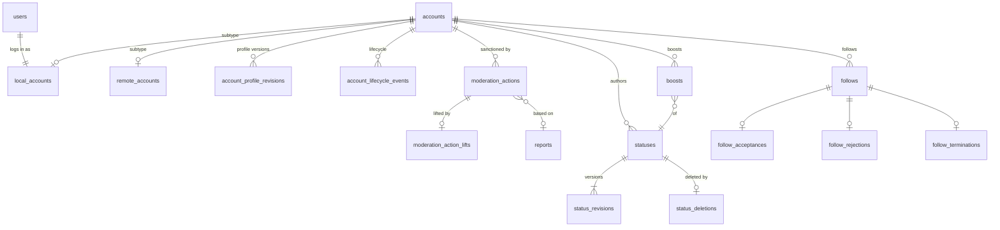
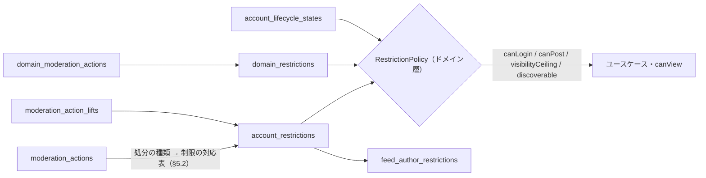

# 論理データモデル（v0）

> 方言に依存しない **論理スキーマ** です。方言別の `schema/<dialect>.sql` はこの文書に従って書き、乖離は CI で検査します（[ADR-0003](../adr/0003-database-abstraction.md)）。
> モデリングの規約は [ADR-0020](../adr/0020-data-modeling-principles.md)（リソース・イベント・投影の分離と、状態の直交分解）です。この文書はその適用結果です。
> 前提にしている ADR: [ADR-0002](../adr/0002-modular-monolith-hexagonal.md)、[ADR-0003](../adr/0003-database-abstraction.md)、[ADR-0004](../adr/0004-job-queue-abstraction.md)、[ADR-0007](../adr/0007-client-api.md)、[ADR-0013](../adr/0013-timeline-strategy.md)、[ADR-0017](../adr/0017-visibility-local.md)、[ADR-0018](../adr/0018-federated-uris.md)。
> v0 はマイグレーションを持たず作り直す前提です（[ADR-0012](../adr/0012-v0-breaking-change-policy.md)）。

## 1. 共通規約

### 1.1 テーブルの分類

すべてのテーブルに、次のいずれかの分類を付けます（ADR-0020 規約 1, 5）。各表の見出しの横に【分類】を記します。

| 分類 | 書き込み | 説明 |
| --- | --- | --- |
| 【リソース】 | INSERT のみ（消去ジョブによる物理削除を除く） | 識別子を持つ「もの」。作成時に決まる不変の事実だけを持つ |
| 【イベント】 | INSERT のみ | 起きた事実。**発生日時のカラムは 1 つだけ**（`*_at`）。訂正・取り消しは別のイベントで表す |
| 【投影】 | 所有モジュールの projector だけが UPSERT / DELETE | イベントから導出した現在値。§9 の再構築手順で作り直せる |
| 【現在値】 | 所有モジュールが UPSERT / DELETE | 履歴に意味がない高頻度の関係・設定値（ADR-0020 規約 5）。お気に入り・ミュート・利用者設定など |
| 【基盤】 | アダプタ | outbox・ジョブ・KV |

- 版（リビジョン）は【イベント】の一種です。「最新版」を頻繁に引くものは投影（`*_heads`）で指します。最新版を引く頻度が低いものは `(親, id DESC)` のインデックスで直接引きます。
- 期限（`expires_at`、`closes_at`）は「決定の内容」であって発生日時ではありません。イベントが持ってもよい属性です。

### 1.2 論理型

| 論理型 | 意味 | SQLite 系 | PostgreSQL 系 |
| --- | --- | --- | --- |
| `id` | UUIDv7 の正規形文字列（36 文字、小文字） | `TEXT` | `text COLLATE "C"`（照合順序に依らずバイト順 = 時刻順。`uuid` 型にするかは §11） |
| `string(n)` | 長さ上限つき文字列（上限はアプリで検証） | `TEXT` | `text` |
| `text` | 長文 | `TEXT` | `text` |
| `iri` | URL / ActivityPub の IRI（最大 2048 文字を想定） | `TEXT` | `text` |
| `int` / `bigint` | 整数 | `INTEGER` | `integer` / `bigint` |
| `real` | 倍精度の浮動小数点数（メディアの焦点など、誤差を許す量だけ） | `REAL` | `double precision` |
| `bool` | 真偽値 | `INTEGER`（0/1） | `boolean` |
| `timestamp` | UTC・ミリ秒精度の時刻 | `INTEGER`（Unix ミリ秒、#17 の推奨） | `timestamptz` |
| `lang` | BCP 47 言語タグ。不明は `und` | `TEXT` | `text` |
| `enum(…)` | 英小文字スネークケースの列挙 | `TEXT` + `CHECK` | `text` + `CHECK` |
| `bytes` | バイナリ（暗号化済みの秘密など） | `BLOB` | `bytea` |
| `document` | **解釈しない** JSON 文書（受信した AP 文書の原本など）。検索・制約・部分更新に使わない | `TEXT` | `jsonb` |

- 表記: カラムは特記がなければ `NOT NULL`。NULL 可のものは「NULL 可」と書きます。
  - **状態を NULL で表すことはしません**（ADR-0020 規約 4）。NULL 可は「任意の関連」（例: 通報に基づかない処分の `report_id`）と「無期限」（`expires_at`）に限ります。
- 名前: カラム・テーブルは英語スネークケースで、テーブル名は複数形です。
  - 大文字小文字を無視する値は正規化済みカラム（`*_normalized`）を別に持ち、そちらに一意制約を張ります。
  - ドメイン名は小文字・punycode で保存します。
- 「ローカル」を表すドメインは空文字 `''` です。NULL は一意制約上は互いに別の値として扱われるため、NULL では表しません。

### 1.3 ID とキーセットページング

- 主キーは UUIDv7 です（`IdGenerator` ポート、Go 1.27 の `uuid.NewV7()`）。辞書順と時刻順が一致するので、`ORDER BY id` がそのまま時系列になります。
- ページングは常にキーセット方式（`id < :cursor ORDER BY id DESC LIMIT :n + 1`）です。不透明なカーソルの中身はこの `id` です（ADR-0016）。
- リモート投稿の `id` は AP の `published` から生成します（未来の時刻は現在時刻に丸めます）。
- UUIDv7 は時刻から下限値を作れるので、`id >= uuidv7_floor(now - N days)` を読み取り量の上限として使えます（§6）。Go では `kernel.UUIDv7Floor` が下限値を返します。

### 1.4 参照と削除

- 参照は `xxx_id` による論理参照です。物理的な外部キーは同一モジュール内に限り任意で、モジュールをまたぐ参照には付けません。
  - Aurora DSQL も外部キーに対応した（#18）ため、同一モジュール内の外部キーは方言別スキーマで付ける方向で検討します（§11）。
- 削除の扱い（ADR-0020 規約 6）:
  - **論理的な削除は削除イベントで表します**（`status_deletions`、`account_lifecycle_events`）。
  - **物理削除は消去ジョブだけが行います**。個人データの行（本文・プロフィール・メールアドレス）を消し、投影を更新します。
  - 連合の重複排除に必要な URI は削除イベント側に残ります（tombstone を兼ねます）。

## 2. 整合性モデル

### 2.1 トランザクションの規律

ADR-0003（短く再実行可能なトランザクション、内部で外部 I/O をしない）と ADR-0020 規約 7 に従います。

- 1 つのコマンドは、**1 つのモジュールのリソース / イベント** を書き込みます。加えて、そのイベントを購読する **同期 projector**（自分の投影を更新）と `outbox_events` を、同じトランザクションで書きます。
- projector は購読するイベントの内容だけで投影を更新し、他モジュールのテーブルを読みません。必要な値はイベントに載せます。
- 同期 projector は起動時に `uow.Projectors` へイベント種別ごとに登録します。コマンドがトランザクション関数の中で `tx.Emit(ctx, event)` を呼ぶと、登録順に同じトランザクションで実行され、projector の失敗はコマンドごとロールバックします。
- 件数が利用者数・フォロワー数に比例する処理は、非同期 projector またはカーソル付きのジョブで、一定件数ずつ行います。
  - 該当するのは、配送先の展開・消去・アカウント単位の制限の全投稿への反映などです。
- 時刻と ID はトランザクション関数の外で一度だけ生成して渡します（再実行で値が変わらないように）。

| コマンド | 書き込むリソース / イベント | 同期で更新する投影 | outbox |
| --- | --- | --- | --- |
| 利用者登録 | `users`, `password_credentials`, `accounts`, `local_accounts`, `account_profile_revisions`, `account_keys`, `local_account_private_keys` | `account_handles`, `account_profile_heads` | なし |
| 投稿 | `statuses`, `local_statuses`, `status_revisions` と子テーブル | `status_heads`, `status_mention_index`, `status_reply_links`, `status_counters`, `feed_entries`, `feed_tag_entries`, `feed_direct_recipients`, `account_post_counters`, `notifications`（メンション） | 配送の展開 |
| 投稿の編集 | `status_revisions` と子テーブル | `status_heads`, `status_mention_index`, `feed_entries`（言語）, `feed_tag_entries`, `feed_direct_recipients`, `notifications`（増えたメンション） | `Update` の配送 |
| 投稿の削除 | `status_deletions` | `status_heads`, `status_mention_index`, `status_reply_links`, `status_counters`, `account_post_counters`, `boost_edges`, `feed_entries`, `feed_tag_entries`, `feed_direct_recipients` | `Delete` の配送 |
| ブースト | `boosts` | `boost_edges`, `feed_entries`, `status_counters`, `notifications` | `Announce` の配送（`local` 投稿のブーストは連合しない） |
| ブーストの取り消し | `boost_retractions` | `boost_edges`, `feed_entries`, `status_counters` | `Undo Announce` の配送（連合したブーストだけ） |
| お気に入り / 取り消し | `favourites`（現在値） | `status_counters`, `notifications`（お気に入りだけ） | `Like` / `Undo Like` の配送（リモートの投稿だけ） |
| ブックマーク・ピン留め / 取り消し | `bookmarks` / `status_pins`（現在値） | なし | なし |
| フォロー | `follows`（＋自動承認なら `follow_acceptances`） | `follow_edges`, `feed_follow_edges`, `follow_counters`, `notifications` | `Follow` / `Accept` の配送 |
| ブロック | `blocks`（＋両方向のフォローの `follow_terminations`） | `block_edges`, `follow_edges`, `feed_follow_edges`, `follow_counters` | `Block` の配送 |
| 処分 | `moderation_actions`（＋`moderation_action_statuses`） | `account_restrictions`, `feed_author_restrictions` | 通知・投稿の削除やセンシティブ化（大量なら非同期） |
| Inbox 処理 | `received_activities` と対象のリソース / イベント | 対象に応じて | 対象に応じて |

`queue/db` アダプタでは、outbox を経由せず同じトランザクションで `jobs` に挿入してもかまいません。

利用者登録は、ログイン主体（`identity`）とそれが名乗るアカウント（`account`）が片方だけ存在する状態を作らないよう、例外として 2 つのモジュールに書き込みます。
`identity` のコマンドが `account` のアプリケーション層の公開 API（`PrepareLocalAccount` / `WriteLocalAccount`）を同じトランザクションの中で呼び、`account` のテーブルは `account` のコードだけが書きます。
鍵の生成・暗号化とパスワードのハッシュ計算は、トランザクションの前に済ませます。

### 2.2 冪等キーと一意制約

| 対象 | キー | 用途 |
| --- | --- | --- |
| 受信アクティビティ | `received_activities (activity_uri)` | Inbox 処理の重複排除。`id` を持たないものは本文ダイジェストから合成する |
| AP オブジェクト | `accounts (uri)`, `statuses (uri)`, `boosts (uri)`, `follows (uri)`, `blocks (uri)`, `reports (uri)`, `poll_votes (uri)`, `custom_emojis (uri)` | 受信・取得の重複排除 |
| 版 | `status_revisions (status_id, seq)`, `account_profile_revisions (account_id, seq)` | 同じ `Update` の再処理を no-op にする。リモートの `updated` が現在版以下なら版を作らない |
| 状態遷移イベント | `follow_acceptances (follow_id)`, `follow_rejections (follow_id)`, `follow_terminations (follow_id)`, `boost_retractions (boost_id)`, `block_retractions (block_id)`, `moderation_action_lifts (action_id)` | 同じ遷移の二重記録を防ぐ（1 リソースにつき 1 回だけ起きる遷移は PK にする） |
| 1 回限りの引き換え | `oauth_authorization_code_redemptions (code_hash)`, `user_token_redemptions (token_id)`, `invite_redemptions (invite_id, seq)` | 条件付き UPDATE の代わりに、引き換えイベントの一意制約で 1 回性を保証する |
| クライアントからの投稿 | `local_statuses (author_account_id, idempotency_key)` | API の `Idempotency-Key`。再送には同じ投稿を返す |
| 通知 | `notifications (recipient_account_id, dedupe_key)` | 同じイベントの再処理や繰り返した操作で通知を増やさない（§4.7） |
| 配送 | `deliveries (outbound_activity_id, inbox_url)` | 展開ジョブの再実行で重複しない |
| ジョブ | `jobs (idempotency_key)` | 未完了のジョブの重複投入を no-op にする（ADR-0004） |

### 2.3 集計値

- カウンタは【投影】です。イベントを集計するモジュールが所有します。
  - `account_post_counters` と `status_counters` は `content`、`follow_counters` は `graph` が所有します。
- 加算・減算は、元のイベントが実際に挿入された（影響行数 = 1）ときだけ行います。
- ずれは定期ジョブ `projection.verify` が、イベントから数え直して補正します（§9）。
- リモートアカウントのフォロワー数などは、取得スナップショットの `totalItems` を表示に使います。ローカルのカウンタは「このインスタンスが知っている件数」として別に持ちます。

## 3. 概念モデル

### 3.1 モジュールと主な概念



### 3.2 イベントから投影への流れ（例: 処分）



## 4. モジュール別テーブル定義

### 4.0 所有モジュール

| モジュール | リソース / イベント | 投影 / 現在値 |
| --- | --- | --- |
| `identity` | `users`, `user_email_addresses`, `user_email_verifications`, `password_credentials`, `totp_enrollments`, `totp_enrollment_revocations`, `totp_recovery_codes`, `totp_recovery_code_uses`, `registration_applications`, `registration_decisions`, `invites`, `invite_redemptions`, `invite_revocations`, `user_tokens`, `user_token_redemptions`, `roles`, `role_permissions`, `user_role_grants`, `user_role_revocations`, `sessions`, `session_revocations`, `oauth_clients`, `oauth_client_redirect_uris`, `oauth_authorization_codes`, `oauth_authorization_code_redemptions`, `oauth_access_tokens`, `oauth_token_revocations`, `data_exports`, `data_export_results` | `user_primary_emails`, `user_registration_states`, `user_roles`, `user_preferences`, `user_timeline_languages`, `session_activity` |
| `account` | `accounts`, `local_accounts`, `remote_accounts`, `remote_account_snapshots`, `account_profile_revisions`, `account_profile_revision_sources`, `account_profile_fields`, `account_profile_field_verifications`, `account_keys`, `local_account_private_keys`, `account_key_revocations`, `account_lifecycle_events` | `account_handles`, `account_profile_heads`, `remote_account_heads`, `account_lifecycle_states` |
| `moderation` | `moderation_actions`, `moderation_action_statuses`, `moderation_action_lifts`, `moderation_appeals`, `moderation_appeal_decisions`, `domain_moderation_actions`, `domain_moderation_action_lifts`, `reports`, `report_statuses`, `report_rule_citations`, `report_assignments`, `report_resolutions`, `report_reopenings`, `report_notes`, `signup_blocks`, `signup_block_lifts` | `account_restrictions`, `domain_restrictions`, `report_states` |
| `content` | `statuses`, `local_statuses`, `status_revisions`, `status_revision_bodies`, `status_revision_sources`, `status_revision_attachments`, `status_revision_mentions`, `status_revision_tags`, `status_revision_emojis`, `status_deletions`, `boosts`, `boost_retractions`, `tags`, `media_files`, `uploaded_media`, `remote_media`, `media_processing_results`, `media_variants`, `custom_emojis`, `custom_emoji_images`, `polls`, `poll_options`, `poll_votes`, `poll_tally_observations`, `poll_tally_observation_counts` | `status_heads`, `status_reply_links`, `status_mention_index`, `status_sensitivity_overrides`, `boost_edges`, `status_counters`, `account_post_counters`, `poll_tallies`, `custom_emoji_settings`, `media_focus`, `remote_media_cache`, `favourites`, `bookmarks`, `status_pins` |
| `graph` | `follows`, `follow_acceptances`, `follow_rejections`, `follow_terminations`, `blocks`, `block_retractions` | `follow_edges`, `block_edges`, `follow_counters`, `follow_preferences`, `mutes`, `account_domain_mutes` |
| `timeline` | なし | `feed_entries`, `feed_direct_recipients`, `feed_tag_entries`, `feed_follow_edges`, `feed_exclusions`, `feed_author_restrictions`, `feed_domain_restrictions` |
| `notification` | `notifications`, `notification_dismissals` | `notification_read_markers`, `push_subscriptions`, `push_subscription_alerts` |
| `federation` | `received_activities`, `received_activity_documents`, `outbound_activities`, `deliveries`, `delivery_attempts`, `remote_instances`, `instance_nodeinfo_observations` | `instance_health` |
| `instance` | `instance_setting_revisions`, `instance_text_revisions`, `instance_rules`, `instance_rule_revisions`, `instance_rule_texts`, `instance_rule_retirements` | `instance_settings`, `instance_texts`, `instance_rule_heads` |
| 基盤 | — | `outbox_events`, `jobs`, `dead_jobs`, `kv_entries` |

### 4.1 identity

ログイン主体（`users`）を中心に、資格情報・メール・登録審査・権限・設定を、それぞれ独立した概念として持ちます。

#### users【リソース】

| カラム | 型 | 説明 |
| --- | --- | --- |
| `id` | `id` | PK |
| `created_at` | `timestamp` | |

ログイン主体の識別だけを持ちます。ローカルアカウントとの対応は `local_accounts.user_id` です。

#### メールアドレス

| テーブル | 分類 | カラム | 制約 |
| --- | --- | --- | --- |
| `user_email_addresses` | リソース | `id`, `user_id`, `address`（`string(320)`）, `address_normalized`, `added_at` | インデックス `(user_id, id)` |
| `user_email_verifications` | イベント | `email_address_id`（PK）, `verified_at` | 確認は 1 アドレスにつき 1 回 |
| `user_primary_emails` | 投影 | `user_id`（PK）, `email_address_id`, `address_normalized` | **一意 `(address_normalized)`**。ログイン時の照合とアドレスの重複防止 |

- メールアドレスの変更は、新しいアドレスの追加 → 確認 → 主アドレスの切り替え（投影の更新）で表します。古いアドレスは消去ジョブの対象です。

#### 資格情報

| テーブル | 分類 | カラム | 制約 |
| --- | --- | --- | --- |
| `password_credentials` | イベント（版） | `id`, `user_id`, `password_hash`（Argon2id の PHC 文字列）, `set_at` | インデックス `(user_id, id DESC)`。最新行が現在のパスワード。過去のハッシュは再利用防止に使え、保持期間後に消去する |
| `totp_enrollments` | イベント | `id`, `user_id`, `secret_enc`（`bytes`）, `enrolled_at` | インデックス `(user_id, id DESC)` |
| `totp_enrollment_revocations` | イベント | `enrollment_id`（PK）, `revoked_at` | 有効な登録 = 失効イベントの無い最新の登録 |
| `totp_recovery_codes` | リソース | `enrollment_id`, `code_hash` | PK `(enrollment_id, code_hash)` |
| `totp_recovery_code_uses` | イベント | `enrollment_id`, `code_hash`, `used_at` | PK `(enrollment_id, code_hash)`。挿入の成否で 1 回性を保証 |

#### 登録審査

| テーブル | 分類 | カラム | 制約 |
| --- | --- | --- | --- |
| `registration_applications` | リソース | `id`, `user_id`, `reason`（`text`、NULL 可）, `invite_id`（NULL 可）, `submitted_at` | 一意 `(user_id)` |
| `registration_decisions` | イベント | `id`, `application_id`, `decision`（`enum(approved, rejected)`）, `decided_by`（`enum(moderator, system)`）, `decided_by_user_id`（NULL 可）, `note`（NULL 可）, `decided_at` | インデックス `(application_id, id DESC)`。`open` / `invite` モードでは `system` が即時に承認する |
| `user_registration_states` | 投影 | `user_id`（PK）, `state`（`enum(pending, approved, rejected)`）, `since` | インデックス `(state, since)`（承認待ち一覧） |

#### 招待・1 回限りのトークン

| テーブル | 分類 | カラム | 制約 |
| --- | --- | --- | --- |
| `invites` | リソース | `id`, `code`, `created_by_user_id`, `max_uses`（NULL 可 = 無制限）, `expires_at`（NULL 可）, `created_at` | 一意 `(code)` |
| `invite_redemptions` | イベント | `invite_id`, `seq`（`int`、1 始まり）, `user_id`, `redeemed_at` | PK `(invite_id, seq)`。`seq = 既存件数 + 1` で挿入し、一意制約違反なら再試行する。`seq > max_uses` は拒否する |
| `invite_revocations` | イベント | `invite_id`（PK）, `revoked_by_user_id`, `revoked_at` | |
| `user_tokens` | リソース | `id`, `user_id`, `purpose`（`enum(email_verification, password_reset)`）, `email_address_id`（NULL 可）, `token_hash`, `expires_at`, `issued_at` | 一意 `(token_hash)` |
| `user_token_redemptions` | イベント | `token_id`（PK）, `redeemed_at` | |

#### 権限

固定の `role` enum ではなく、ロールと権限を分けます。組み込みロールは起動時に冪等に作ります（`roles (key)` の一意制約で重複しない）。
`admin`（`position` 1000）はすべての権限、`moderator`（`position` 100）は `manage_reports`・`manage_accounts`・`view_audit` を持ちます。

| テーブル | 分類 | カラム | 制約 |
| --- | --- | --- | --- |
| `roles` | リソース | `id`, `key`（`string(64)`）, `position`（`int`）, `created_at` | 一意 `(key)` |
| `role_permissions` | 現在値 | `role_id`, `permission`（`enum(manage_reports, manage_accounts, manage_domains, manage_rules, manage_settings, manage_roles, manage_invites, view_audit)`） | PK `(role_id, permission)` |
| `user_role_grants` | イベント | `id`, `user_id`, `role_id`, `granted_by_user_id`（NULL 可 = CLI による付与。最初の管理者など）, `granted_at` | |
| `user_role_revocations` | イベント | `grant_id`（PK）, `revoked_by_user_id`（NULL 可 = CLI による剥奪）, `revoked_at` | |
| `user_roles` | 投影 | `user_id`, `role_id`, `grant_id` | PK `(user_id, role_id)` |

#### セッション・OAuth

| テーブル | 分類 | カラム | 制約 |
| --- | --- | --- | --- |
| `sessions` | リソース | `id`, `user_id`, `token_hash`（`bytes`。Cookie の値の SHA-256）, `user_agent`（`string(512)`、NULL 可）, `ip`（NULL 可）, `created_at`, `expires_at` | 一意 `(token_hash)` |
| `session_revocations` | イベント | `session_id`（PK）, `reason`（`enum(logout, replaced, password_changed, moderation, expired_cleanup)`）, `revoked_at` | 有効なセッション = 失効イベントが無く `expires_at` を過ぎていないもの。`replaced` は同じブラウザでのログインし直し |
| `session_activity` | 現在値 | `session_id`（PK）, `last_seen_at` | ログイン時に作り、以後の更新は 1 時間に 1 回に間引く |
| `oauth_clients` | リソース | `id`, `client_id`, `client_secret_hash`（NULL 可 = 公開クライアント）, `name`, `website`（NULL 可）, `scope`, `is_first_party`, `owner_user_id`（NULL 可）, `created_at` | 一意 `(client_id)` |
| `oauth_client_redirect_uris` | リソース | `client_id`, `redirect_uri` | PK `(client_id, redirect_uri)`。完全一致で照合する |
| `oauth_authorization_codes` | リソース | `code_hash`（PK）, `client_id`, `user_id`, `redirect_uri`, `scope`, `code_challenge`, `issued_at`, `expires_at` | |
| `oauth_authorization_code_redemptions` | イベント | `code_hash`（PK）, `redeemed_at` | |
| `oauth_access_tokens` | リソース | `id`, `client_id`, `user_id`, `access_token_hash`, `refresh_token_hash`（NULL 可）, `scope`, `rotated_from_token_id`（NULL 可）, `issued_at`, `expires_at` | 一意 `(access_token_hash)`, `(refresh_token_hash)` |
| `oauth_token_revocations` | イベント | `token_id`（PK）, `reason`（`enum(user, rotation, password_changed, moderation)`）, `revoked_at` | |

- セッションは、サーバーが返す画面（ログイン・登録・認可同意）の Cookie `__Host-my_session` です（ADR-0019 §4、ADR-0030）。
  ログインのたびに新しいトークンを発行し、ブラウザが持っていた古いセッションは `replaced` で失効させます。
- `scope` は RFC 6749 の scope 文字列（空白区切り・ソート済みの正規形）です。照合は文字列全体で行い、個々のスコープの検索には使わないため、1 カラムで持ちます。

#### 利用者設定【現在値】

| テーブル | カラム | 制約 |
| --- | --- | --- |
| `user_preferences` | `user_id`（PK）, `locale`（`lang`）, `time_zone`（IANA 名）, `default_visibility`（`enum(public, local, unlisted, private, direct)`）, `default_post_language`（`lang`）, `require_media_description`（`bool`）, `updated_at` | |
| `user_timeline_languages` | `user_id`, `language`（`lang`） | PK `(user_id, language)`。行が無ければすべての言語を表示（FR-208） |

- 登録時に既定値の行を作ります。`locale` は登録時に指定されたロケール、無ければインスタンスの既定（`default_locale`）、それも無ければ `en` です。
  `time_zone` は `UTC`、`default_visibility` は `public`、`default_post_language` は `und`（クライアントに任せる）、`require_media_description` は偽です。
- `lang` の値は BCP 47 として検証し、正規形（`ja-JP`、`zh-Hant-TW`、`iw` → `he`）で保存します。未知のサブタグ、言語を明示しないタグ（`und-JP`、私用の `x-…`）は拒否します。
  `locale` は `und` も拒否します。
- `time_zone` は IANA タイムゾーンデータベースにある名前だけを受け付けます（`Local` や `+09:00` は不可）。サーバーのバイナリはデータベースを埋め込む（Go の `time/tzdata`）ので、検証結果はホストに依存しません。
- `user_timeline_languages` は 1 回の設定で全体を置き換えます（重複を除き、上限 64 件）。

#### データエクスポート

| テーブル | 分類 | カラム |
| --- | --- | --- |
| `data_exports` | リソース | `id`, `user_id`, `requested_at` |
| `data_export_results` | イベント | `export_id`（PK）, `outcome`（`enum(ready, failed)`）, `blob_key`（NULL 可）, `file_size`（NULL 可）, `expires_at`（NULL 可）, `completed_at` |

### 4.2 account

ローカル・リモートの Actor です。識別（`accounts`）、部分型、プロフィール（版）、ライフサイクル（イベント）を分けます。

#### accounts【リソース】と部分型

| テーブル | 分類 | カラム | 制約 |
| --- | --- | --- | --- |
| `accounts` | リソース | `id`, `uri`, `domain`（`''` = ローカル）, `actor_type`（`enum(person, service, application, group, organization)`）, `created_at` | 一意 `(uri)`。インデックス `(domain, id)`。部分一意 `(domain, actor_type) WHERE domain = '' AND actor_type = 'application'`（インスタンス Actor は 1 つ） |
| `local_accounts` | リソース（部分型） | `account_id`（PK）, `user_id`, `username`, `username_normalized` | 一意 `(user_id)`, `(username_normalized)`。ローカルのユーザー名は変更しない（URI は ID ベースだが、ハンドルの再利用による混乱を避けるため） |
| `remote_accounts` | リソース（部分型） | `account_id`（PK）, `first_seen_at` | |
| `remote_account_snapshots` | イベント | `id`, `account_id`, `preferred_username`, `inbox_url`, `shared_inbox_url`（NULL 可）, `outbox_url`, `followers_url`, `following_url`, `featured_url`（NULL 可）, `followers_total` / `following_total` / `statuses_total`（`bigint`、NULL 可）, `document_digest`, `fetched_at` | インデックス `(account_id, id DESC)`。取得のたびに 1 行。内容（ダイジェスト）が前回と同じなら挿入しない |
| `remote_account_heads` | 投影 | `account_id`（PK）, `snapshot_id`, `inbox_url`, `shared_inbox_url`, `last_fetched_at`, `consecutive_fetch_failures`（`int`） | インデックス `(last_fetched_at)`（定期リフレッシュ） |
| `account_handles` | 投影 | `account_id`（PK）, `username`, `username_normalized`, `domain` | **一意 `(username_normalized, domain)`**。WebFinger・`@user@host` の解決（FR-305, FR-401）。ローカルは `local_accounts`、リモートは最新スナップショットから作る |

- インスタンス自身の Actor（`Application`）もローカルの `accounts` に 1 行持ちます（`local_accounts` と `account_handles` には入れません）。
  ローカルの `application` はこの 1 行だけなので、部分一意インデックスで二重作成を防ぎ、作成を冪等にします。
- ローカルアカウントの `uri` は `https://{host}/ap/actors/{id}`（ADR-0018）です。ハンドルの `domain` は `account_domain` ではなく `''` です（設定値に依存させない）。
- リモートのハンドルが変わった場合、同じハンドルを別の Actor が後から名乗ることがあります。そのとき投影の一意制約で衝突したら、古い側を再取得して解消するジョブを入れます。

#### プロフィール【イベント（版）】

| テーブル | 分類 | カラム | 制約 |
| --- | --- | --- | --- |
| `account_profile_revisions` | イベント | `id`, `account_id`, `seq`, `display_name`, `note_html`, `locked`, `bot`, `discoverable`, `indexable`（`bool`）, `avatar_media_id` / `header_media_id`（NULL 可）, `revised_at` | 一意 `(account_id, seq)` |
| `account_profile_revision_sources` | イベント（部分型） | `revision_id`（PK）, `note_source` | ローカルのみ。入力されたままの自己紹介 |
| `account_profile_fields` | イベント（版の子） | `revision_id`, `position`（`int`）, `name`, `value_html` | PK `(revision_id, position)`（FR-006） |
| `account_profile_field_verifications` | イベント | `revision_id`, `position`, `verified_at` | PK `(revision_id, position)`。`rel="me"` リンクの検証結果 |
| `account_profile_heads` | 投影 | `account_id`（PK）, `revision_id` | `seq` が最大の版を指す |

- 鍵アカウント（`locked`）・bot などのフラグはプロフィールの一部として版を持ちます。いつから鍵アカウントだったかが分かります。
- 新しい版の `seq` は現在の版の `seq + 1` です。同時に版を作って `(account_id, seq)` が衝突したら、トランザクションを再実行して次の `seq` を取ります。
- ローカルアカウントは作成時に `seq = 1` の版を持ちます。
- リモートのプロフィールは、取得した文書から版を作ります（内容が変わったときだけ）。

#### 署名鍵

| テーブル | 分類 | カラム | 制約 |
| --- | --- | --- | --- |
| `account_keys` | リソース | `id`, `account_id`, `key_id`（`iri`）, `algorithm`（`enum(rsa_sha256, ed25519)`）, `public_key_pem`（PKIX の `PUBLIC KEY`）, `created_at` | 一意 `(key_id)`。インデックス `(account_id)` |
| `local_account_private_keys` | リソース（部分型） | `account_key_id`（PK）, `private_key_enc`（`bytes`） | NFR-SEC-7。リストア後も変わらないこと（NFR-REL-4） |
| `account_key_revocations` | イベント | `account_key_id`（PK）, `revoked_at` | |

- ローカルの Actor（インスタンス Actor を含む）は、作成時に RSA 2048 ビット（`rsa_sha256`、`key_id` = `{actor}#main-key`）と Ed25519（`ed25519`、`key_id` = `{actor}#ed25519-key`）の 2 つの鍵を持ちます。
- `private_key_enc` は PKCS #8 の秘密鍵を `kernel.Sealer` で暗号化した値です（ADR-0019 §6）。AAD は `account_key_id` と列名 `local_account_private_keys.private_key_enc` で、別の行・列に写すと復号できません。

#### ライフサイクル

| テーブル | 分類 | カラム | 制約 |
| --- | --- | --- | --- |
| `account_lifecycle_events` | イベント | `id`, `account_id`, `kind`（`enum(deactivated, reactivated, deletion_scheduled, deletion_cancelled, deleted, remote_deleted)`）, `initiated_by`（`enum(self, moderator, system, remote)`）, `moderation_action_id`（NULL 可）, `deletion_due_at`（NULL 可。`deletion_scheduled` のみ）, `occurred_at` | インデックス `(account_id, id DESC)` |
| `account_lifecycle_states` | 投影 | `account_id`（PK）, `state`（`enum(active, deactivated, deletion_scheduled, deleted)`）, `since`, `deletion_due_at`（NULL 可） | インデックス `(state, deletion_due_at)`（削除の実行） |

- **ライフサイクルは本人とシステムの軸** です。モデレーションの処分は別の軸（§4.3）に置きます。
  - BAN のように処分が削除を伴う場合は、処分が `deletion_scheduled` イベントを `initiated_by = moderator` で発生させます（`moderation_action_id` で根拠を辿れる）。
- 行が無いアカウントは `active` とみなします。作成時には行を作らず、最初のライフサイクルイベントで作ります（イベントからの再構築と一致させるため）。
- 投影はイベントを `id` 順に畳み込んで作ります: `deactivated` → `deactivated`、`reactivated` / `deletion_cancelled` → `active`、`deletion_scheduled` → `deletion_scheduled`（`deletion_due_at` を写す）、`deleted` / `remote_deleted` → `deleted`。`deleted` は最終状態で、以後のイベントでは変わりません。`since` は最後に状態を変えたイベントの `occurred_at` です。
- `deletion_due_at` は、イベントでは `kind = deletion_scheduled` のとき、投影では `state = deletion_scheduled` のときだけ値を持ちます（`CHECK` 制約）。

### 4.3 moderation

#### 処分【イベント】

| テーブル | 分類 | カラム | 制約 |
| --- | --- | --- | --- |
| `moderation_actions` | イベント | `id`, `target_account_id`, `kind`（§5.2 の enum）, `reason_category`（`enum(spam, legal, violation, other)`）, `public_reason`（`text`、NULL 可。本人に見せる理由）, `private_note`（`text`、NULL 可）, `report_id`（NULL 可）, `issuer`（`enum(moderator, system, remote)`）, `issued_by_user_id`（NULL 可）, `notify_target`（`bool`）, `expires_at`（NULL 可 = 無期限）, `issued_at` | インデックス `(target_account_id, id DESC)`, `(report_id)` |
| `moderation_action_statuses` | イベント（子） | `action_id`, `status_id` | PK `(action_id, status_id)`。投稿単位の処分（`delete_statuses` / `mark_statuses_sensitive`）の対象 |
| `moderation_action_lifts` | イベント | `action_id`（PK）, `lifted_by_user_id`（NULL 可 = システム）, `reason`（`text`、NULL 可）, `lifted_at` | 期限切れは「解除」ではないので記録しない（投影の読み取り時に期限で判定） |
| `moderation_appeals` | リソース | `id`, `action_id`, `body`, `submitted_at` | 一意 `(action_id)`（S/C） |
| `moderation_appeal_decisions` | イベント | `appeal_id`（PK）, `decision`（`enum(upheld, overturned)`）, `decided_by_user_id`, `decided_at` | 覆った場合は同じトランザクションで `moderation_action_lifts` も記録する |

#### 制限【投影】

| テーブル | カラム | 制約 |
| --- | --- | --- |
| `account_restrictions` | `account_id`, `restriction`（§5.2 の能力の enum）, `source_action_id`, `effective_until`（NULL 可 = 無期限） | PK `(account_id, restriction, source_action_id)`。読み取りは `WHERE account_id = ? AND (effective_until IS NULL OR effective_until > :now)` |

- 1 つの処分は複数の制限を生みます（例: サイレンス → 3 つの制限、§5.2）。
- 複数の処分が重なった場合は、制限の和集合になります。解除すると、その処分由来の行だけが消えます。期限切れの行は、読み取り時の条件で無効になり、定期ジョブで掃除します。

#### ドメイン単位の処分

| テーブル | 分類 | カラム | 制約 |
| --- | --- | --- | --- |
| `domain_moderation_actions` | イベント | `id`, `domain`, `kind`（`enum(limit, suspend, reject_media, reject_reports, force_sensitive)`）, `public_comment` / `private_note`（NULL 可）, `obfuscate`（`bool`）, `issued_by_user_id`, `expires_at`（NULL 可）, `issued_at` | インデックス `(domain, id DESC)` |
| `domain_moderation_action_lifts` | イベント | `action_id`（PK）, `lifted_by_user_id`, `lifted_at` | |
| `domain_restrictions` | 投影 | `domain`, `restriction`, `source_action_id`, `effective_until`（NULL 可） | PK `(domain, restriction, source_action_id)` |

- サブドメインにも効きます。判定は、対象ドメインとその親ドメイン群を列挙して `domain IN (…)` で引きます。
- ドメイン単位の制限を各アカウントの行に展開することはしません（件数が膨らむため）。判定時に `account_restrictions` と合成します（§5.3）。

#### 通報

| テーブル | 分類 | カラム | 制約 |
| --- | --- | --- | --- |
| `reports` | リソース | `id`, `uri`（NULL 可。受信した `Flag`）, `reporter_account_id`, `target_account_id`, `category`（`enum(spam, legal, violation, other)`）, `comment`, `forwarded`（`bool`）, `filed_at` | 一意 `(uri)`。インデックス `(target_account_id, id)` |
| `report_statuses` | リソース（子） | `report_id`, `status_id` | PK `(report_id, status_id)` |
| `report_rule_citations` | リソース（子） | `report_id`, `rule_id` | PK `(report_id, rule_id)`。ルールの文言が改訂されても `rule_id` は変わらない（§4.9） |
| `report_assignments` | イベント | `id`, `report_id`, `assignee_user_id`（NULL 可 = 担当解除）, `assigned_by_user_id`, `assigned_at` | インデックス `(report_id, id DESC)` |
| `report_resolutions` | イベント | `id`, `report_id`, `outcome`（`enum(actioned, dismissed)`）, `resolved_by_user_id`, `resolved_at` | 処分との関連は `moderation_actions.report_id` で辿る |
| `report_reopenings` | イベント | `id`, `report_id`, `reopened_by_user_id`, `reopened_at` | |
| `report_notes` | イベント | `id`, `report_id`, `author_user_id`, `body`, `written_at` | |
| `report_states` | 投影 | `report_id`（PK）, `state`（`enum(open, resolved)`）, `assignee_user_id`（NULL 可）, `since` | インデックス `(state, report_id)`（未解決一覧） |

#### 登録の拒否リスト（C）

| テーブル | 分類 | カラム |
| --- | --- | --- |
| `signup_blocks` | イベント | `id`, `kind`（`enum(email_domain, email_hash, ip_range)`）, `value`, `moderation_action_id`（NULL 可。BAN から作られた場合）, `created_by_user_id`, `created_at` |
| `signup_block_lifts` | イベント | `block_id`（PK）, `lifted_by_user_id`, `lifted_at` |

### 4.4 content

#### 投稿【リソース】と版【イベント】

| テーブル | 分類 | カラム | 制約 |
| --- | --- | --- | --- |
| `statuses` | リソース | `id`, `uri`, `url`（NULL 可）, `author_account_id`, `is_local`（`bool`）, `visibility`（`enum(public, local, unlisted, private, direct)`）, `in_reply_to_uri`（NULL 可）, `conversation_uri`（NULL 可）, `published_at` | 一意 `(uri)`。インデックス `(author_account_id, id)`, `(in_reply_to_uri)`, `(conversation_uri, id)`。CHECK `visibility <> 'local' OR is_local` |
| `local_statuses` | リソース（部分型） | `status_id`（PK）, `author_account_id`, `client_id`（NULL 可）, `idempotency_key`（NULL 可） | 一意 `(author_account_id, idempotency_key)` |
| `status_revisions` | イベント（版） | `id`, `status_id`, `seq`（`int`、1 始まり）, `spoiler_text`, `sensitive`（`bool`）, `language`（`lang`）, `revised_at` | 一意 `(status_id, seq)` |
| `status_revision_bodies` | イベント（版の子） | `revision_id`, `language`（`lang`）, `content_html` | PK `(revision_id, language)`。AP の `contentMap` を正規化したもの。`content` だけのものは版の `language` で 1 行（NFR-I18N-5） |
| `status_revision_sources` | イベント（部分型） | `revision_id`（PK）, `source_text`, `source_format`（`enum(text_plain)`） | ローカル投稿の入力ソース |
| `status_revision_attachments` | イベント（版の子） | `revision_id`, `position`（`int`、0〜3）, `media_id`, `description`（`text`、NULL 可） | PK `(revision_id, position)`。代替テキストは版ごと（編集で直せる） |
| `status_revision_mentions` | イベント（版の子） | `revision_id`, `account_id` | PK `(revision_id, account_id)` |
| `status_revision_tags` | イベント（版の子） | `revision_id`, `tag_id` | PK `(revision_id, tag_id)` |
| `status_revision_emojis` | イベント（版の子） | `revision_id`, `emoji_id` | PK `(revision_id, emoji_id)` |
| `status_deletions` | イベント | `status_id`（PK）, `uri`, `author_account_id`, `origin`（`enum(author, moderation, remote, account_deletion)`）, `moderation_action_id`（NULL 可）, `deleted_at` | 一意 `(uri)`。tombstone を兼ねる（遅れて届いた `Create` / `Update` で復活させない。GET には `410 Gone`） |

- **公開範囲・作者・返信先・公開日時は投稿の不変の事実** です。変わり得る本文・CW・言語・添付・メンション・タグは版に置きます（FR-109）。
- 返信先は `in_reply_to_uri`（不変の事実）だけを持ちます。親の `status_id` は `statuses (uri)` で引けるため保存しません。
  親を後から取得しても、投稿の行を更新する必要はありません。スレッド表示を速くするために、投影 `status_reply_links` を持ちます。
- ローカル投稿も `uri` を生成して保存します（ADR-0018 の規約）。

#### 投稿の投影

| テーブル | カラム | 制約 / 用途 |
| --- | --- | --- |
| `status_heads` | `status_id`（PK）, `revision_id`, `seq`, `last_revised_at` | 現在版（`seq` が最大の版）。`seq > 1` なら編集済み |
| `status_reply_links` | `status_id`（PK）, `parent_status_id`, `parent_author_account_id` | インデックス `(parent_status_id, status_id)`（返信一覧）。親が既知になった時点で作る |
| `status_mention_index` | `account_id`, `status_id` | PK `(account_id, status_id)`、インデックス `(status_id)`（編集・削除での置き換え）。現在版のメンション（`direct` の閲覧判定・メンション通知） |
| `status_sensitivity_overrides` | `status_id`, `source_action_id` | PK `(status_id, source_action_id)`。モデレーションによる強制センシティブ |
| `status_counters` | `status_id`（PK）, `replies_count`, `boosts_count`, `favourites_count`（`bigint`） | §2.3 |
| `account_post_counters` | `account_id`（PK）, `statuses_count`（`bigint`、1 以上）, `last_status_at` | §2.3。投稿が 0 件のアカウントは行を持たない |

- 投稿の投影は **削除されていない投稿だけ** を対象にします。削除イベントを記録したトランザクションで、その投稿の `status_heads`・`status_mention_index`・`status_counters`・`status_reply_links`（返信としての行と、親としての行の両方）を消します。削除された投稿への遅れた版は投影に反映しません。
- `status_reply_links` は、返信と親の両方が既知で、どちらも削除されていないときに 1 行です。返信が先に届いた場合は、親の投稿のトランザクションで `statuses (in_reply_to_uri)` から返信を引いてつなぎます。
- `replies_count` は、つながった返信のうち公開範囲が `public` / `local` / `unlisted` のものを数えます。`private` / `direct` の返信は、件数からも存在が分からないように数えません。
- `account_post_counters` は削除されていない投稿の件数と、その中で最新の `published_at` です。後から届いた古いリモート投稿では `last_status_at` は戻りません。投稿を削除したときは、残りの投稿から `last_status_at` を取り直します。
- 再構築（§9）は、各投影を空にして `statuses`・`status_revisions` と子テーブル・`status_deletions` から 1 つの SQL で作り直します。projector と同じ規則を SQL で書いたもので、両者の一致をコントラクトテストの性質テストで確かめます。

#### ローカル投稿のコマンド

ローカルの投稿・編集・削除は `internal/app/content` の `Service`（`Create` / `Edit` / `Delete`）が行います。

- **本文**: 利用者が書いたプレーンテキストを `status_revision_sources` にそのまま保存し、サーバーが HTML を生成して `status_revision_bodies` に保存します（ADR-0019 §2）。
  - 生成する HTML は `p`、`br`、`span[class]`、`a[href, class, rel, target]` だけで、テキストはすべてエスケープします。リンクには `rel="nofollow noopener noreferrer"` と `target="_blank"` を付けます。
  - メンション `@user`（`@user@{account_domain}`・`@user@{host}` も同じ）は、`account` の公開 API で引いたローカルの `active` なアカウントだけをリンクにし、版の `status_revision_mentions` に記録します。それ以外のドメインのハンドルはテキストのままです。
  - ハッシュタグ `#name` は、NFKC + 小文字化した名前で `tags` を引き（無ければ作り）、版の `status_revision_tags` に記録します。リンク先は `https://{host}/tags/{正規化した名前}` です。
  - `http` / `https` の URL だけを自動リンクにします。URL は空白・非 ASCII 文字・`<>"` などで終わり、末尾の句読点と対応しない閉じ括弧は含めません。
- **文字数**: 本文と CW の文字数（Unicode のコードポイント数）の合計が、インスタンス設定 `max_status_length` 以下でなければなりません。設定はコマンドごとに `instance` の公開 API から読みます。
- **公開範囲**: 要求された公開範囲を、`RestrictionPolicy` が返す上限で切り詰めて `statuses.visibility` に記録します（§5.4）。`post` の制限があれば投稿と編集を拒否します。削除は制限されません。
- **言語**: 要求が無ければ利用者設定の `default_post_language`、それも無ければ `und` です。
- **返信**: 返信先は、投稿者が `CanView` で見られる削除されていない投稿だけです。見られない・存在しない・削除済みは同じエラーにします。`conversation_uri` は返信先のものを引き継ぎ、返信でない投稿は自分の `uri` です。
- **冪等キー**: `Idempotency-Key` を受け取ったら `local_statuses (author_account_id, idempotency_key)` で同じ作者の投稿を引き、あればそれを返します。同時に届いた再送は一意制約で 1 つだけが成功し、残りは成功した投稿を返します。削除済みの投稿のキーはエラーにします。
- **編集**: 現在版の `seq + 1` で新しい版を作ります（FR-109）。公開範囲・作者・返信先は変わりません。
- **削除**: `status_deletions`（`origin = author`）を記録し、同じトランザクションで投影から外します。

コマンドは、記録したイベントに応じて次のドメインイベントを 1 つ発行します（`tx.Emit`、§2.1）。
購読する projector はイベントの内容（投稿の行・版と子テーブルの値・削除の行）だけで投影を更新します。

| ドメインイベント | 発行するとき | 載せるもの | `content` の投影 | 想定する購読者 |
| --- | --- | --- | --- | --- |
| `content.status_created` | 投稿 | 投稿、最初の版 | `status_heads`、`status_mention_index`、`status_reply_links`、`status_counters`、`account_post_counters` | `feed_entries`・`feed_tag_entries`・`feed_direct_recipients`、通知 `mention` |
| `content.status_revised` | 編集 | 投稿、新しい版 | `status_heads`、`status_mention_index` | `feed_entries`（言語）・`feed_tag_entries`・`feed_direct_recipients`、通知 `mention`（編集で増えたメンション） |
| `content.status_deleted` | 削除 | 投稿、削除の行 | すべての投稿の投影から外す、`account_post_counters` 減算 | `feed_*` から外す |

#### ブースト

| テーブル | 分類 | カラム | 制約 |
| --- | --- | --- | --- |
| `boosts` | リソース | `id`, `uri`（`Announce` の IRI）, `booster_account_id`, `status_id`, `visibility`（元投稿の値を写す。不変）, `is_local`（ブーストした人がローカルか）, `boosted_at` | 一意 `(uri)`。インデックス `(status_id)`（件数の再集計）。CHECK `visibility <> 'local' OR is_local` |
| `boost_retractions` | イベント | `boost_id`（PK）, `origin`（`enum(booster, status_deleted, moderation, remote)`）, `retracted_at` | |
| `boost_edges` | 投影 | `booster_account_id`, `status_id`, `boost_id` | PK `(booster_account_id, status_id)`、インデックス `(status_id)`（投稿の削除での除去）。有効なブーストは 1 人 1 投稿につき 1 つ。取り消し後の再ブーストは新しい `boosts` 行 |

- `local` 投稿のブーストは連合しません（ADR-0017）。写した `visibility = 'local'` がその印です。`local` 投稿のブーストはこのサーバーのアカウントだけが作るので、`boosts.is_local` は常に真です（CHECK）。配送ジョブは作りません（`content.Boost.Federates`）。
- ブーストできるのは、閲覧できる（`canView`）投稿のうち `public` / `local` / `unlisted` のものです。`private` は作者本人だけが自分のフォロワーへブーストでき、`direct` は誰もブーストできません。
- `boost_edges` は、取り消されていないブーストのうち、元投稿が削除されていないものを持ちます。投稿の削除イベントを記録したトランザクションで、その投稿の行を消します（取り消しイベントは作りません）。
- `status_counters.boosts_count` は `boost_edges` の行を挿入・削除したときだけ増減し、`favourites_count` は `favourites` の行を実際に挿入・削除したときだけ増減します（§2.3）。再構築は、取り消されていない `boosts` と `favourites` の件数を数えます。
- 同じ組への同時のブーストは、後の方が `boost_edges` の主キーで再実行され、既存のブーストを返します。同時の取り消しは、後の方が `boost_retractions` の主キーで再実行され、何もしません。

ブースト・お気に入りのコマンドは、行を実際に書いたときだけ次のドメインイベントを 1 つ発行します（`tx.Emit`、§2.1）。ブックマークとピン留めは本人だけのものなので、イベントを発行しません。

| ドメインイベント | 発行するとき | `content` の投影 | 想定する購読者 |
| --- | --- | --- | --- |
| `content.boosted` | ブーストの作成 | `boost_edges`、`boosts_count` 加算 | `feed_entries`（`kind = boost`）、通知 `boost`、`Federates` なら `Announce` の配送 |
| `content.boost_retracted` | 有効なブーストの取り消し | `boost_edges` から削除、`boosts_count` 減算 | `feed_entries` から削除、連合したブーストなら `Undo Announce` の配送 |
| `content.favourited` | お気に入りの追加 | `favourites_count` 加算 | 通知 `favourite`、リモートの投稿なら `Like` の配送 |
| `content.unfavourited` | お気に入りの削除 | `favourites_count` 減算 | リモートの投稿なら `Undo Like` の配送 |

#### メディア

| テーブル | 分類 | カラム | 制約 |
| --- | --- | --- | --- |
| `media_files` | リソース | `id`, `owner_account_id`, `origin`（`enum(upload, remote)`）, `created_at` | インデックス `(owner_account_id, id)` |
| `uploaded_media` | リソース（部分型） | `media_id`（PK）, `blob_key`, `content_type`, `file_size`（`bigint`） | |
| `remote_media` | リソース（部分型） | `media_id`（PK）, `remote_url` | 一意 `(remote_url)` |
| `media_processing_results` | イベント | `id`, `media_id`, `outcome`（`enum(ready, failed)`）, `media_type`（`enum(image, gifv, video, audio, unknown)`）, `width` / `height` / `duration_ms`（NULL 可）, `blurhash`（NULL 可）, `processed_at` | インデックス `(media_id, id DESC)`。最新行が現在の処理結果 |
| `media_variants` | イベント（結果の子） | `result_id`, `kind`（`enum(full, thumbnail)`）, `blob_key`, `content_type`, `file_size`（`bigint`）, `width` / `height`（`int`） | PK `(result_id, kind)` |
| `media_focus` | 現在値 | `media_id`（PK）, `focus_x` / `focus_y`（`real`、-1.0〜1.0） | 行がなければ中央 |
| `remote_media_cache` | 現在値（キャッシュ） | `url`（PK）, `blob_key`, `content_type`, `file_size`, `fetched_at`, `expires_at`, `last_accessed_at` | FR-409, NFR-COST-4。インデックス `(expires_at)`, `(last_accessed_at)` |

- アップロードは同期で受け付けます。形式は中身から判定し（申告された `Content-Type` とファイル名は信用しない）、サイズと寸法の上限は全体をデコードする前にヘッダで検査します（ADR-0019 §8）。
  `uploaded_media.content_type` は判定した形式で、`blob_key`（`uploads/<id>`）は受け取ったままの非公開のファイルです。
- 処理はジョブ `media.process` が非同期に行います。再エンコードでメタデータ（EXIF の位置情報など）を落とした `media_variants` を公開のキー（`media/<id>/full.<ext>`, `media/<id>/thumbnail.<ext>`）に書き、結果を記録してから受け取ったままのファイルを Blob から削除します（位置情報を残さない）。
  ジョブは冪等です。結果のあるファイルは受け取ったままのファイルの削除だけを繰り返し、消去済みのファイルは何もしません。処理できない中身は `outcome = failed`（版なし）の結果として記録します。
- `width` / `height` は EXIF の向きを適用した元画像の寸法です。`media_variants` の寸法は各版の実寸です。
- 未添付のアップロード（どの版からも参照されず、`account_profile_revisions` のアバター・ヘッダーにも使われていない `media_files`）は、
  作成から `media_unattached_ttl`（既定 24 時間）後に、1 時間ごとの消去ジョブ `media.cleanup` が行と Blob ごと削除します（FR-803）。
  アバター・ヘッダーの参照は `account` モジュールの公開 API で問い合わせます。削除は同じトランザクションで添付の有無を再検査します。

#### タグ・カスタム絵文字・投票

| テーブル | 分類 | カラム | 制約 |
| --- | --- | --- | --- |
| `tags` | リソース | `id`, `name`（最初に使われた表記）, `name_normalized`（NFKC + 小文字化）, `created_at` | 一意 `(name_normalized)` |
| `custom_emojis` | リソース | `id`, `shortcode`, `domain`, `uri`（NULL 可）, `created_at` | 一意 `(shortcode, domain)`, `(uri)` |
| `custom_emoji_images` | イベント（版） | `id`, `emoji_id`, `media_id`, `revised_at` | インデックス `(emoji_id, id DESC)` |
| `custom_emoji_settings` | 現在値 | `emoji_id`（PK）, `category`（NULL 可）, `visible_in_picker`, `enabled`（`bool`） | |
| `polls` | イベント（版の子） | `id`, `revision_id`, `multiple`（`bool`）, `closes_at`（NULL 可） | 一意 `(revision_id)`。投票を作り直す編集は新しい版の新しい投票になる |
| `poll_options` | イベント（子） | `poll_id`, `position`, `title` | PK `(poll_id, position)` |
| `poll_votes` | イベント | `id`, `poll_id`, `account_id`, `position`, `uri`（NULL 可）, `voted_at` | 一意 `(poll_id, account_id, position)`, `(uri)` |
| `poll_tally_observations` | イベント | `id`, `poll_id`, `voters_count`（NULL 可）, `observed_at` | リモートの投票の集計値（`Update` で届く） |
| `poll_tally_observation_counts` | イベント（子） | `observation_id`, `position`, `votes` | PK `(observation_id, position)` |
| `poll_tallies` | 投影 | `poll_id`, `position`, `votes`, `voters_count` | PK `(poll_id, position)`。ローカルは `poll_votes` から、リモートは最新の観測から |

- タグのモデレーション（使用禁止・トレンド除外）は、v0 では持ちません。必要になったら `tag_moderation_actions` を同じ型で追加します。

#### 利用者ごとの関係【現在値】

| テーブル | カラム | 制約 / インデックス |
| --- | --- | --- |
| `favourites` | `account_id`, `status_id`, `uri`（`Like` の IRI）, `created_at`, `id` | PK `(account_id, status_id)`、一意 `(uri)`、`(account_id, id)`、`(status_id, id)` |
| `bookmarks` | `account_id`, `status_id`, `created_at`, `id` | PK `(account_id, status_id)`、`(account_id, id)` |
| `status_pins` | `account_id`, `status_id`, `created_at`, `id` | PK `(account_id, status_id)`、`(account_id, id)` |

- お気に入り・ブックマーク・ピン留めは、閲覧できる（`canView`）削除されていない投稿にだけ付けられます。閲覧できない投稿は、存在しない投稿と同じく見つからないものとして扱います。
- どれも `INSERT … ON CONFLICT DO NOTHING` と `DELETE` で書き、実際に行が変わったかどうかを返します。繰り返しても結果は変わりません。
- ピン留めは自分の投稿だけで、`direct` は除きます。1 アカウント 5 件までで、挿入後に数えて超えたらロールバックします（同時のピン留めでは超えることがあります）。
- 投稿が削除されても行はすぐには消さず、消去ジョブが物理削除します（§8）。削除された投稿は `status_counters` を持たないので、件数は変わりません。

### 4.5 graph

#### フォロー

| テーブル | 分類 | カラム | 制約 |
| --- | --- | --- | --- |
| `follows` | リソース | `id`, `uri`（`Follow` の IRI。ローカルのフォローは `https://{host}/ap/activities/{id}`、ADR-0018）, `follower_account_id`, `followee_account_id`, `requested_at` | 一意 `(uri)`。フォローし直すと新しい行になる（過去のフォロー関係が残る） |
| `follow_acceptances` | イベント | `follow_id`（PK）, `accepted_by`（`enum(auto, followee, remote)`）, `activity_uri`（NULL 可。受信した `Accept`）, `accepted_at` | |
| `follow_rejections` | イベント | `follow_id`（PK）, `rejected_by`（`enum(followee, remote, system)`）, `activity_uri`（NULL 可）, `rejected_at` | |
| `follow_terminations` | イベント | `follow_id`（PK）, `reason`（`enum(unfollowed, removed_by_followee, blocked, account_deleted, moderation)`）, `terminated_at` | 承認前の取り下げ（`Undo Follow`）も `unfollowed` |
| `follow_edges` | 投影 | `follower_account_id`, `followee_account_id`, `follow_id`, `state`（`enum(pending, active)`）, `since`（`pending` は申請、`active` は承認の日時） | PK `(follower_account_id, followee_account_id)`。インデックス `(followee_account_id, state, follow_id)`（フォロワー・フォローリクエストの一覧・配送先の展開）、`(follower_account_id, state, follow_id)`（フォロー中の一覧）。一覧は `follow_id` のキーセットで新しい順に引く。拒否・終了で行を消す |
| `follow_preferences` | 現在値 | `follow_id`（PK）, `show_boosts`, `notify`（`bool`） | フォローの作成時に既定値（`show_boosts = true`, `notify = false`）で作る |
| `follow_counters` | 投影 | `account_id`（PK）, `followers_count`, `following_count`（`bigint`、0 以上） | `active` のフォローだけを数える。両方 0 になったら行を消す（行が無い = 0） |

- 鍵アカウントへのフォロー（FR-302）は `follows` を作り、承認待ちの間は `follow_edges.state = pending` です。
  鍵アカウントかどうかは、フォローされる側の現在のプロフィール版の `locked` で決め、`account` のアプリケーション層の公開 API から読みます。
  鍵アカウントでなければ、同じトランザクションで `follow_acceptances`（`accepted_by = auto`）も記録します。
- 拒否は承認待ちのフォローだけ、フォロワーの削除（`removed_by_followee`）は `active` のフォローだけが対象です。
- `follow_edges` の行があるペアへのフォローは何もしません。同時に 2 つのフォローが作られた場合は、投影の主キーで後の方を再実行させ、既存のフォローを返します。
- リモートへのフォローは、`Accept` を受け取ったら `follow_acceptances` を記録し、投影を `active` にします。

フォローとブロックのコマンドは、記録したイベントに応じて次のドメインイベントを発行します（`tx.Emit`、§2.1）。
フォローのコマンドは 1 つ、ブロックは終了したフォローごとの `graph.follow_terminated` と `graph.blocked` を発行します。
購読する projector はイベントの内容（`follows` の行と、承認・拒否・終了の行、設定、`blocks` の行と取り消しの行）だけで投影を更新します。

| ドメインイベント | 発行するとき | `graph` の投影 | 想定する購読者 |
| --- | --- | --- | --- |
| `graph.followed` | 鍵アカウントでない相手へのフォロー（自動承認） | `follow_edges`（`active`）、`follow_counters` 加算 | `feed_follow_edges`、通知 `follow` |
| `graph.follow_requested` | 鍵アカウントへのフォロー | `follow_edges`（`pending`） | 通知 `follow_request` |
| `graph.follow_accepted` | フォローリクエストの承認 | `follow_edges` を `active` に、`follow_counters` 加算 | `feed_follow_edges`、通知 `follow_accepted` |
| `graph.follow_rejected` | フォローリクエストの拒否 | `follow_edges` から削除 | — |
| `graph.follow_terminated` | フォロー解除・申請の取り下げ・フォロワーの削除など（終了前の状態を載せる） | `follow_edges` から削除、`active` だったら `follow_counters` 減算 | `feed_follow_edges` |
| `graph.follow_preferences_changed` | フォローごとの設定の変更 | — | `feed_follow_edges`（`show_boosts`） |
| `graph.blocked` | ブロック（終了したフォローごとの `graph.follow_terminated`（`reason = blocked`）の後に発行する） | `block_edges` に追加 | 通知・タイムラインの絞り込み、`Block` の配送 |
| `graph.unblocked` | ブロックの解除 | `block_edges` から削除 | `Undo Block` の配送 |

#### ブロック・ミュート

| テーブル | 分類 | カラム | 制約 |
| --- | --- | --- | --- |
| `blocks` | リソース | `id`, `uri`（`Block` の IRI。ローカルのブロックは `https://{host}/ap/activities/{id}`、ADR-0018。`id` の無い `Block` を受信したときだけ NULL）, `blocker_account_id`, `blocked_account_id`, `created_at` | 一意 `(uri)`。ブロックし直すと新しい行になる（過去のブロックが残る） |
| `block_retractions` | イベント | `block_id`（PK）, `retracted_at` | |
| `block_edges` | 投影 | `blocker_account_id`, `blocked_account_id`, `block_id` | PK `(blocker_account_id, blocked_account_id)`。インデックス `(blocked_account_id)`、`(blocker_account_id, block_id)`（ブロック中の一覧。`block_id` のキーセットで新しい順に引く）。取り消しで行を消す |
| `mutes` | 現在値 | `account_id`, `target_account_id`, `hide_notifications`（`bool`）, `expires_at`（NULL 可。NULL は解除まで）, `created_at` | PK `(account_id, target_account_id)`。`expires_at > created_at`。インデックス `(account_id, created_at, target_account_id)`（ミュート中の一覧。`(created_at, target_account_id)` のキーセットで新しい順に引く） |
| `account_domain_mutes` | 現在値 | `account_id`, `domain`, `created_at` | PK `(account_id, domain)`（FR-304、C） |

- ブロックは連合（`Block` / `Undo Block`）やフォロー関係の終了と連動し、嫌がらせの調査にも使うので、イベントとして持ちます。
- ブロックすると、同じトランザクションで 2 人の間のフォローを両方向とも（承認待ちも含めて）`follow_terminations`（`reason = blocked`）で終了します。
  解除してもフォローは戻りません。ブロックが有効な間は、どちらの向きのフォローも作れません。
- フォローとブロックは、2 人の組（順序なし）単位でトランザクションを直列化します（`Repository.LockPair`）。
  PostgreSQL は READ COMMITTED なので、トランザクションスコープのアドバイザリロックを取ります。SQLite は書き込みトランザクションが `BEGIN IMMEDIATE` で直列なので何もしません。
  これが無いと、同時に走ったフォローとブロックが互いを見落とし、ブロック中のフォローが残ります。
- ブロックの対象はローカルのアカウントだけです（存在すれば有効でなくてもよい）。リモートとのブロックは連合（`federation`）から記録します。
- ミュートは本人だけに効き、履歴にも意味がないので現在値です（ADR-0020 規約 5）。ミュートし直すと設定・期限・`created_at` を置き換えます。
- 期限付きのミュートは、読み取り時に `expires_at > 現在時刻` で絞り込むので、期限が来た時点で書き込み無しに無効になります。期限切れの行は、ミュートし直すか解除するまで残ります。
- ミュートの対象はリモートのアカウントでもかまいません。ミュートは読み取り時の絞り込みにだけ使い、ドメインイベントを発行しません。

### 4.6 timeline

`timeline` モジュールは **自前の投影だけ** を読みます（ADR-0002 の例外は不要）。どれも `content` / `graph` / `moderation` / `account` のイベントを購読する同期 projector が更新します（§2.1）。

| テーブル | カラム | 制約 / 用途 | 元になるイベント |
| --- | --- | --- | --- |
| `feed_entries` | `id`（= 投稿の `status_id` またはブーストの `boost_id`）, `author_account_id`（投稿者またはブーストした人）, `status_id`, `original_author_account_id`（元投稿の作者。投稿なら `author_account_id` と同じ）, `kind`（`enum(post, boost)`）, `visibility`, `is_local`, `reply_parent_author_account_id`（NULL 可）, `language`（`lang`） | PK `(id)`。インデックス `(author_account_id, id)`、部分インデックス `(id) WHERE is_local AND kind = 'post' AND visibility IN ('public','local')`（ローカル）、`(id) WHERE kind = 'post' AND visibility = 'public'`（連合） | 投稿・版（言語）・削除・ブースト・ブースト取り消し |
| `feed_direct_recipients` | `entry_id`, `recipient_account_id` | PK `(recipient_account_id, entry_id)`。`direct` 投稿の宛先（現在版のメンション） | 投稿・版 |
| `feed_tag_entries` | `tag_id`, `entry_id`, `author_account_id`, `visibility`, `is_local` | PK `(tag_id, entry_id)`。現在版のタグ。公開範囲は不変なので非正規化してよい（FR-203） | 投稿・版・削除 |
| `feed_follow_edges` | `follower_account_id`, `followee_account_id`, `show_boosts` | PK `(follower_account_id, followee_account_id)`。`active` のフォローだけ | フォローの承認・終了、フォローごとの設定 |
| `feed_exclusions` | `viewer_account_id`, `target_account_id`, `reason`（`enum(block, blocked_by, mute)`）, `expires_at`（NULL 可） | PK `(viewer_account_id, target_account_id, reason)` | ブロック・ミュート |
| `feed_author_restrictions` | `account_id`, `restriction`, `effective_until`（NULL 可） | PK `(account_id, restriction)`（複数の処分の和集合をまとめ、最も遅い期限を持つ） | 制限・ライフサイクル（凍結・削除済みは `profile_view` として表す） |
| `feed_domain_restrictions` | `domain`, `restriction`, `effective_until`（NULL 可） | PK `(domain, restriction)` | ドメイン単位の制限 |

- `feed_entries` は元の公開範囲を持ちます。サイレンスによる上限（§5.4）は、読み取り時に `feed_author_restrictions` と合成して適用します。
  データを書き換えないので、解除すれば元に戻ります。
- 将来 fan-out-on-write に切り替える場合も、`home_feed`（閲覧者 × エントリ）をこのモジュールの投影として追加するだけで済みます（ADR-0013）。

### 4.7 notification

| テーブル | 分類 | カラム | 制約 |
| --- | --- | --- | --- |
| `notifications` | イベント | `id`, `recipient_account_id`, `type`（`enum(follow, follow_request, follow_accepted, mention, boost, favourite, poll_closed, moderation_notice)`）, `source_account_id`（NULL 可。`moderation_notice` はインスタンス）, `status_id`（NULL 可）, `moderation_action_id`（NULL 可）, `dedupe_key`, `created_at` | 一意 `(recipient_account_id, dedupe_key)`。インデックス `(recipient_account_id, id)`, `(recipient_account_id, type, id)` |
| `notification_dismissals` | イベント | `notification_id`（PK）, `dismissed_at` | |
| `notification_read_markers` | 現在値 | `account_id`（PK）, `last_read_id` | 未読数は `id > last_read_id` で数える |
| `push_subscriptions` | 現在値 | `id`, `user_id`, `oauth_token_id`, `endpoint`, `key_p256dh`, `key_auth`, `created_at`, `updated_at` | 一意 `(endpoint)`（FR-206） |
| `push_subscription_alerts` | 現在値 | `subscription_id`, `notification_type` | PK `(subscription_id, notification_type)` |

- 通知は `notification` の同期 projector が、`graph` と `content` のドメインイベントから同じトランザクションで作ります（§2.1）。

  | ドメインイベント | 種類 | 受け取る人 | `source_account_id` | `dedupe_key` |
  | --- | --- | --- | --- | --- |
  | `graph.followed` | `follow` | フォローされた人 | フォローした人 | `follow:<follow_id>` |
  | `graph.follow_requested` | `follow_request` | フォローされた人 | フォローした人 | `follow_request:<follow_id>` |
  | `graph.follow_accepted` | `follow_accepted` | フォローした人 | 承認した人 | `follow_accepted:<follow_id>` |
  | `content.status_created` / `content.status_revised` | `mention` | 版がメンションした人ごと | 投稿者 | `mention:<status_id>` |
  | `content.boosted` | `boost` | 元投稿の作者 | ブーストした人 | `boost:<status_id>:<account_id>` |
  | `content.favourited` | `favourite` | 投稿の作者 | お気に入りした人 | `favourite:<status_id>:<account_id>` |

  - `dedupe_key` は受け取る人ごとに一意で、挿入は `ON CONFLICT DO NOTHING` です。同じイベントを再処理しても、同時に処理しても、通知は 1 つです。
    フォローし直すと新しいフォローなので通知し直し、ブースト・お気に入りの取り消しと繰り返しでは通知し直しません。編集では、新しくメンションされた人だけに届きます。
  - 受け取るのはローカルのアカウントだけです（リモートの人には相手のサーバーが通知します）。自分の操作は通知しません（CHECK `source_account_id <> recipient_account_id`）。
  - どちらかがもう一方をブロックしているとき、または受け取る人が相手を `hide_notifications` 付きで（期限切れでなく）ミュートしているときは作りません。
  - 受け取る人がローカルかどうか（`account` の `IsLocal`）とブロック・ミュート（`graph` の `HidesNotifications`）は、他モジュールのテーブルを直接読まず、そのモジュールのアプリケーション層の公開 API をイベントのトランザクションの中で呼んで調べます。
    ミュートはイベントを発行せず、ブロックの有無はイベントに載らない事実なので、§2.1 の「イベントの内容だけで更新する」の例外です。作成時に判定するので、後からのミュート・ブロックは作成済みの通知を隠しません。
- 一覧は、消していない通知を `id` のキーセットで新しい順に引きます。種類の絞り込み（複数可）は `(recipient_account_id, type, id)` を使います。
- 既読位置は前にだけ進みます（`last_read_id` より古い通知を指定しても変わりません）。同時に既読位置を送る複数の端末が位置を戻さないためです。指定できるのは自分の通知だけです。
- 未読数は、消していない通知のうち `id > last_read_id` のものの件数です。既読位置が無ければすべてが未読です。
- 処分の通知（`notify_target`）は `moderation_notice` として届きます。本人は処分の種類・公開理由・期限を見られ、異議申し立て（S/C）に進めます。

### 4.8 federation

| テーブル | 分類 | カラム | 制約 |
| --- | --- | --- | --- |
| `received_activities` | イベント | `activity_uri`（PK）, `actor_uri`, `type`, `signature_scheme`（`enum(rfc9421, cavage)`）, `received_at` | インデックス `(received_at)`（保持期間後に削除） |
| `received_activity_documents` | イベント | `activity_uri`（PK）, `document`（`document`） | 原本。障害調査とフィクスチャ採取のため短期保持（#44） |
| `outbound_activities` | イベント | `id`, `activity_uri`, `type`, `actor_account_id`, `object_type`（`enum(status, boost, follow, block, account, …)`）, `object_id`, `created_at` | 一意 `(activity_uri)`。インデックス `(object_type, object_id, id)` |
| `deliveries` | イベント | `id`, `outbound_activity_id`, `inbox_url`（shared inbox に集約済み）, `created_at` | 一意 `(outbound_activity_id, inbox_url)` |
| `delivery_attempts` | イベント | `id`, `delivery_id`, `outcome`（`enum(succeeded, retryable_failure, permanent_failure)`）, `http_status`（NULL 可）, `error`（NULL 可）, `attempted_at` | インデックス `(delivery_id, id)`。保持期間（例: 30 日）後に削除（NFR-OPS-3） |
| `remote_instances` | リソース | `domain`（PK）, `first_seen_at` | |
| `instance_nodeinfo_observations` | イベント | `id`, `domain`, `software_name`, `software_version`, `observed_at` | インデックス `(domain, id DESC)` |
| `instance_health` | 投影 | `domain`（PK）, `shared_inbox_url`（NULL 可）, `consecutive_failures`, `last_success_at` / `last_failure_at`（NULL 可）, `unavailable_until`（NULL 可） | `delivery_attempts` から更新。成功時の更新は間引く |

- **配送先の記録** は `deliveries` が兼ねます。
  - 投稿の `Update` / `Delete` は、その投稿の `Create` の `outbound_activities` に紐づく `deliveries` の inbox に送ります（§7）。

### 4.9 instance

| テーブル | 分類 | カラム | 制約 |
| --- | --- | --- | --- |
| `instance_setting_revisions` | イベント（版） | `id`, `key`（`enum(registration_mode, max_status_length, default_locale, local_timeline_enabled, federated_timeline_enabled)`）, `value`（スカラー値の正規形の文字列表現。型はキーごとにコードで定義）, `revised_by_user_id`（NULL 可 = CLI による変更）, `revised_at` | インデックス `(key, id DESC)` |
| `instance_settings` | 投影 | `key`（PK）, `revision_id`, `value` | |
| `instance_text_revisions` | イベント（版） | `id`, `key`（`enum(name, short_description, description, terms, privacy_policy)`）, `locale`（`lang`）, `body`（空 = そのロケールの文章を消す）, `revised_by_user_id`（NULL 可 = CLI による変更）, `revised_at` | インデックス `(key, locale, id DESC)` |
| `instance_texts` | 投影 | `key`, `locale`, `revision_id` | PK `(key, locale)`。表示はロケールのフォールバックチェーン（ADR-0009）で選ぶ |
| `instance_rules` | リソース | `id`, `created_at` | ルールの識別子。通報が引用する（`report_rule_citations`） |
| `instance_rule_revisions` | イベント（版） | `id`, `rule_id`, `position`, `revised_by_user_id`, `revised_at` | インデックス `(rule_id, id DESC)` |
| `instance_rule_texts` | イベント（版の子） | `rule_revision_id`, `locale`, `text`, `hint`（NULL 可） | PK `(rule_revision_id, locale)` |
| `instance_rule_retirements` | イベント | `rule_id`（PK）, `retired_by_user_id`, `retired_at` | 廃止したルールも通報からは参照できる |
| `instance_rule_heads` | 投影 | `rule_id`（PK）, `revision_id`, `position` | 有効なルールだけ。インデックス `(position)` |

- 設定値は 1 キー 1 スカラーにします。複合的な設定はキーを分けます（JSON にしない）。
  キー・型・既定値・検証は `internal/domain/instance` に定義し、`key` の `CHECK` と一緒に増やします。一度も設定していないキーは既定値として読みます。
- 現在値の投影は、キー（文章はキーとロケール）ごとに `id` が最大の版を指します。
- 文章は読み手のロケールのフォールバックチェーン、`default_locale` のチェーン、`en` の順に探し、空の文章は飛ばします。
- 環境変数・設定ファイルによる設定（ADR-0010）とインスタンス設定は、同じキーを持ちません。
  再起動で反映するデプロイの構成（アダプタ・接続先・ホスト名・秘密情報）は設定に、運営者が稼働中に変える方針と文章はこの表に置きます。
  どちらかがもう一方を上書きすることはありません（[設定リファレンス](../reference/configuration.md)、[運用手順](../operations/instance-settings.md)）。
- 他の設定（`remote_media_policy`・`authorized_fetch` など）は、それを使う機能と一緒にキーを追加します。

### 4.10 基盤（アダプタ所有）

| テーブル | カラム | 一意 | インデックス |
| --- | --- | --- | --- |
| `outbox_events` | `id`, `job_type`, `payload`（`document`）, `idempotency_key`（NULL 可）, `ordering_key`（NULL 可）, `run_at`, `created_at` | — | PK 順に読み、キュー投入後に削除 |
| `jobs`（`queue/db`） | `id`, `type`, `payload`（`document`）, `idempotency_key`（NULL 可）, `ordering_key`（NULL 可）, `attempt`, `run_at`, `locked_by`（NULL 可）, `locked_until`（NULL 可）, `last_error`（NULL 可）, `created_at` | `(idempotency_key)` | `(run_at)`, `(ordering_key, run_at)` |
| `dead_jobs` | `id`, `type`, `payload`（`document`）, `idempotency_key`（NULL 可）, `ordering_key`（NULL 可）, `attempt`, `last_error`, `created_at`, `failed_at` | — | `(failed_at)` |
| `kv_entries`（`kv/db`） | `namespace`, `key`, `value`（`bytes`）, `expires_at`（NULL 可 = 無期限） | PK `(namespace, key)` | `(expires_at)` |

- ジョブのペイロードはアダプタ間を渡る「解釈しない文書」なので `document` 型です（ドメインのデータは入れず、ID を渡します）。
- `outbox_events` は投入先のキューに渡す値（`run_at` を含む）をすべて持ち、リレーがそのまま `JobQueue.Enqueue` に渡します。
- `jobs` は未完了のジョブだけを持ちます。完了したジョブは削除し、恒久的に失敗したジョブは `dead_jobs` に移します。
  そのため `jobs (idempotency_key)` の一意制約は「未完了のジョブの間での一意」を表します。
- `kv_entries` は `KeyValueStore` ポートの値です。`expires_at` を過ぎた行は無いものとして扱い、`DeleteExpired` が物理削除します。
  カウンタ（`IncrBy`、レート制限）は値を 10 進の文字列で持ち、1 文の upsert で加算します。
- `locked_by` と `locked_until` はワーカーのリース（ADR-0004）で、取得時に両方を設定し、結果の記録時に両方を NULL に戻します（`CHECK` で同時性を保証）。
  リースが切れた（`locked_until <= now`）ジョブは他のワーカーが取り直します。結果の記録は `(id, locked_by, attempt)` が一致するときだけ有効です。

## 5. 状態とポリシー

### 5.1 アカウントの状態の軸

| 軸 | 対象 | 投影 | 値 |
| --- | --- | --- | --- |
| 登録審査 | `users` | `user_registration_states` | `pending` / `approved` / `rejected` |
| メール確認 | `users` | `user_primary_emails` + `user_email_verifications` | 確認済みか |
| ライフサイクル | `accounts` | `account_lifecycle_states` | `active` / `deactivated` / `deletion_scheduled` / `deleted` |
| モデレーション上の制限 | `accounts`（とドメイン） | `account_restrictions` + `domain_restrictions` | 能力の集合（§5.2） |
| 権限 | `users` | `user_roles` + `role_permissions` | 権限の集合 |

軸は互いに独立しています。たとえば「承認済み・メール確認済み・有効・サイレンス中・モデレーター」のような組み合わせを、状態 enum を増やさずに表せます。

### 5.2 処分の種類と制限（能力の剥奪）

処分の種類（`moderation_actions.kind`）と、それが生む制限（`account_restrictions.restriction`）の対応表です。この表はドメインのコードに定義し、変更したら `account_restrictions` を再構築します（§9）。

| 処分 `kind` | 日本語 | 生む制限 | 備考 |
| --- | --- | --- | --- |
| `warn` | 警告 | なし | 通知だけ |
| `mark_statuses_sensitive` | 投稿のセンシティブ化 | なし（対象投稿に `status_sensitivity_overrides`） | `moderation_action_statuses` で対象を指定 |
| `delete_statuses` | 投稿の削除 | なし（対象投稿に `status_deletions`、`origin = moderation`） | 同上 |
| `force_sensitive` | メディアの強制センシティブ | `media_sensitive` | 以後の添付をすべてセンシティブとして表示 |
| `limit` | サイレンス | `visibility_ceiling_private`, `public_discovery`, `unsolicited_reach` | 公開範囲の上限がフォロワー限定になる（§5.4） |
| `restrict_posting` | 投稿禁止 | `post` | 閲覧・フォロー・お気に入りはできる |
| `restrict_interaction` | 交流の禁止（S） | `interact` | フォロー・お気に入り・ブースト・投票・返信を禁止 |
| `disable_login` | ログイン停止 | `login` | 公開済みの内容は表示されたまま |
| `suspend` | 凍結 | `login`, `post`, `interact`, `profile_view`, `federation` | 期限付き可。解除すれば元に戻る。データは保持 |
| `ban` | BAN | `suspend` と同じ | **期限なし**（`expires_at` は NULL 必須）。`account_lifecycle_events` に `deletion_scheduled` を発生させ、任意で `signup_blocks` を作る |

制限（能力）の enum:

| `restriction` | 意味 | 判定に使う場面 |
| --- | --- | --- |
| `login` | ログイン・API 利用の禁止 | 認証。有効なセッションとトークンは処分時に失効させる（`session_revocations` / `oauth_token_revocations`、`reason = moderation`） |
| `post` | 投稿・返信・ブースト・編集の禁止 | 投稿系ユースケース |
| `interact` | フォロー・お気に入り・ブースト・投票の禁止 | 交流系ユースケース |
| `visibility_ceiling_private` | 公開範囲の上限を `private` にする | 投稿時の公開範囲の決定、`canView`（§5.4） |
| `public_discovery` | ローカル / 連合 / ハッシュタグのタイムライン・検索・おすすめに出さない | タイムライン・検索 |
| `unsolicited_reach` | フォローされていない相手への通知・メンションを届けない | 通知生成 |
| `media_sensitive` | 添付を常にセンシティブとして表示 | 表示 |
| `profile_view` | プロフィール・投稿を本人とモデレーター以外に表示しない | `canView`、Actor・オブジェクトの GET（404） |
| `federation` | 連合しない（リモートなら受信を破棄、ローカルなら配送しない） | Inbox 処理・配送 |
| `media_fetch` | メディアを取得・表示しない（ドメイン単位の `reject_media`） | メディアプロキシ |
| `report_intake` | 通報を受け付けない（ドメイン単位の `reject_reports`） | `Flag` の受信 |

- 新しい処分は、`kind` に値を足して対応表に 1 行書くだけで追加できます（テーブル変更なし）。
- リモートアカウントへの処分は `limit` / `suspend` / `force_sensitive` などを同じ表で扱います。`login` と `post` はリモートには意味がないので無視します。
- ドメイン単位の処分の対応: `limit` → `public_discovery`, `unsolicited_reach`、`suspend` → `profile_view`, `federation`、`reject_media` → `media_fetch`、`reject_reports` → `report_intake`、`force_sensitive` → `media_sensitive`。

### 5.3 判定（RestrictionPolicy）

ドメイン層の `RestrictionPolicy` が、次の 4 つから「有効な制限の集合」を作ります。

1. `account_restrictions`（期限内のもの）
2. `domain_restrictions`（対象ドメインと親ドメイン、期限内のもの）
3. ライフサイクル（`deactivated` / `deletion_scheduled` / `deleted` は `login`・`post`・`interact`・`profile_view` 相当として扱います。本人による無効化は再有効化でログインできるため、`login` は除きます）
4. 登録審査（`approved` 以外は、ログインはできても投稿・交流はできない）

ユースケースは `policy.CanLogin()`、`policy.CanPost()`、`policy.VisibilityCeiling()`、`policy.Discoverable()` などを通じてだけ判定し、テーブルを直接見ません。
`content` は `RestrictionPolicy` ポート（`internal/app/content`）を通して投稿者の制限を読みます。処分の投影を持つ `moderation` の実装ができるまでは、どのアカウントも制限しない `NoRestrictions` を組み込みます。
タイムラインの SQL は、`feed_author_restrictions` / `feed_domain_restrictions` を同じ規則で写像した条件を使います（共通のクエリビルダ）。

### 5.4 サイレンスと公開範囲

オーナーの定義: サイレンスされたアカウントの **全部の投稿がフォロワー限定になる**。

- **投稿時**: 要求された公開範囲を上限で切り詰めます。`public` / `local` / `unlisted` は `private` になり、`private` / `direct` はそのままです。切り詰めた結果を `statuses.visibility`（不変）に記録します。
- **過去の投稿**: `statuses.visibility` は書き換えません。`canView` が「実効公開範囲 = min(元の公開範囲, 上限)」で判定するので、このサーバー上ではサイレンス中は過去の投稿もフォロワー限定として扱われ、解除すれば元に戻ります。
- **連合**: 公開として配送済みの過去の投稿を、連合先から取り消すことはできません（ActivityPub の制約）。サイレンス後の新しい投稿は `private` として配送されます。
- 実効公開範囲は `content.EffectiveVisibility` が求めます。`canView` の判定表は [公開範囲の閲覧判定](visibility.md) にあります。

## 6. タイムラインのクエリ

v0 は fan-out-on-read（ADR-0013）です。`timeline` モジュールの投影だけを読みます。返す直前にドメインの `canView`（[公開範囲の閲覧判定](visibility.md)）を再適用します（多重防御、NFR-SEC-4）。以下は方言に依存しない概略です。

### 6.1 ホーム（FR-201）

```sql
SELECT e.*
FROM feed_entries e
WHERE e.author_account_id IN (
        SELECT followee_account_id FROM feed_follow_edges WHERE follower_account_id = :viewer
        UNION ALL SELECT :viewer)
  AND e.id < :cursor
  AND e.id >= :window_floor                       -- uuidv7_floor(now - N days)
  AND (e.kind = 'post' OR EXISTS (SELECT 1 FROM feed_follow_edges f
         WHERE f.follower_account_id = :viewer AND f.followee_account_id = e.author_account_id AND f.show_boosts))
  AND (e.visibility <> 'direct' OR e.author_account_id = :viewer
       OR EXISTS (SELECT 1 FROM feed_direct_recipients d
                  WHERE d.recipient_account_id = :viewer AND d.entry_id = e.id))
  AND NOT EXISTS (SELECT 1 FROM feed_exclusions x
         WHERE x.viewer_account_id = :viewer
           AND x.target_account_id IN (e.author_account_id, e.original_author_account_id)
           AND (x.expires_at IS NULL OR x.expires_at > :now))
  AND NOT EXISTS (SELECT 1 FROM feed_author_restrictions r
         WHERE r.account_id IN (e.author_account_id, e.original_author_account_id)
           AND r.restriction = 'profile_view'
           AND (r.effective_until IS NULL OR r.effective_until > :now))
ORDER BY e.id DESC
LIMIT :limit + 1
```

- 使うインデックス: `feed_entries (author_account_id, id)`、`feed_follow_edges (follower_account_id, followee_account_id)`、`feed_exclusions` の PK。
- フォローしている相手の投稿は、`public` / `local` / `unlisted` / `private` のどれでも表示できます（閲覧者はフォロワーかつローカル）。
- ブーストは、ブーストした人と元投稿の作者（`original_author_account_id`）の両方について、ブロック・ミュート・制限で除外します。
- フォローしていない相手からの `direct` 投稿（自分宛て）は、ホームではなく会話一覧で `feed_direct_recipients (recipient_account_id, entry_id)` から読みます。

### 6.2 ローカル / 連合（FR-202）

```sql
SELECT e.* FROM feed_entries e
WHERE e.is_local AND e.kind = 'post'
  AND e.visibility IN ('public', 'local')          -- 未ログインは 'public' だけ（ADR-0017）
  AND e.id < :cursor
  AND NOT EXISTS (SELECT 1 FROM feed_author_restrictions r
        WHERE r.account_id = e.author_account_id
          AND r.restriction IN ('public_discovery', 'visibility_ceiling_private', 'profile_view')
          AND (r.effective_until IS NULL OR r.effective_until > :now))
ORDER BY e.id DESC LIMIT :limit + 1;
```

- 連合タイムラインは `kind = 'post' AND visibility = 'public'` の部分インデックスを使い、`feed_domain_restrictions`（`public_discovery`・`profile_view`）も除外します。
- 閲覧者のブロック・ミュートは `feed_exclusions` で除外します。

### 6.3 ハッシュタグ・プロフィール・スレッド

- **ハッシュタグ（FR-203）**: `feed_tag_entries (tag_id, entry_id)` を `visibility IN ('public','local')`（未ログインは `public`）で絞ります。作者の `public_discovery` などの制限は `feed_author_restrictions` / `feed_domain_restrictions` で除外します。
- **プロフィール（FR-204）**: `feed_entries (author_account_id, id)` を使います。閲覧者と作者の関係（本人 / フォロワー / ローカルログイン / 未ログイン）と作者の制限から、許される公開範囲の集合を求めて `IN (…)` に入れます。
- **スレッド（FR-106）**: `statuses (conversation_uri, id)` で一括取得し、行ごとに `canView` を適用します。親子関係は `status_reply_links` を使います。

## 7. 公開範囲と配送

| 公開範囲 | 配送先（作成時） | `Update` / `Delete` の宛先 |
| --- | --- | --- |
| `public` / `unlisted` | 作者のリモートフォロワー + メンション先 | 作成時の `deliveries` + その時点のフォロワー |
| `local` | 作者の **リモートフォロワーだけ**。フォロワーでないメンション先には送らない（ADR-0017、オーナー確認済み） | 作成時の `deliveries` |
| `private` | 作者のリモートフォロワー + メンション先 | 作成時の `deliveries` |
| `direct` | メンション先 | 作成時の `deliveries` |

1. 投稿のトランザクションで、`outbound_activities`（`Create`）と `outbox_events`（`FanOutDelivery`）を記録します。
2. `FanOutDelivery` ジョブが宛先を一定件数ずつ算出し、`deliveries` に挿入します（`ON CONFLICT DO NOTHING`）。続けて `DeliverActivity` ジョブを投入し、カーソルを進めます。
3. `DeliverActivity` の結果は `delivery_attempts` に記録し、同期 projector が `instance_health` を更新します。
4. 配送先の算出とオブジェクト IRI への GET は、`canView` で判定します（ADR-0017, ADR-0018、[公開範囲の閲覧判定](visibility.md)）。
   - `public` / `unlisted` は署名がなくても返します。
   - `local` は「署名者のドメインに作者の `active` なフォロワーがいる」場合だけ返します。`private` はそれに加えて署名者のドメインにメンション先がいる場合も、`direct` はメンション先がいる場合だけ返します。それ以外は 404 にします。
   - 作者に `profile_view` の制限があれば 404 にします。

## 8. 削除と消去

| 操作 | 記録するイベント | 消去ジョブが物理削除するもの | 残すもの |
| --- | --- | --- | --- |
| 投稿の削除（FR-108） | `status_deletions` | `statuses`・版と子テーブル・投影の行・その投稿の `favourites` / `bookmarks` / `status_pins` | `status_deletions`（URI = tombstone） |
| アカウント削除（FR-008） | `account_lifecycle_events`（`deletion_scheduled` → 期日に `deleted`） | プロフィールの版・メールアドレス・資格情報・投稿（上と同じ）・現在値の関係 | `accounts`（`uri` と `domain` のみ。URI の再利用防止）、処分の記録（理由・種類・日時） |
| BAN | `moderation_actions`（`ban`） + 上記の `deletion_scheduled` | 同上 | 同上 + `signup_blocks` |

- `Delete`（Actor）は、`active` なフォロワーの inbox と、`instance_health` にある既知のドメインの shared inbox に送ります。
- 消去は「イベントを記録 → 投影から即時に除外 → 消去ジョブが一定件数ずつ物理削除」の順です。表示から消えるのは即時、物理削除は非同期です。

## 9. 投影の再構築と検証

| 投影 | 元になるイベント / リソース | 更新 |
| --- | --- | --- |
| `account_restrictions` | `moderation_actions`, `moderation_action_lifts`, §5.2 の対応表 | 同期 |
| `domain_restrictions` | `domain_moderation_actions`, `domain_moderation_action_lifts` | 同期 |
| `account_lifecycle_states` | `account_lifecycle_events` | 同期 |
| `user_registration_states` | `registration_decisions` | 同期 |
| `user_roles` | `user_role_grants`, `user_role_revocations` | 同期 |
| `account_handles` / `remote_account_heads` / `account_profile_heads` | `local_accounts`, `remote_account_snapshots`, `account_profile_revisions` | 同期 |
| `status_heads` / `status_mention_index` / `status_reply_links` | `status_revisions` と子テーブル、`statuses`、`status_deletions` | 同期 |
| `follow_edges` / `block_edges` / `boost_edges` | `follows` と承認・拒否・終了、`blocks` と取り消し、`boosts` と取り消し | 同期 |
| `feed_*` | 上記の投影の元になるイベント | 同期 |
| カウンタ類 | 元のイベントの件数 | 同期（加算）＋定期検証 |
| `instance_health` | `delivery_attempts` | 同期（間引き） |

- CLI: `my projection rebuild <name>` で投影を空にしてイベントから作り直し、`my projection verify <name>` で作り直した結果と現在の投影を比較します。
- コントラクトテスト: 各 projector に「イベント列を与えて投影を作る」テストと、「インクリメンタル更新の結果 = 一括再構築の結果」の性質テストを書きます。

## 10. 機能要件とテーブルの対応

| FR | 優先度 | 主なテーブル |
| --- | --- | --- |
| FR-001 登録モード | M | `instance_settings`（`registration_mode`）, `registration_applications`, `registration_decisions`, `invites`, `invite_redemptions` |
| FR-002 メール + パスワード | M | `user_email_addresses`, `user_email_verifications`, `user_primary_emails`, `password_credentials`, `user_tokens` |
| FR-003 OAuth 2.0 + PKCE | M | `oauth_clients`, `oauth_client_redirect_uris`, `oauth_authorization_codes`, `oauth_access_tokens`, `sessions` |
| FR-005 TOTP | S | `totp_enrollments`, `totp_recovery_codes`, `totp_recovery_code_uses` |
| FR-006 プロフィール | M | `account_profile_revisions`, `account_profile_fields`, `account_profile_heads` |
| FR-007 言語・タイムゾーン | M | `user_preferences` |
| FR-008 アカウント削除・エクスポート | S | `account_lifecycle_events`, `data_exports`, `data_export_results` |
| FR-101〜104 投稿・公開範囲・メンション・タグ・CW | M | `statuses`, `status_revisions` と子テーブル, `status_mention_index`, `feed_tag_entries` |
| FR-105 画像添付・代替テキスト | M | `media_files`, `uploaded_media`, `media_processing_results`, `media_variants`, `media_focus`, `status_revision_attachments` |
| FR-106 返信・スレッド | M | `statuses.in_reply_to_uri` / `conversation_uri`, `status_reply_links` |
| FR-107 ブースト・お気に入り | M | `boosts`, `boost_retractions`, `boost_edges`, `favourites`, `status_counters` |
| FR-108 削除 | M | `status_deletions`, `deliveries` |
| FR-109 編集と履歴 | S | `status_revisions`, `status_heads` |
| FR-110 言語タグ | M | `status_revisions.language`, `status_revision_bodies` |
| FR-111 カスタム絵文字 | S | `custom_emojis`, `custom_emoji_images`, `custom_emoji_settings`, `status_revision_emojis` |
| FR-112 投票 | C | `polls`, `poll_options`, `poll_votes`, `poll_tally_observations`, `poll_tallies` |
| FR-113 ブックマーク | S | `bookmarks` |
| FR-201〜204 タイムライン | M | `feed_entries`, `feed_direct_recipients`, `feed_tag_entries`, `feed_follow_edges`, `feed_exclusions`, `feed_author_restrictions`, `feed_domain_restrictions` |
| FR-205 通知 | M | `notifications`, `notification_dismissals`, `notification_read_markers` |
| FR-206 Web Push | S | `push_subscriptions`, `push_subscription_alerts` |
| FR-208 言語フィルタ | S | `user_timeline_languages`, `feed_entries.language` |
| FR-301〜302 フォロー・リクエスト | M | `follows`, `follow_acceptances`, `follow_rejections`, `follow_terminations`, `follow_edges` |
| FR-303 ブロック・ミュート | M | `blocks`, `block_retractions`, `block_edges`, `mutes` |
| FR-304 ドメインミュート | C | `account_domain_mutes` |
| FR-305 リモートアカウント検索 | M | `account_handles`, `accounts.uri` |
| FR-401〜404 WebFinger・NodeInfo・Actor・署名 | M | `account_handles`, `account_keys`, `local_account_private_keys`, `follow_edges`, `feed_entries` |
| FR-405 受信アクティビティ | M | `received_activities`, `received_activity_documents` |
| FR-406 配送・リトライ・一時停止 | M | `outbound_activities`, `deliveries`, `delivery_attempts`, `instance_health`, `jobs` |
| FR-407 リモート取得 | M | `remote_account_snapshots`, `remote_account_heads`, `kv_entries` |
| FR-409 リモートメディア方針 | M | `remote_media`, `remote_media_cache`, `instance_settings` |
| FR-501 クライアント API | M | `oauth_*`, `local_statuses.idempotency_key` |
| FR-602 管理画面 | M | `user_roles`, `role_permissions`、モデレーション系 |
| FR-701 通報 | M | `reports`, `report_statuses`, `report_rule_citations`, `report_assignments`, `report_resolutions`, `report_states` |
| FR-702 ドメインブロック | M | `domain_moderation_actions`, `domain_restrictions` |
| FR-703 処分（サイレンス・投稿禁止・ログイン停止・凍結・BAN ほか） | M | `moderation_actions`, `moderation_action_lifts`, `account_restrictions` |
| FR-707 異議申し立て | C | `moderation_appeals`, `moderation_appeal_decisions` |
| FR-708 交流の禁止 | S | `moderation_actions`（`restrict_interaction`）, `account_restrictions`（`interact`） |
| FR-704 監査ログ | S | 処分・解除・通報対応・設定の版（各イベントテーブル） |
| FR-705 インスタンス設定 | M | `instance_setting_revisions`, `instance_text_revisions`, `instance_rules` とその版 |
| FR-801 CLI | M | `dead_jobs`, §9 の再構築、管理者作成（`users`, `user_primary_emails`, `user_role_grants`） |
| FR-803 定期クリーンアップ | M | `received_activities`, `received_activity_documents`, `delivery_attempts`, `remote_media_cache`, 未添付の `media_files`, `kv_entries`, 期限切れの制限 |

## 11. 未決事項

- [ ] ADR-0020（モデリング方針）の決定
- [ ] 同一モジュール内の外部キーを方言別スキーマに付けるか（Aurora DSQL は対応済み、#18）
- [ ] PostgreSQL で `id` を `uuid` 型にするか（#17 は `COLLATE "C"` の `text` か `uuid` のどちらかを推奨）
- [ ] ホームタイムラインの読み取り窓 `N` 日の既定値（ADR-0013 の計測で決める）
- [ ] 古いリモート投稿の消去条件（ローカルからの参照がある投稿を残すか）
- [ ] 書き込み行数の増加（イベント + 投影）が従量課金 DB のコストに与える影響の計測（M2）
